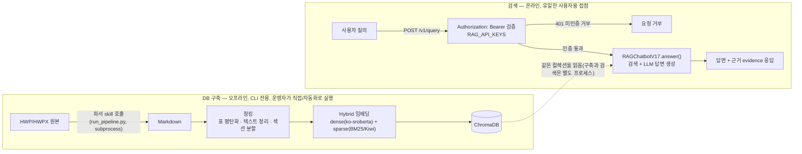
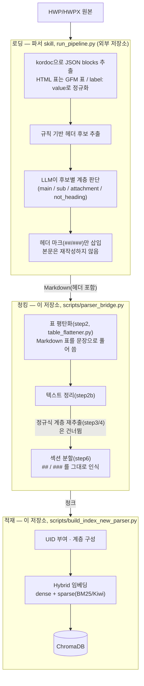

# hierarchical-md-rag

한국 공공기관 입찰공고문(HWP/HWPX/PDF)을 검색·질의응답하는 RAG 파이프라인이다.</br>
**팀 프로젝트(AI_7-team)의 실제 RAG 파이프라인을 포크**해서, HWP/HWPX 문서를
markdown으로 변환하는 파싱 단계만
[`hwp-hierarchical-md-skill`](https://github.com/adover134/korean_official_document_parser_skill)로
교체하였다.</br>
기존의 "HWP→PDF→markdown" 변환 체인을 완전히 대체하며, 그 이전 단계들이 만들던 청킹/검색/답변 생성 로직은 원본 그대로 재사용한다.</br>
PDF 원본 문서는 팀의 기존 파이프라인을 그대로 쓴다(새 파서는 HWP/HWPX 전용).

## 개발 사유

팀 프로젝트 당시의 파싱 단계에서는 계층 구조를 활용하지 못하였다.</br>
이는 HWP 파일의 로딩 방식으로 인한 문제임을 알게 되었다.</br>
이에 전용 로더를 찾아 전처리 결과를 개선하고자 수행하였다.</br>
</br>
DB가 개선된 후, 기존과 다른 문제들을 만들어 테스트하였더니 기존 파이프라인의 개선점들이 발견되었다.</br>
이들을 추가로 개선하여 답변의 안정성을 높였다.

## 전체 프로젝트 파일 시스템 구조

- `src/graph/workflow.py` — `RAGChatbotV17`, 질의 분석·검색·답변 생성을 orchestrate
- `src/parsers/` — 청킹(`chunker.py`), 헤더 감지(`auditor.py`), HWP/PDF 로더
- `src/retrievers/` — 벡터스토어(`vectorstore.py`), DB 구축(`build_db.py`), 검색
  휴리스틱(`query_heuristics.py`), 결과 후처리(`result_postprocess.py`)
- `src/evaluation/` — recall/MRR 지표(`metrics.py`), LLM-as-Judge(`llm_judge.py`)
- `scripts/parser_bridge.py` — 새 skill 파서를 팀 파이프라인에 연결하는 통합 지점
  (재매핑 없이 완전 대체 — 상세는 파일 내 docstring 참고)
- `scripts/build_index_new_parser.py` / `scripts/index_pdf_originals.py` — DB 구축
- `scripts/api.py` — 검색(질의응답) API. UI가 실제로 붙는 지점은 이거 하나뿐 —
  DB 구축은 위 스크립트를 서비스 제공자가 직접/자동화로 돌리는 별개 작업(CLI 전용,
  API로 노출하지 않음)
- `scripts/eval_retrieval.py` — E2E 평가(검색 recall + LLM-as-Judge 4축 채점)
- `docs/BUGFIXES.md` / `docs/BUGFIXES_PLAIN.md` — 버그 수정 기록(상세/쉬운 설명)

## 아키텍처

DB 구축(오프라인, CLI 전용)과 검색(온라인, 유일한 사용자용 접점)은 완전히 분리된 두 흐름이다 —
문서를 채워 넣는 일은 서비스 제공자만 하는 운영 작업이고, API는 "LLM을 통한 검색"이라는
사용자용 기능 하나만 가진다.



### DB 구축 단계 상세

역할은 둘로 나뉜다. **파서 skill은 HWP/HWPX를 헤더가 붙은 Markdown으로 바꾸는 로딩 단계**이고,
**이 저장소는 그 Markdown의 청킹과 DB 적재**를 맡는다. 원본 팀 파이프라인은 HWP를 PDF로 바꾼 뒤
markdown을 추출하고 정규식으로 헤더를 감지·삽입했는데(`hwp_converter.py` + `pdf_loader.py` +
`auditor.py`), 새 경로는 이 로딩 구간을 파서 skill(`scripts/run_pipeline.py`)로 통째로 대체한다.



**전처리 변경 정리** — 입력이 "헤더 없는 PDF 추출 텍스트"에서 "skill이 헤더까지 확정한
Markdown"으로 바뀌었으므로, 그 입력에 맞게 청킹 앞단을 고쳤다. 청킹 규칙 자체(`##` 경계,
두 번째 `###`부터 경계, 1000자 초과 시 200자 겹침 분할)는 팀 원본 그대로다.

| 구분 | 변경 | 이유 |
|---|---|---|
| 건너뜀 | 정규식 계층 재추출(`step3`/`step4`) | "제N조" 패턴을 본문에서 다시 찾아 Level 1로 재배정하고 `#` 헤더를 또 삽입하는 로직이다. 헤더가 없는 텍스트를 전제로 만들어져서, skill이 `### 제1조(납품)`처럼 이미 sub_section으로 처리한 줄까지 가짜 H1로 오염시키는 것이 실측으로 확인됐다. |
| 확장 | 섹션 분할의 헤더 정규식을 인자로 받게 함(`step6_section_split`의 `h1_re`/`h2_re`) | skill의 실제 레벨(`##`/`###`)을 그대로 인식하기 위해서다. 기본값(`#`/`##`)은 그대로라 PDF 경로는 영향이 없다. |
| 수정 | 표 평탄화(`table_flattener.py`)가 헤더 없는 표·2단 헤더 표를 잘못 읽던 문제 | 파서 skill이 만드는 Markdown 표는 GFM 문법상 헤더 행을 강제로 만든다. 헤더 없는 "라벨: 값" 표는 첫 데이터 행이 헤더로 취급되어 "사 업 명: 공사기간"처럼 라벨이 뒤섞였고, 2단 헤더 표는 하위 헤더 행이 데이터처럼 한 번 더 반복됐다. 둘 다 좁은 조건으로 감지해 고쳤다(`3728ab8`). 이후 남아 있던 병합 2단 헤더(상위 헤더가 빈 셀로 풀리는 표)와 열 수가 홀수인 테두리 없는 숫자 표도 같은 방식으로 고쳤다. 이 문제가 평가 문항 하나(m17)가 0점이던 원인이었고 수정 후 만점이 됐다. |
| 그대로 | 텍스트 정리, 섹션 맵 기반 청킹, UID 부여, 임베딩, Chroma 적재 | 팀 원본 로직을 재사용한다. |

PDF 원본 문서는 skill을 거치지 않고 팀의 기존 로더(`pdf_loader.py`)로 들어온다.

skill 내부(kordoc 변환, 표 정규화, 헤더 후보 추출, LLM 계층 판단)의 상세는
[korean_official_document_parser_skill](https://github.com/adover134/korean_official_document_parser_skill)
저장소를 참고한다.

### 표 평탄화 기법

**무엇을 하나** — `src/parsers/table_flattener.py`가 청킹 직전(`step2`)에 Markdown 표(`| a | b |`)를
`헤더: 값` 형태의 줄로 풀어 쓴다. 파이프 표는 한 행의 값만 떼어 놓으면 무엇의 값인지 알 수 없고, 임베딩·BM25 모두
`|`와 구분선(`---`)에 휘둘린다. 행마다 라벨을 붙여 두면 한 줄(청크 안의 한 조각)만 읽어도 "공사기간: 착공일로부터 60일"처럼
뜻이 완결되어 검색과 답변 생성 모두에 유리하다. 평탄화 직후 텍스트 정리(`step2b`: 굵게 표시 `**` 제거 등)를 거친 뒤 섹션 분할로 넘어간다.

**어려운 점** — 파서 skill이 만드는 표는 GFM 문법 때문에 **항상 첫 행을 헤더로 둔다**. 원본에 헤더가 없거나
(라벨:값 목록, 테두리 없는 표), 헤더가 2단이거나(병합 셀), 헤더가 비어 있으면 첫 행이 엉뚱하게 모든 행의 열 이름이 된다.
그래서 표의 모양을 먼저 판별하고 모양별로 다르게 푼다. 판별 조건은 정상 표를 건드리지 않도록 일부러 좁게 잡았다.

| 판별 순서 | 표 모양 | 판별 기준 | 결과 예 |
|---|---|---|---|
| 1 | 헤더가 `Col1`, `Col2` 같은 자리표시자 | 모든 헤더가 `Col N` | 값만 쉼표로 이음: `a, b` |
| 2 | 2열 키-값 표 | 열이 2개(자리표시자 제외). 헤더가 `항목`·`내용` 같은 일반 열 제목뿐이면 헤더는 버리고, 아니면 헤더 행도 데이터로 봄 | `사업명: 차세대 포털` |
| 3 | 헤더 없는 `라벨\|값\|라벨\|값` 그리드 | 짝수 열 4개 이상이고, 짝수 위치 문자열이 행마다 달라지고, 헤더의 값 자리가 길고 구체적임 | 첫 행도 데이터로 보고 값이 있는 칸만 순서대로 짝지음: `공사기간: 착공일로부터 60일` |
| 4 | 헤더 없는 숫자 표(테두리 없는 표) | 헤더 행에 `:`·`%` 단독 셀이 있거나 쉼표·소수점이 있는 수가 둘 이상 | `지반조성·포장공사업: 14,045,146 (5.4%)` |
| 5 | 병합 2단 헤더 | 상위 헤더에 빈 칸이 있고, 아래 행이 짧은 항목명뿐(숫자 없음) | 빈 칸을 왼쪽 상위 라벨로 채워 이어 붙임: `기 초 금 액 추정가격: 259,204,546` |
| 6 | 그 밖의 다열 표 | 위 어느 것도 아님 | `연번: 1, 학교명: 덕적고, 계약금액: 1,000원` |

5번이 필요한 이유: kordoc은 가로 병합된 상위 헤더(`기초금액`이 `계`·`추정가격`·`부가가치세`에 걸침)를 빈 셀로 풀어
`| 추정금액 | 기 초 금 액 | | | 관 급 자 재 | |` 아래에 하위 헤더 행을 데이터처럼 붙인다. 이를 그대로 풀면
`기 초 금 액: 계, 추정가격, 부가가치세` 줄과 `…259,204,546, 25,920,454…` 값 줄이 따로 나와 라벨과 값의 짝이 끊긴다.
한계: 3단 이상 헤더, 세로 병합, 위 조건에 맞지 않는 불규칙한 표는 6번의 일반 규칙으로 풀리므로 라벨이 어긋날 수 있다.
표 처리가 잘 되는지는 로더 검출과 평탄화를 나눠 `scripts/eval_parsing.py`로 잰다(아래 "표 처리 측정").

## DB 구축

```bash
python scripts/build_index_new_parser.py --input <HWP/HWPX_폴더>   # 새 파서 경로
python scripts/index_pdf_originals.py --input <PDF_폴더>            # 팀 원본 경로
```

두 스크립트 다 `data_index/`(gitignore됨)에 동일한 Chroma 컬렉션으로 upsert한다.
임베딩은 로컬 모델(`jhgan/ko-sroberta-multitask`, dense) + BM25(sparse, Kiwi
형태소 분석 기반)를 함께 쓰는 하이브리드 인덱스라 별도 API 키가 필요 없다.

HWP/HWPX 변환은 [파서 skill](https://github.com/adover134/korean_official_document_parser_skill)의
`scripts/run_pipeline.py`를 호출한다 — 이 저장소와 같은 폴더에 `korean_official_document_parser_skill`로
클론해 두거나 `HWP_SKILL_DIR` 환경변수로 위치를 알려준다. 헤더 판단(Pass1b) LLM은 skill 옵션을 그대로
받는다(`--backend`, `--model`, `--base-url`, `--api-key`). 예: 로컬 Ollama의 gpt-oss:20b는
`--backend openai --base-url http://localhost:11434/v1 --api-key ollama-local --model gpt-oss:20b`로 호출하고,
Ollama 서버를 `OLLAMA_CONTEXT_LENGTH=32768`로 띄워야 한다(기본 4096토큰이면 응답이 잘린다).

## 답변 생성 LLM 설정

`.env`(gitignore됨)에 아래 값을 채운다:

```bash
HWP_RAG_LLM_BASE_URL=https://api.groq.com/openai/v1   # 또는 http://localhost:11434/v1 (Ollama)
OPENAI_API_KEY=<groq api key 또는 로컬이면 아무 문자열>
REASONING_MODEL=openai/gpt-oss-20b                      # Ollama면 gpt-oss:20b
QUERY_INTENT_MODEL=openai/gpt-oss-20b
```

Groq 무료 한도(일일 200,000 토큰)를 소진하면 로컬 Ollama로 즉시 전환 가능하다
— **반드시 같은 모델(`gpt-oss:20b`)을 써야 결과가 비교 가능하다**(다른 모델,
특히 VLM 계열은 이 파이프라인의 2단계 프롬프트에 안 맞아 결과가 왜곡될 수
있음, `docs/BUGFIXES_PLAIN.md` 참고). 로컬은 응답이 느려서(질문당 1~2분)
타임아웃을 넉넉히 잡아야 한다:

```bash
ollama pull gpt-oss:20b
HWP_RAG_LLM_BASE_URL=http://localhost:11434/v1 OPENAI_API_KEY=ollama-local \
REASONING_MODEL=gpt-oss:20b QUERY_INTENT_MODEL=gpt-oss:20b OPENAI_TIMEOUT_SEC=1200 \
python scripts/eval_retrieval.py --dataset eval_resources/eval_dataset_new8.yaml --judge_model gpt-oss:20b
```

`gpt-oss:20b` 정도 크기의 로컬 reasoning 모델은 검색(retrieval)이 완벽해도
답변 생성 단계에서 실행마다 결과가 달라질 수 있다 — 동일한 컨텍스트에
정답이 명확히 들어있는데도 어떨 때는 정확히 답하고 어떨때는 "확인되지
않습니다"로 놓치는 사례가 확인됐다(`docs/BUGFIXES.md`의 "다른 모델로
m2/m19 교차검증" 참고, 같은 컨텍스트를 OpenAI/Claude로 재현하면 매번
정답). retrieval 관련 회귀를 진단할 때 recall@k가 이미 만점인데 correctness만
낮다면, 먼저 리트리벌 코드가 아니라 이 모델 자체의 편차를 의심할 것.

### 답변 생성 방식: 기본은 순수 LLM

정규식으로 값을 뽑아 템플릿에 끼워넣는 규칙 기반 추출 계층이 원본에 있었지만,
`eval_dataset_new8.yaml`로 직접 비교해본 결과 **LLM이 검색된 컨텍스트만 보고
직접 답변을 생성하는 쪽이 correctness/coverage 모두 더 높게 나왔다**(규칙 기반
템플릿·근거검증 둘 다 자체적으로 취약한 키워드 휴리스틱에 의존하고 있었음 —
자세한 원인은 `docs/BUGFIXES.md` 참고). 그래서 **기본값은 순수 LLM 생성**이다.
규칙 기반 계층은 코드는 그대로 남겨뒀고, 비교/디버깅용으로만 아래처럼 되살릴
수 있다:

```bash
HWP_RAG_ENABLE_LEGACY_EXTRACTIVE=1 python ...
```

## 검색 API

`RAGChatbotV17.answer()`를 HTTP로 노출하는 질의응답 전용 API(`scripts/api.py`,
FastAPI + `uvicorn`, `langc` conda 환경에 이미 설치돼 있음). DB 구축(위 "DB 구축" 절)과는
완전히 별개다 — 이 API에는 문서 업로드/인덱싱 엔드포인트가 없고, 서비스 사용자용 UI가
붙는 지점이 여기 하나뿐이라는 게 설계 원칙이다.

```bash
python scripts/api.py --port 8001
```

| 변수 | 기본값 | 설명 |
|---|---|---|
| `RAG_API_KEYS` | - | 쉼표로 구분한 허용 API 키 목록. 미설정 시 인증 없이 열린 상태로 동작(로컬 개발용) — 실제 배포 시 반드시 설정할 것 |

인증/요청 검증 배선(실제 챗봇은 목으로 대체 — LLM 호출 없이 즉시 실행됨)은
`tests/test_api.py`로 배포 전에 바로 돌려볼 수 있다:

```bash
pytest tests/test_api.py
```

엔드포인트:
- `GET /v1/health` — DB/챗봇 초기화 상태 점검(인증 불필요)
- `POST /v1/query` — `{"query": "...", "top_k": 24}` -> `RAGChatbotV17.answer()`의 반환 dict
  그대로(`answer`/`evidence`/`confidence`/`retrieved_docs` 등)

```bash
curl -X POST http://localhost:8001/v1/query \
  -H "Authorization: Bearer $RAG_API_KEYS" \
  -H "Content-Type: application/json" \
  -d '{"query": "사업비가 가장 높은 공고는?", "top_k": 10}'
```

rate limit은 아직 없다(hwp-hierarchical-md-service의 rate_limit.py는 Langfuse 트레이스를
근거로 세는데, 이 저장소는 Langfuse를 아직 안 씀 — 필요해지면 추가 검토).

## 테스트 배포용 Gradio UI

랜덤 테스터가 바로 써볼 수 있는 채팅 화면(`scripts/gradio_app.py`)이다. 검색 API와 같은
백엔드(`RAGChatbotV17.answer()`)를 쓰지만 API 서버가 아니라 웹 UI다.

```bash
pip install -r requirements.txt
GRADIO_APP_SHARED_PASSWORD=<공유 비밀번호> python scripts/gradio_app.py [--share] [--port 7860]
```

- **모델 고정**: 로컬 Ollama `gpt-oss:20b`를 스크립트 안에서 강제한다(환경변수로 덮어쓸 수
  없음). 답변 생성 전략은 고정하지 않고 저장소 기본값(`two_stage`)을 따른다. 실행 전
  Ollama가 떠 있고 모델이 받아져 있어야 하며, 아니면 시작 시점에 사유를 알려주고 종료한다.
- **인증**: `GRADIO_APP_SHARED_PASSWORD`를 설정하면 공유 계정(아이디 `tester`) 하나로 접속을
  막는다. 도메인 배포 시 필수, 로컬 확인용이면 없어도 되며 경고만 출력한다.
- **동시 처리**: 챗봇 인스턴스를 `GRADIO_APP_POOL_SIZE`(기본 2)개 풀로 관리해 요청마다 하나씩
  대여한다. Ollama 쪽도 `OLLAMA_NUM_PARALLEL`을 맞춰야 실제 병렬이 된다.
- **로그**: 👍/👎 피드백은 `eval_resources/gradio_flagged/`, 모든 질의/답변은
  `eval_resources/gradio_query_log.jsonl`에 남는다(둘 다 gitignore). HuggingFace 등
  외부 텔레메트리는 차단한다.

## 평가

```bash
python scripts/eval_retrieval.py --dataset eval_resources/eval_dataset_new8.yaml --judge_model openai/gpt-oss-20b --label <라벨>
python scripts/build_eval_report.py --label <라벨>   # eval_resources/eval_report_<라벨>.html 생성
```

두 단계 다 팀 프로젝트(AI_7-team)와 동일한 방식이다 — `eval_retrieval.py`가
`eval_resources/eval_results_<라벨>.json`을 쓰고, `build_eval_report.py`가 그걸
읽어 HTML 대시보드로 만든다. `build_eval_report.py`는 표준 라이브러리만 써서
(`src/` 비의존) 두 저장소 어디서 돌려도 그대로 동작한다. 결과 JSON/HTML은 둘 다
gitignore됨(`eval_resources/eval_results_*.json`, `eval_resources/eval_report_*.html`).

- `eval_resources/eval_dataset_57docs.yaml`(q1~q8) — 초기 재현 케이스 중심
- `eval_resources/eval_dataset_new8.yaml`(n1~n8) — 문서/기관 겹치지 않는 신규
  세트, 문서 단위+청크 단위(`chunk_uids`) 정답 라벨 포함, 최신 상태에서 8/8 정답
- `--judge_model`은 반드시 지정할 것 — 기본값(`gpt-5-mini`)은 Groq에 없어서
  판정 자체가 실패한다

### 표 처리 측정 (로더 검출 · 평탄화 분리)

전처리가 표를 제대로 다루는지는 DB·LLM 없이 잴 수 있다. 정답 `라벨: 값` 쌍
(`experiments/table_samples.yaml`)마다 (1) 로더 출력에서 라벨-값 연결이 살아 있는가(같은 표 안, 또는 한 줄의 `라벨 : 값`), (2) 평탄화·텍스트 정리 뒤에도
`라벨: 값`으로 남는가, (3) 최종 청크에 남는가를 단계별로 센다. 브랜치와 무관하게 같은 스크립트를 쓴다:

```bash
python scripts/eval_parsing.py --project-root . --loader-md-dir output/new_parser_md --rechunk --tag <꼬리표>
```

`--loader-md-dir`은 파서 skill이 낸 Markdown 폴더, `--rechunk`는 그 Markdown을 이 프로젝트의 평탄화·청킹으로 다시
처리해 종단 값을 계산한다(DB는 건드리지 않음). 다른 체크아웃(예: 팀 저장소)을 재려면 `--project-root`와
`--loader-md-glob`, 청크 덤프용 `--chunk-dump`를 쓴다. 결과는 `eval_resources/parsing_runs/parsing_<꼬리표>.{json,md}`.

## 현재 상태

`docs/BUGFIXES.md`에 오늘까지 추적·수정한 근본원인 15개가 전부 기록돼 있다
(검색 순위 오판, org 해석 우선순위, retrieval depth, 답변 생성 방식 전환,
비교 질의 컨텍스트 불균형 등). 두 평가셋 모두 현재 전 문항 정답 상태다.

## 참조

본 프로젝트는 [공공 입찰 데이터 RAG 시스템 개발 프로젝트](https://github.com/Loah-Lee/AI_7-team)에 대해 개선한 버전으로,
HWP(X) 파일 파싱 및 로딩 프로세스 및 검색 과정의 개선을 수행하였다.

기존 프로젝트를 함께 진행한 아래 팀원들에게 감사를 전한다.

- @youuuchul (이메일: dbcjf25@gmail.com)
- @Loah-Lee (이메일: sims0724@gmail.com)
- @wwwwkjh1022-art
- @dinu1108

문의는 아래 이메일로
adfsfsf@naver.com
