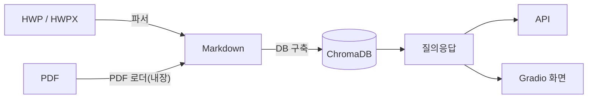

# hierarchical-md-rag

공공기관 입찰공고문에서 금액, 기간, 수량 같은 값을 **질문으로 찾는** RAG 시스템이다.

[팀 프로젝트(AI_7-team)](https://github.com/Loah-Lee/AI_7-team)에서 출발했고, 문서 읽기와 표 처리, 검색, 답변, 채점을 바꿨다.

## 구조 한눈에



## 1. DB 만들기

**입력은 Markdown 파일이다.** HWP/HWPX를 Markdown으로 바꾸는 일은 이 저장소가 아니라 파서가 한다.

**문서는 항상 [나라장터](https://www.g2b.go.kr/)에서 가져온 것이라고 가정한다.** 공고문 양식과 첨부 구성이 다른 출처의 문서는 다루지 않는다.

**공고 목록(엑셀)은 지금 이 저장소가 다루지만, 원래 파서가 만들어야 하는 정보다.**
기관명 사전과 순위·금액 질문이 이 엑셀에 기대고 있어서, 나중에 파서 쪽으로 옮길 예정이다.

| Markdown을 만드는 곳 | 대상 | 비고 |
|---|---|---|
| [파서 skill](https://github.com/adover134/korean_official_document_parser_skill) | HWP, HWPX | 명령줄(`run_pipeline.py`), Node(kordoc)와 LLM 필요 |
| [파서 service](https://github.com/adover134/korean_official_document_parser_service) | HWP, HWPX | 같은 파서를 API/Docker로 제공 |
| PDF 로더(이 저장소 내장) | PDF | `src/parsers/pdf_loader.py`, 스캔 PDF는 제외 |

입력 Markdown의 모양:

```markdown
---
title: 송림리 마을만들기사업_충청남도 서천군 농업기술센터.hwpx   ← 원본 파일 이름
---

## 1. 입찰사항           ← 대분류 (## )
### 가. 사업개요          ← 소분류 (### )
사업명: 송림리 마을만들기사업(건축,기계)

| 구분 | 금액 |            ← 표는 GFM 표. 청킹 단계에서 `라벨: 값` 줄로 풀린다
|---|---|
| 기초금액 | 285,125,000 |
```

- **파일 이름은 `공고명_기관명.md`** 형태다(문서 하나가 파일 하나).
  - 이 저장소가 이름의 첫 `_`를 기준으로 앞은 `org`, 뒤는 `project_name` 메타데이터로 나눠 DB에 넣는다.
  - 파서 skill 혼자 돌리면 기본 출력 이름은 `<원본 파일 이름>.md`(예: `공고.hwpx.md`)이다.
  - 그래서 이 저장소 스크립트는 `-o` 옵션으로 `output/new_parser_md/<원본 파일 이름에서 확장자를 뺀 이름>.md`에 저장한다.

- 이 저장소의 `build_index_new_parser.py`는 HWP/HWPX 폴더를 **목록으로** 받는다.
  - 문서마다 `output/new_parser_md/`에 같은 이름의 Markdown이 있으면 **파서를 다시 돌리지 않고** 그 Markdown으로 색인한다.
  - 없을 때만 skill을 호출해 만든다.

- 있는지만 파일 이름으로 확인한다.
  - 파서나 kordoc 버전을 바꾼 뒤에는 `output/new_parser_md/`를 지우고 다시 만들어야 새 Markdown이 쓰인다.

```bash
python scripts/build_index_new_parser.py --input <HWP/HWPX 폴더>   # Markdown이 있으면 그대로, 없으면 skill로 만들어 색인
python scripts/index_pdf_originals.py --input <PDF 폴더>            # PDF 로더로 Markdown을 만들고 색인
```

결과는 `data_index/`(git 제외)에 쌓인다.

- 같은 내용의 문서를 다시 넣으면 덮어쓴다(upsert).
- 내용이 바뀐 문서는 새 문서로 취급되어 이전 청크가 남는다.
  - 파서나 kordoc 버전을 바꿔 Markdown이 달라졌다면 `data_index/`를 비우고 다시 만든다.

## 2. 질문하기 (두 가지 방법)

둘 다 답변용 LLM(로컬 Ollama의 `gpt-oss:20b` 등)에 연결돼 있어야 한다.

연결 설정은 [아키텍처](docs/03_아키텍처.md)의 "실행하려면"을 본다.

| | API | Gradio 화면 |
|---|---|---|
| 용도 | 프로그램에서 호출 | 사람이 채팅으로 써 보기 |
| 실행 | `python scripts/api.py --port 8001` | `python scripts/gradio_app.py --port 7860` |
| 주소 | `http://localhost:8001/v1/query` | `http://localhost:7860` |
| 인증 | `.env`의 `RAG_API_KEYS`(쉼표로 여러 개, 비우면 열림) | `.env`의 `GRADIO_APP_USERNAME`, `GRADIO_APP_PASSWORD` |
| 답변 방식 | 환경변수로 선택(`two_stage` 기본, `multi_agent`) | `multi_agent`로 고정 |

```bash
# API
curl -X POST http://localhost:8001/v1/query -H "Content-Type: application/json" \
  -d '{"query": "송림리 마을만들기사업의 기초금액은?", "top_k": 10}'

# Gradio (외부 공개 링크가 필요하면 --share)
python scripts/gradio_app.py
```

## 문서 읽는 순서

| 순서 | 문서 | 알게 되는 것 |
|---|---|---|
| 1 | [개요](docs/01_개요.md) | 무슨 문제를 푸는가, 팀 프로젝트와 무엇이 다른가 |
| 2 | [유즈케이스](docs/02_유즈케이스.md) | 누가 무엇을 하는가, 질문 유형 |
| 3 | [아키텍처](docs/03_아키텍처.md) | 구성요소와 질문 한 건의 흐름 |
| 4 | [DB 구축](docs/04_DB구축.md) | Markdown이 청크가 되기까지, DB 구조, 다시 넣는 규칙 |
| 5 | [질의 처리](docs/05_질의처리.md) | 질문이 답이 되기까지, 검색과 답변 방식 두 가지 |
| 6 | [평가](docs/06_평가.md) | 무엇을 비교하고 점수가 무엇을 재는가 |
| 7 | [결과](docs/07_결과.md) | 무엇이 점수를 바꿨는가, 믿어도 되는 범위 |
| 8 | [버전과 브랜치](docs/08_버전과_브랜치.md) | 버전별 변화, 브랜치 차이 |
| 9 | [용어집](docs/09_용어집.md) | 문서에 나온 말의 뜻 |
| 요약 | [발표.html](docs/발표.html) | 브라우저에서 여는 슬라이드 요약(← → 키) |
| 기록 | [`EXPERIMENTS.md`](EXPERIMENTS.md) | 실험 전 과정과 측정값 |
| 기록 | [채점 규칙](docs/judge_rules.md), [채점기 개선](docs/judge_improvement.md), [버그 수정](docs/BUGFIXES.md) | 채점과 수정의 상세 기록 |
| 기록 | [이전 README](README_이전.md) | 문서 개편 전의 README(설정, API, 평가 명령이 길게 적혀 있다) |

## 현재 결과와 한계

40개 질문에서 정답 점수(5점 만점)는 팀 프로세스 1.1~2.8, 이 프로젝트의 프로세스 4.8~5.0이다.

- 스캔 PDF는 다루지 않는다.
- DB 변경의 효과는 문항 40개로는 통계적으로 구분되지 않았다.

## 브랜치

`multi-agent`(최신: 멀티 에이전트, 평가 도구, 결과 문서), `main`(기본 `two_stage` 경로만).
