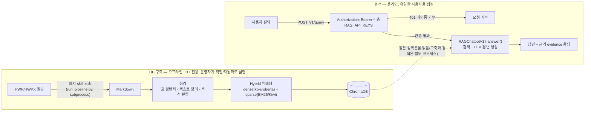
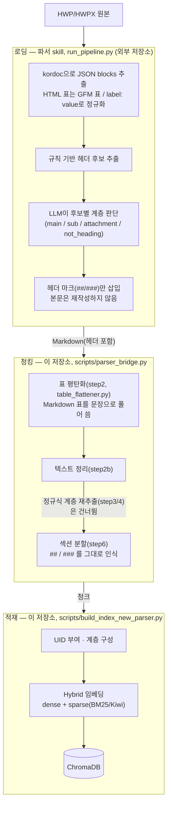

# hierarchical-md-rag

한국 공공기관 입찰공고문(HWP/HWPX/PDF)을 검색·질의응답하는 RAG 파이프라인이다.</br>
**팀 프로젝트(AI_7-team)의 실제 RAG 파이프라인을 포크**해서, HWP/HWPX 문서를
markdown으로 변환하는 파싱 단계만
[`hwp-hierarchical-md-skill`](https://github.com/adover134/korean_official_document_parser_skill)로
교체하였다.</br>
기존의 "HWP→PDF→markdown" 변환 체인을 완전히 대체하며, 그 이전 단계들이 만들던 청킹/검색/답변 생성 로직은 원본 그대로 재사용한다.</br>
PDF 원본 문서는 팀의 기존 파이프라인을 그대로 쓴다(새 파서는 HWP/HWPX 전용).

## 개발 사유

팀 프로젝트 당시의 파싱 단계에서는 계층 구조를 활용하지 못하였다.</br>
이는 HWP 파일의 로딩 방식으로 인한 문제임을 알게 되었다.</br>
이에 전용 로더를 찾아 전처리 결과를 개선하고자 수행하였다.</br>
</br>
DB가 개선된 후, 기존과 다른 문제들을 만들어 테스트하였더니 기존 파이프라인의 개선점들이 발견되었다.</br>
이들을 추가로 개선하여 답변의 안정성을 높였다.

### 왜 multi-agent를 추가했는가

개선한 DB에서도 다음 두 가지 한계가 남았다.</br>
1. **로컬 모델의 한계** — 로컬 `gpt-oss:20b`는 검색이 완벽해도 같은 입력 · temperature=0.0에서 실행마다 정답 근거를 놓치거나 값을 뒤섞었다. 근거 압축, 값 추출, 비교를 한 번의 호출에 몰아 맡길수록 심해졌다.</br>
2. **한 번의 검색으로는 필요한 근거를 다 못 가져옴** — 여러 기관을 비교하거나 여러 사실을 묻는 질의는 한 번의 검색으로 필요한 청크가 전부 올라오지 않는 경우가 있었다. 검색 건수(top-k)를 키우면 DB에서 가져오는 것 자체는 문제없지만, 리랭킹을 앱에서 실행하기 때문에 후보가 늘수록 앱의 리랭킹이 속도 병목이 된다.

그래서 질의를 1~3개 step으로 나눠 필요한 근거만 단계별로 확보하고, step마다 값을 미리 추출해 확정하며, 확정된 값은 최종 생성 LLM의 재판단을 거치지 않게 했다(상세는 아래 "답변 생성 전략: multi_agent" 절).</br>
(이 절의 점수는 로컬 `gpt-oss:20b`가 채점한 값이다. 이후 채점은 Claude로 바꿨다.) 최초 이식 시점의 기존 20문항(`eval_dataset_new20.yaml`)에서 Correctness는 `two_stage` 4.30에서 `multi_agent` 4.95로 올랐다. 이후 팀 프로젝트 당시에 쓰지 않은 신규 20문항(`eval_dataset_new20_v2.yaml`)으로 일반화를 시도한 결과는 4.65로, 기존 `two_stage`보다 높았다.

## 버전

| 버전 | 범위 | 상태 |
|---|---|---|
| **1.0** | 팀 프로젝트 포크 + 전용 로더(skill + kordoc) + 계층 청킹 + 답변 전략(`two_stage`/`multi_agent`) + 3개 시스템 비교 실험 설계. 저장소 태그 `v1.0`(커밋 `9347720`)까지이며, `main1` 측정값이 여기에 속한다 | 종료 |
| **1.1.0** | 검색·답변 프로세스 자체의 개선. 구조는 그대로 두고 단계별 결함을 측정해 고친다. 저장소 태그 `v1.1.0` | **확정** (2026-11-02, 3×2 비교 `dbcmp6` 측정 완료) |
| **1.2** | 문서 식별(첫 청크에 제목), 스캔 PDF OCR, 채점기 개선(채점기가 같은 DB로 직접 RAG를 수행해 비교). 효과는 같은 조건의 Claude 채점으로 잰다 | **진행 중** (2026-11-02 시작) |

1.1.0은 3×2 비교 측정이 끝난 뒤 확정했다. 본 실험(11월)의 결과에는 어느 버전을 측정했는지 함께 적을 것이다. 이후 개선(답변이 끊기거나 나오지 않는 문항 등)은 1.1.0 다음 버전으로 한다.

**1.1.0 최종 결론** (3×2 비교 `dbcmp6`, 단축 경로와 금액 열을 켠 비교 `dbcmp7`, 40문항, 채점: Claude 서브에이전트)

0. 측정 범위: DB 성능은 재정렬 이전 후보 풀로 두 가지를 모두 잰다 — 필터 없는 순수 밀집 풀 Recall@90/180/360과 프로세스가 만드는 풀(기관 필터 포함) @90/180/360. 프로세스 성능은 최종 상위 5개(@5)와 Correctness로 잰다. DB 자체 지표 중 표 정합률(22.0% → 100%)과 누락 coverage(0.938 → 0.978)는 개선됐지만, 필터 없는 순수 밀집 풀 Recall은 팀 DB와 같거나 약간 낮아 개선이 확인되지 않았다(청크 recall@360 0.957 대 0.938). 다만 문서 57건·문항 40개라 차이가 1~2문항 수준이어서 데이터 수가 충분하지 않을 수 있다. 프로세스 풀에서는 현재 DB가 40/40으로 팀 프로세스 × 팀 DB(37/40)보다 앞서지만 프로세스·라벨 차이가 섞여 있다. 요약은 [`EXPERIMENTS.md`](EXPERIMENTS.md) "DB 자체 성능 요약".
1. 계층화는 팀 DB와 최신 DB 모두에 적용돼 있어(두 DB 모두 `hierarchy` 컬렉션이 있다) 계층화 유무로 성능 향상을 비교할 대상이 없다. 이 실험은 계층화의 효과를 재지 못했고, 두 DB의 차이는 로더와 청킹(표 평탄화 등)의 차이다. 그 차이가 답변 점수에서는 구분되지 않았다.
2. 팀 프로세스는 두 DB 모두 성능이 낮다. Correctness는 단축 경로를 끈 조건에서 1.150(팀 DB)·0.925(최신 DB), 금액 열을 넣고 단축을 켠 조건에서 2.775·2.650이다. 단축으로 답한 19문항은 4.8 안팎이지만 단축이 아닌 21문항은 0.67~0.95다(규칙 기반 답변이 CSV에 없는 항목에서 약하다).
3. 개선된 프로세스(main, 멀티 에이전트)는 어느 DB든 만점에 가깝다. main(`two_stage`, 단축 끔) 4.775~4.875, 멀티 에이전트 4.925~5.000이고 평균은 멀티가 전체적으로 높다. 다만 문항별 쌍체 검정으로는 main과 구분되지 않는다(`docs/dbcmp6_summary.md`, 반복 실행 잡음 약 0.2점). 멀티는 CoT 분해가 있고 main은 없다.
4. 한계: 문항당 실행은 한 번이고 main과 멀티는 천장(4.8~5.0)에 가깝다. `dbcmp7`의 단축 켠 값은 "금액 열 + 모든 단축 경로 켬"의 합산이고, main은 단축을 켠 값이 없다. 자세한 표는 [`EXPERIMENTS.md`](EXPERIMENTS.md) "단축 경로와 금액 열을 켠 조건".

**1.2 항목 (우선순위 순)**

| 순서 | 항목 | 상태 | 내용 |
|---|---|---|---|
| 1 | 첫 청크에 `document_title`·`source_file` 넣기 | ↩ 되돌림 | 문서 식별 개선 시도. 두 DB 모두 청크 본문에 제목 블록이 든 청크가 팀 DB 57개, 최신 DB 15개(PDF)뿐이라는 점에서 출발한 가설이었다. 첫 청크 본문 맨 앞에 두 줄을 넣고 DB를 재구축해 측정했으나 이득이 없어 되돌렸다. 프로세스가 만드는 후보 풀(재정렬 이전, 기관 필터 포함)의 정답 청크는 @90/180/360 모두 두 DB가 40/40으로 같고, 필터 없는 순수 밀집 풀 Recall@360은 오히려 0.938 → 0.912, 답변 Correctness는 4.875 → 4.800(5점 문항 37개로 같음)이었다. [`EXPERIMENTS.md`](EXPERIMENTS.md) "1.2 개선 ①" |
| 2 | 스캔 PDF OCR | 🟡 | 텍스트 층이 없는 스캔 PDF는 57건 중 1건(벼 병해충 항공방제, 7쪽 모두 JPEG 한 장)이다. easyocr로 텍스트 층이 없는 쪽만 읽도록 `pdf_loader`에 넣었다(`src/parsers/ocr.py`, 테스트 5개). 문서 내용이 DB에 들어가고(청크 1개 → 11개) 숫자도 정확히 읽히지만, 묻는 질문 3개는 모두 틀리거나 못 찾았다(표 모양 OCR을 모델이 잘못 짝지은 것으로 추정). 평가셋에는 이 문서의 문항이 없어 기존 지표는 변하지 않는다. [`EXPERIMENTS.md`](EXPERIMENTS.md) "1.2 개선 ②" |
| 3 | 채점기 개선 | ⬜ | 값은 맞는데 `기초금액`을 묻는 질문에 `사업비는 …`로 답한 단축 답변이 4점으로 채점된 경우가 있다(멀티 × 팀 DB의 n1, n9, n15). 채점 신뢰도 문제다. 채점기(Claude)가 같은 DB로 직접 RAG를 수행해 자기가 찾은 정보와 생성 답변을 비교하는 방식으로 바꾼다. 바꾸기 전에 같은 답변을 다시 채점해 점수가 흔들리는지부터 본다. 이미 흔들림의 정황이 있다: 답변이 같은 26문항에서 Answer coverage가 라운드 사이에 10문항 달라졌다. 원인은 기대 답변의 괄호 안 세부 내역을 감점할지가 루브릭에 없어 라운드마다 기준이 달랐던 것이다(`EXPERIMENTS.md` "채점 방식"). 이 기준을 루브릭에 명시하고 다시 채점한다 |
| 4 | DB 쪽 추가 개선 (기록만) | 📝 | 지금은 착수하지 않고 기록만 한다. 필터 없는 순수 밀집 풀 Recall이 팀 DB와 같거나 약간 낮다(@360 청크 recall 0.938 대 0.957). 풀 360에서 정답 청크가 밀리는 문항은 n2, n13이고, 비슷한 다른 문서의 청크에 밀린다. 후보: 청크 구성·임베딩 입력 텍스트 변경(제목 블록은 개선하지 못했다). 데이터 수가 충분하지 않아 차이를 단정하기 어려우므로 개선을 시작하기 전에 평가셋부터 늘리는 것을 같이 본다 |

**1.1 항목 (✅ 완료 · 🟡 진행 중 · ⬜ 예정)**

| 항목 | 상태 | 내용 |
|---|---|---|
| 표 평탄화 수정, 표 지표 단계 분리 | ✅ | 병합 2단 헤더·헤더 없는 표를 고쳤고, 표 지표를 로더 검출 · 평탄화 · 종단으로 나눴다. 현 버전은 3단계 모두 60/60(`main2`). [`EXPERIMENTS.md`](EXPERIMENTS.md) "표 지표" |
| 로더 갱신(kordoc 4.24.29), DB `main2` 재구축 | ✅ | 57/57 문서 |
| 팀 DB와 최신 DB 비교, 오답 원인 진단 | ✅ | 같은 프로세스에서 DB만 바꿔 비교했고 답변 품질은 구분되지 않았다. 오답 원인은 기관 후보 추출(n4)과 컨텍스트 발췌 잘림(m17)으로 좁혔다. [`EXPERIMENTS.md`](EXPERIMENTS.md) "DB 비교" |
| 질문 키워드에서 조사·어미 제거 | ✅ | Kiwi(0.24.1)로 `공사기간은` → `공사기간`처럼 뗀 낱말을 키워드로 쓴다. 진단 9문항 중 m17이 700자 컨텍스트에서도 풀렸다(결정적으로 확인). 전체 40문항 측정은 3×2 비교(`dbcmp6`)에서 했다: main × 최신 DB가 Correctness 4.875, 37/40 문항 5점 |
| 기관명 Kiwi 사전 | ✅ | 엑셀의 기관명(법인 표기를 뗀 것과 붙은 것)을 DB 구축 단계에서 고유명사로 등록해 질의 처리(키워드, 기관 후보 추출)와 BM25 명사 추출이 같은 사전을 쓴다. 단, 색인에 저장되는 BM25 희소 벡터는 검색에서 읽지 않는다. 현재 DB의 BM25 색인은 사전 없이 만들어졌다. 기관 후보 추출(n4, m11)에도 쓰인다 |
| 컨텍스트 크기(청크당 700자) | ✅ | 1200자로 키운 시험만 했고 기본값 700을 유지한 채 확정했다 |
| 기관 후보 추출: 고유명 하나만 겹쳐도 인정 | ✅ | 앞 단계에서 후보가 없을 때 Kiwi(기관명 사전)로 조사를 뗀 고유명 낱말을 비교한다(`src/utils/org_match.py`). 기준선 38/40 → 40/40, n4가 종단까지 통과. 평가셋 58문항 중 이전에 후보가 비던 3개만 바뀌었다 |
| 어휘 점수에 조사 뗀 키워드 사용 | ✅ | 하이브리드 점수 `0.6×밀집 + 0.4×어휘`의 어휘 점수(낱말 겹침 비율, BM25 아님)를 원문 질의가 아니라 Kiwi로 조사를 뗀 키워드로 계산한다. 밀집 검색은 원문 질의 그대로 |
| 재정렬 규칙 수정, 기관 단위로 먼저 좁힌 뒤 검색 | ✅ | 날짜·시각 서식을 답이 있는 숫자로 인식하고 `100분의 5` 같은 비율은 제외하며, 이미 대상 기관인 청크에는 제목 낱말 감점을 하지 않는다. 기관을 알면 Chroma 조회에서 그 기관의 청크로 먼저 좁힌 뒤 자른다(기본 켬, `RETRIEVAL_ORG_PREFILTER`). 후보 풀을 DB 전체로 넓히는 전수 조사는 채택하지 않았다. 결과: n13 0→5, Context relevance 4.450→4.925(p<0.01), Correctness 평균은 4.675로 같음 |
| 채점을 Claude로 | ✅ | 생성은 로컬 `gpt-oss:20b`, 채점은 항상 Claude 서브에이전트(`scripts/claude_judge.py`). gpt-oss 채점은 Correctness를 낮게, Context relevance를 후하게 줬다 |
| 팀·main·멀티 에이전트 × 팀 DB·최신 DB 비교 | ✅ | DB 효과와 프로세스 효과를 분리하는 3×2 비교(`dbcmp6`, 채점 Claude). 프로세스 효과는 크고(팀 프로세스는 규칙 기반 답변) main과 멀티 에이전트는 구분되지 않으며, DB 효과는 작고 Context relevance는 최신 DB가 낮았다. [`EXPERIMENTS.md`](EXPERIMENTS.md) "3×2 비교" |
| `org`를 기관명으로, 페이지 정보 반영 | ⬜ | DB 메타데이터 의미가 바뀌어 DB를 다시 만들어야 하므로 2.0 후보로 본다 |
| 계층(문서 구조) 활용 점검 | ⬜ | 두 DB 모두 계층 정보(`hierarchy` 컬렉션)를 갖고 있어 계층화 유무로 성능을 비교할 대상이 없었다. 그래서 DB 효과가 작았던 이유를 계층 탓으로 단정할 수 없다. 계층이 검색 점수와 컨텍스트 선택에 어떻게 쓰이는지 점검하는 것부터 하고, 계층을 쓰지 않는 조건을 만들어 비교할 수 있는지 본다 |
| 엑셀에 금액 열 추가 | 🟡 | 입찰공고목록 엑셀(`data_index/`와 `RAG_프로세스_테스트_데이터_원본/`, 둘 다 저장소 밖)에 `사업 금액` 열을 문서에서 추출해 채웠다: 57건 중 50건. 기초금액을 쓰고 없으면 예산·사업금액 중 큰 쪽, 값이 빈 문서는 표의 `계`를 썼다. 값이 없는 7건(SRT 3, 무공해차 충전인프라 4)은 문서에 금액이 없어 비워 뒀다. 건별 근거는 [`eval_resources/bid_amounts.csv`](eval_resources/bid_amounts.csv). 팀 CSV 변환(`bid_list_to_team_csv`)이 이 열을 그대로 넘긴다. 남은 일은 단축 경로를 켠 조건으로 11월 본 실험 |

## 전체 프로젝트 파일 시스템 구조

- `src/graph/workflow.py` — `RAGChatbotV17`, 질의 분석·검색·답변 생성을 orchestrate
- `src/parsers/` — 청킹(`chunker.py`), 헤더 감지(`auditor.py`), HWP/PDF 로더
- `src/retrievers/` — 벡터스토어(`vectorstore.py`), DB 구축(`build_db.py`), 검색
  휴리스틱(`query_heuristics.py`), 결과 후처리(`result_postprocess.py`)
- `src/evaluation/` — recall/MRR 지표(`metrics.py`), LLM-as-Judge(`llm_judge.py`)
- `scripts/parser_bridge.py` — 새 skill 파서를 팀 파이프라인에 연결하는 통합 지점
  (재매핑 없이 완전 대체 — 상세는 파일 내 docstring 참고)
- `scripts/build_index_new_parser.py` / `scripts/index_pdf_originals.py` — DB 구축
- `scripts/api.py` — 검색(질의응답) API. UI가 실제로 붙는 지점은 이거 하나뿐 —
  DB 구축은 위 스크립트를 서비스 제공자가 직접/자동화로 돌리는 별개 작업(CLI 전용,
  API로 노출하지 않음)
- `scripts/eval_retrieval.py` — E2E 평가(검색 recall + LLM-as-Judge 4축 채점)
- `docs/BUGFIXES.md` / `docs/BUGFIXES_PLAIN.md` — 버그 수정 기록(상세/쉬운 설명)

## 아키텍처

DB 구축(오프라인, CLI 전용)과 검색(온라인, 유일한 사용자용 접점)은 완전히 분리된 두 흐름이다 —
문서를 채워 넣는 일은 서비스 제공자만 하는 운영 작업이고, API는 "LLM을 통한 검색"이라는
사용자용 기능 하나만 가진다.



### DB 구축 단계 상세

역할은 둘로 나뉜다. **파서 skill은 HWP/HWPX를 헤더가 붙은 Markdown으로 바꾸는 로딩 단계**이고,
**이 저장소는 그 Markdown의 청킹과 DB 적재**를 맡는다. 원본 팀 파이프라인은 HWP를 PDF로 바꾼 뒤
markdown을 추출하고 정규식으로 헤더를 감지·삽입했는데(`hwp_converter.py` + `pdf_loader.py` +
`auditor.py`), 새 경로는 이 로딩 구간을 파서 skill(`scripts/run_pipeline.py`)로 통째로 대체한다.



**전처리 변경 정리** — 입력이 "헤더 없는 PDF 추출 텍스트"에서 "skill이 헤더까지 확정한
Markdown"으로 바뀌었으므로, 그 입력에 맞게 청킹 앞단을 고쳤다. 청킹 규칙 자체(`##` 경계,
두 번째 `###`부터 경계, 1000자 초과 시 200자 겹침 분할)는 팀 원본 그대로다.

| 구분 | 변경 | 이유 |
|---|---|---|
| 건너뜀 | 정규식 계층 재추출(`step3`/`step4`) | "제N조" 패턴을 본문에서 다시 찾아 Level 1로 재배정하고 `#` 헤더를 또 삽입하는 로직이다. 헤더가 없는 텍스트를 전제로 만들어져서, skill이 `### 제1조(납품)`처럼 이미 sub_section으로 처리한 줄까지 가짜 H1로 오염시키는 것이 실측으로 확인됐다. |
| 확장 | 섹션 분할의 헤더 정규식을 인자로 받게 함(`step6_section_split`의 `h1_re`/`h2_re`) | skill의 실제 레벨(`##`/`###`)을 그대로 인식하기 위해서다. 기본값(`#`/`##`)은 그대로라 PDF 경로는 영향이 없다. |
| 수정 | 표 평탄화(`table_flattener.py`)가 헤더 없는 표·2단 헤더 표를 잘못 읽던 문제 | 파서 skill이 만드는 Markdown 표는 GFM 문법상 헤더 행을 강제로 만든다. 헤더 없는 "라벨: 값" 표는 첫 데이터 행이 헤더로 취급되어 "사 업 명: 공사기간"처럼 라벨이 뒤섞였고, 2단 헤더 표는 하위 헤더 행이 데이터처럼 한 번 더 반복됐다. 둘 다 좁은 조건으로 감지해 고쳤다(`3728ab8`). 이후 남아 있던 병합 2단 헤더(상위 헤더가 빈 셀로 풀리는 표)와 열 수가 홀수인 테두리 없는 숫자 표도 같은 방식으로 고쳤다(`87cdde7`). 이 문제가 평가 문항 하나(m17)가 0점이던 원인이었고 수정 후 만점이 됐다. |
| 그대로 | 텍스트 정리, 섹션 맵 기반 청킹, UID 부여, 임베딩, Chroma 적재 | 팀 원본 로직을 재사용한다. |

PDF 원본 문서는 skill을 거치지 않고 팀의 기존 로더(`pdf_loader.py`)로 들어온다.

skill 내부(kordoc 변환, 표 정규화, 헤더 후보 추출, LLM 계층 판단)의 상세는
[korean_official_document_parser_skill](https://github.com/adover134/korean_official_document_parser_skill)
저장소를 참고한다.

### 표 평탄화 기법

**무엇을 하나** — `src/parsers/table_flattener.py`가 청킹 직전(`step2`)에 Markdown 표(`| a | b |`)를
`헤더: 값` 형태의 줄로 풀어 쓴다. 파이프 표는 한 행의 값만 떼어 놓으면 무엇의 값인지 알 수 없고, 임베딩·BM25 모두
`|`와 구분선(`---`)에 휘둘린다. 행마다 라벨을 붙여 두면 한 줄(청크 안의 한 조각)만 읽어도 "공사기간: 착공일로부터 60일"처럼
뜻이 완결되어 검색과 답변 생성 모두에 유리하다. 평탄화 직후 텍스트 정리(`step2b`: 굵게 표시 `**` 제거 등)를 거친 뒤 섹션 분할로 넘어간다.

**어려운 점** — 파서 skill이 만드는 표는 GFM 문법 때문에 **항상 첫 행을 헤더로 둔다**. 원본에 헤더가 없거나
(라벨:값 목록, 테두리 없는 표), 헤더가 2단이거나(병합 셀), 헤더가 비어 있으면 첫 행이 엉뚱하게 모든 행의 열 이름이 된다.
그래서 표의 모양을 먼저 판별하고 모양별로 다르게 푼다. 판별 조건은 정상 표를 건드리지 않도록 일부러 좁게 잡았다.

| 판별 순서 | 표 모양 | 판별 기준 | 결과 예 |
|---|---|---|---|
| 1 | 헤더가 `Col1`, `Col2` 같은 자리표시자 | 모든 헤더가 `Col N` | 값만 쉼표로 이음: `a, b` |
| 2 | 2열 키-값 표 | 열이 2개(자리표시자 제외). 헤더가 `항목`·`내용` 같은 일반 열 제목뿐이면 헤더는 버리고, 아니면 헤더 행도 데이터로 봄 | `사업명: 차세대 포털` |
| 3 | 헤더 없는 `라벨\|값\|라벨\|값` 그리드 | 짝수 열 4개 이상이고, 짝수 위치 문자열이 행마다 달라지고, 헤더의 값 자리가 길고 구체적임 | 첫 행도 데이터로 보고 값이 있는 칸만 순서대로 짝지음: `공사기간: 착공일로부터 60일` |
| 4 | 헤더 없는 숫자 표(테두리 없는 표) | 헤더 행에 `:`·`%` 단독 셀이 있거나 쉼표·소수점이 있는 수가 둘 이상 | `지반조성·포장공사업: 14,045,146 (5.4%)` |
| 5 | 병합 2단 헤더 | 상위 헤더에 빈 칸이 있고, 아래 행이 짧은 항목명뿐(숫자 없음) | 빈 칸을 왼쪽 상위 라벨로 채워 이어 붙임: `기 초 금 액 추정가격: 259,204,546` |
| 6 | 그 밖의 다열 표 | 위 어느 것도 아님 | `연번: 1, 학교명: 덕적고, 계약금액: 1,000원` |

5번이 필요한 이유: kordoc은 가로 병합된 상위 헤더(`기초금액`이 `계`·`추정가격`·`부가가치세`에 걸침)를 빈 셀로 풀어
`| 추정금액 | 기 초 금 액 | | | 관 급 자 재 | |` 아래에 하위 헤더 행을 데이터처럼 붙인다. 이를 그대로 풀면
`기 초 금 액: 계, 추정가격, 부가가치세` 줄과 `…259,204,546, 25,920,454…` 값 줄이 따로 나와 라벨과 값의 짝이 끊긴다.
한계: 3단 이상 헤더, 세로 병합, 위 조건에 맞지 않는 불규칙한 표는 6번의 일반 규칙으로 풀리므로 라벨이 어긋날 수 있다.
표 처리가 잘 되는지는 로더 검출과 평탄화를 나눠 `scripts/eval_parsing.py`로 잰다(아래 "표 처리 측정").

**최종 변경점 (표 처리)** — 평탄화 코드와 로더(파서 skill) 양쪽을 손봤다. 평탄화·측정 코드는 `main`과 `multi-agent`가 같다.

| 위치 | 변경 | 효과 |
|---|---|---|
| 이 저장소 `table_flattener.py` | 헤더 없는 숫자 표 감지(`:`·`%` 단독 셀, 쉼표·소수점 수 둘 이상)와 병합 2단 헤더 합성 추가. 기존 규칙(1~3, 6번)은 유지 | 업종별 비율 표, 금액 표, 등급표의 `라벨: 값` 짝 복원 (`87cdde7`) |
| skill (`korean_official_document_parser_skill`) | kordoc을 4.9.0에서 **4.24.29**로 올림(`07880b9`). 4.17.0부터 테두리 없는 틀 표를 글로 풀어낸다 | 4.9.0에서 `합계: :, 85,530,000: 100, %`처럼 깨지던 표가 `합계 : 85,530,000` 한 줄로 나옴 |
| skill | 첨자 태그 정리(`strip_underline_tags.py`): `<sup>`·`<sub>` 등을 벗기되 수식(㎡, 영문·숫자만 있는 첨자)은 유지(`e23da8f`) | 본문에 섞이던 HTML 태그 제거 |
| 이 저장소 `src/evaluation/metrics.py` | 로더 검출 정의 변경: 표 블록 안뿐 아니라 한 줄의 `라벨 : 값`·`값 : 라벨`·`값(라벨)`도 검출로 인정 | kordoc 4.17 이후 글로 나온 표를 미검출로 오판하지 않음 |

측정 결과(60쌍, `main2` 로더 출력): 로더 검출률은 팀 98.3%·현 버전 100%, 평탄화·정리 정합률은 팀 22.0%·현 버전 100%이다.
다만 표본이 평탄화 결함을 찾으며 모은 표들이라 현 버전의 100%는 일반화 증거가 아니다. 표 목록과 해석은
[`EXPERIMENTS.md`](EXPERIMENTS.md)의 "표 지표" 절, 결함 분석은 [`docs/BUGFIXES.md`](docs/BUGFIXES.md) 25번에 있다.

## DB 구축

```bash
python scripts/build_index_new_parser.py --input <HWP/HWPX_폴더>   # 새 파서 경로
python scripts/index_pdf_originals.py --input <PDF_폴더>            # 팀 원본 경로
```

두 스크립트 다 `data_index/`(gitignore됨)에 동일한 Chroma 컬렉션으로 upsert한다.
임베딩은 로컬 모델(`jhgan/ko-sroberta-multitask`, dense)을 쓰고, 색인에는 Kiwi 형태소 분석 기반 BM25 희소 벡터도 저장하지만
검색 때는 읽지 않는다. 검색은 밀집 검색 상위 후보를 낱말 겹침 비율(어휘 점수)과 섞어 다시 점수를 매기는 방식이다. 별도 API 키가 필요 없다.

HWP/HWPX 변환은 [파서 skill](https://github.com/adover134/korean_official_document_parser_skill)의
`scripts/run_pipeline.py`를 호출한다 — 이 저장소와 같은 폴더에 `korean_official_document_parser_skill`로
클론해 두거나 `HWP_SKILL_DIR` 환경변수로 위치를 알려준다. 헤더 판단(Pass1b) LLM은 skill 옵션을 그대로
받는다(`--backend`, `--model`, `--base-url`, `--api-key`). 예: 로컬 Ollama의 gpt-oss:20b는
`--backend openai --base-url http://localhost:11434/v1 --api-key ollama-local --model gpt-oss:20b`로 호출하고,
Ollama 서버를 `OLLAMA_CONTEXT_LENGTH=32768`로 띄워야 한다(기본 4096토큰이면 응답이 잘린다).

## 답변 생성 LLM 설정

`.env`(gitignore됨)에 아래 값을 채운다:

```bash
HWP_RAG_LLM_BASE_URL=https://api.groq.com/openai/v1   # 또는 http://localhost:11434/v1 (Ollama)
OPENAI_API_KEY=<groq api key 또는 로컬이면 아무 문자열>
REASONING_MODEL=openai/gpt-oss-20b                      # Ollama면 gpt-oss:20b
QUERY_INTENT_MODEL=openai/gpt-oss-20b
```

Groq 무료 한도(일일 200,000 토큰)를 소진하면 로컬 Ollama로 즉시 전환 가능하다
— **반드시 같은 모델(`gpt-oss:20b`)을 써야 결과가 비교 가능하다**(다른 모델,
특히 VLM 계열은 이 파이프라인의 2단계 프롬프트에 안 맞아 결과가 왜곡될 수
있음, `docs/BUGFIXES_PLAIN.md` 참고). 로컬은 응답이 느려서(질문당 1~2분)
타임아웃을 넉넉히 잡아야 한다:

```bash
ollama pull gpt-oss:20b
HWP_RAG_LLM_BASE_URL=http://localhost:11434/v1 OPENAI_API_KEY=ollama-local \
REASONING_MODEL=gpt-oss:20b QUERY_INTENT_MODEL=gpt-oss:20b OPENAI_TIMEOUT_SEC=1200 \
python scripts/eval_retrieval.py --dataset eval_resources/eval_dataset_new8.yaml --judge_model gpt-oss:20b
```

`gpt-oss:20b` 정도 크기의 로컬 reasoning 모델은 검색(retrieval)이 완벽해도
답변 생성 단계에서 실행마다 결과가 달라질 수 있다 — 동일한 컨텍스트에
정답이 명확히 들어있는데도 어떨 때는 정확히 답하고 어떨때는 "확인되지
않습니다"로 놓치는 사례가 확인됐다(`docs/BUGFIXES.md`의 "다른 모델로
m2/m19 교차검증" 참고, 같은 컨텍스트를 OpenAI/Claude로 재현하면 매번
정답). retrieval 관련 회귀를 진단할 때 recall@k가 이미 만점인데 correctness만
낮다면, 먼저 리트리벌 코드가 아니라 이 모델 자체의 편차를 의심할 것.

### 답변 생성 방식: 기본은 순수 LLM

정규식으로 값을 뽑아 템플릿에 끼워넣는 규칙 기반 추출 계층이 원본에 있었지만,
`eval_dataset_new8.yaml`로 직접 비교해본 결과 **LLM이 검색된 컨텍스트만 보고
직접 답변을 생성하는 쪽이 correctness/coverage 모두 더 높게 나왔다**(규칙 기반
템플릿·근거검증 둘 다 자체적으로 취약한 키워드 휴리스틱에 의존하고 있었음 —
자세한 원인은 `docs/BUGFIXES.md` 참고). 그래서 **기본값은 순수 LLM 생성**이다.
규칙 기반 계층은 코드는 그대로 남겨뒀고, 비교/디버깅용으로만 아래처럼 되살릴
수 있다:

```bash
HWP_RAG_ENABLE_LEGACY_EXTRACTIVE=1 python ...
```

### 답변 생성 전략: multi_agent(CoT 분해 + 결정론적 최종 생성 우회)

기본 경로(`two_stage`)는 EVIDENCE_REFINEMENT_PROMPT로 검색 컨텍스트를 LLM이 다시 "관련
근거만 추려서" 압축한 뒤 답을 생성한다. 로컬 gpt-oss:20b에서는 이 압축 단계가 같은
입력·temperature=0.0에서도 실행마다 정답 근거를 놓치는 사례가 실측됐다(`docs/BUGFIXES.md`
"다른 모델로 m2/m19 교차검증" 참고 — Claude/OpenAI로 동일 프롬프트를 재현하면 매번 성공).

`HWP_RAG_ANSWER_STRATEGY=multi_agent`는 AI_7-team `feature/kt2` 브랜치
(`version1/phase2_mvp_report.md`)의 CoT 분해 기법을 이식한 대체 경로다 — 질의를 1~3개
검색 step으로 나누고(`plan_steps`), step마다 이미 확보된 근거로 커버되는지 실제로 갭
체크한 뒤(`_find_step_matches` — kt2 step_router 대응, 갭이 없으면 재검색을 건너뛴다),
갭이 있는 step만 구체적인 검색 쿼리로 재검색하고(`refine_step_query`), step마다 값을
미리 추출해(`extract_step_value`) "이미 확인된 값"으로 명시한 컨텍스트를 구성한다.
**최종 답변 생성(`generate_multi_agent`) 자체도 실행마다 확정된 값을 놓치거나
뒤섞는 비결정성이 실측됐다** — step이 1개뿐이고 값이 이미 확정돼 있으면 이 호출을
아예 생략하고 그 값을 그대로 답으로 쓰며, step이 2개인 숫자 비교 질의(예: "A와 B 중
기초금액이 더 큰 곳은?")도 두 값을 결정론적으로 비교해 템플릿 문장을 만든다(LLM 0회,
`_deterministic_numeric_comparison_answer`) — 값이 이미 확정된 경우 재판단을 최대한
피하는 원칙을 최종 생성 단계까지 넓힌 것이다. 이 경로는 비용 절감이 아니라 기법
자체의 효과 검증이 목적이라 kt2의 에이전트 역할을 생략하지 않는다 — 복합 질의는
기본 경로보다 LLM 호출이 더 늘 수 있다.

최초 이식은 여러 겹의 회귀(검색 파라미터 축소, LLM 쿼리 재작성이 검색 트리거 키워드를
지움, comparison 질의 중복 검색, 대화 이력 중복 삽입, 노이즈 청크가 최종 생성을
방해)를 거쳐 실측으로 하나씩 고쳤다 — 특히 갭 체크에 "그 갭을 메우는 청크를 좁혀
확보"하는 역할까지 통합하는 과정에서 한국어 조사(의/은/는 등)가 검색 트리거 문자열
매칭을 깨는 버그를 발견·수정했다.

이후 신규(미조정) 데이터셋으로 재검증하며 두 번째 겹의 버그가 드러났다: 서로 다른
학교/기관의 거의 동일한 템플릿 문서(예: "...(건축)" vs "...(통신)")가 갭 체크의 토큰
겹침 폴백에서 상위 토큰만으로 서로 오매칭되는 문제, 문서 표기("2027년도")와 질의
표기("2027학년도")가 갈릴 때 갭 체크가 아예 후보를 못 찾는 문제, 예산 비교 숏컷
(`_try_chunk_budget_short_circuit`)이 비교 질의 인식을 못 해 여러 기관을 지목한
질의에서 한 기관만 답하고 끝나는 문제, judge 호출 자체가 Ollama의 기본 컨텍스트
윈도우(4096 토큰)에 걸려 응답이 중간에 잘리는 인프라 문제(judge 프롬프트를 매번
줄여 우회하는 대신 `llm_judge.py`에 영구 수정)까지 실측·수정했다. 전체 과정은
`docs/BUGFIXES.md` "`multi_agent` 경로 구현 및 m2/m19 근본 원인 재해결" 절과 세션
대화 기록 참고.

**검증 결과**(채점: 로컬 `gpt-oss:20b`, Claude 재채점 전 값) — 튜닝된 20문항(`eval_dataset_new20.yaml`)과 신규(미조정) 20문항
(`eval_dataset_new20_v2.yaml`) 양쪽 모두: Correctness **4.65**(두 데이터셋 동일),
문서 Recall@5 1.0000/0.9500, 청크 Recall@5 1.0000/0.9000. 40문항 전체가 Correctness
4.0 이상이거나(숫자값은 정확하고 VAT 표기 등 사소한 누락만 있는 경우 포함) 확인됨.

**알려진 미해결 범위**(위 검증 이후 추가로 만든 복합 질의 2건으로 발견, 이번
40문항에는 없는 형태라 아직 자동 검증 대상이 아님):
- 비교가 아닌 진짜 복합 질의(한 대상에 대해 서로 다른 두 사실을 묻는 경우, 예:
  "낙찰자 결정 기준과 계약기간을 각각 알려주세요")는 각 사실 추출 자체는 맞아도
  더 짧고 덜 유용한 라벨(공식 근거 조항 인용 등)을 고르는 경우가 있다.
- 3곳 이상을 비교하는 질의는 예산(`사업비`) 숏컷 경로에서는 지원되지만(질의가
  명시한 대상 개수를 세어 그만큼 정확히 비교), `_answer_with_multi_agent()` 자체의
  결정론적 비교 우회는 정확히 2-step으로 고정돼 있어 예산이 아닌 3+ 항목 비교는
  아직 `generate_multi_agent()`의 비결정성에 그대로 노출돼 있다.

```bash
HWP_RAG_ANSWER_STRATEGY=multi_agent python ...
```

디버깅에는 `scripts/debug_multiagent_gapcheck.py`를 쓴다 — 문항 하나를 이 경로로
돌리며 gap-check 로그·검색 호출·최종 생성 컨텍스트·답변을
`eval_resources/debug_logs/multiagent_runs/`에 JSON으로 자동 저장한다.

## 검색 API

`RAGChatbotV17.answer()`를 HTTP로 노출하는 질의응답 전용 API(`scripts/api.py`,
FastAPI + `uvicorn`, `langc` conda 환경에 이미 설치돼 있음). DB 구축(위 "DB 구축" 절)과는
완전히 별개다 — 이 API에는 문서 업로드/인덱싱 엔드포인트가 없고, 서비스 사용자용 UI가
붙는 지점이 여기 하나뿐이라는 게 설계 원칙이다.

```bash
python scripts/api.py --port 8001
```

| 변수 | 기본값 | 설명 |
|---|---|---|
| `RAG_API_KEYS` | - | 쉼표로 구분한 허용 API 키 목록. 미설정 시 인증 없이 열린 상태로 동작(로컬 개발용) — 실제 배포 시 반드시 설정할 것 |

인증/요청 검증 배선(실제 챗봇은 목으로 대체 — LLM 호출 없이 즉시 실행됨)은
`tests/test_api.py`로 배포 전에 바로 돌려볼 수 있다:

```bash
pytest tests/test_api.py
```

엔드포인트:
- `GET /v1/health` — DB/챗봇 초기화 상태 점검(인증 불필요)
- `POST /v1/query` — `{"query": "...", "top_k": 24}` -> `RAGChatbotV17.answer()`의 반환 dict
  그대로(`answer`/`evidence`/`confidence`/`retrieved_docs` 등)

```bash
curl -X POST http://localhost:8001/v1/query \
  -H "Authorization: Bearer $RAG_API_KEYS" \
  -H "Content-Type: application/json" \
  -d '{"query": "사업비가 가장 높은 공고는?", "top_k": 10}'
```

rate limit은 아직 없다(hwp-hierarchical-md-service의 rate_limit.py는 Langfuse 트레이스를
근거로 세는데, 이 저장소는 Langfuse를 아직 안 씀 — 필요해지면 추가 검토).

## 테스트 배포용 Gradio UI

랜덤 테스터가 바로 써볼 수 있는 채팅 화면(`scripts/gradio_app.py`)이다. 검색 API와 같은
백엔드(`RAGChatbotV17.answer()`)를 쓰지만 API 서버가 아니라 웹 UI다.

```bash
GRADIO_APP_SHARED_PASSWORD=<공유 비밀번호> python scripts/gradio_app.py [--share] [--port 7860]
```

- **전략/모델 고정**: `multi_agent` + 로컬 Ollama `gpt-oss:20b`로 스크립트 안에서 강제한다
  (환경변수로 덮어쓸 수 없음 — 검증한 조합만 테스터에게 노출하기 위함). 실행 전 Ollama가
  떠 있고 모델이 받아져 있어야 하며, 아니면 시작 시점에 사유를 알려주고 종료한다.
- **인증**: `GRADIO_APP_SHARED_PASSWORD`를 설정하면 공유 계정(아이디 `tester`) 하나로 접속을
  막는다. 도메인 배포 시 필수, 로컬 확인용이면 없어도 되며 경고만 출력한다.
- **동시 처리**: 챗봇 인스턴스를 `GRADIO_APP_POOL_SIZE`(기본 2)개 풀로 관리해 요청마다 하나씩
  대여한다. Ollama 쪽도 `OLLAMA_NUM_PARALLEL`을 맞춰야 실제 병렬이 된다.
- **로그**: 👍/👎 피드백은 `eval_resources/gradio_flagged/`, 모든 질의/답변은
  `eval_resources/gradio_query_log.jsonl`에 남는다(둘 다 gitignore). HuggingFace 등
  외부 텔레메트리는 차단한다.
- 배포 절차·사전 점검 질문은 [`TEST_SCENARIOS.md`](TEST_SCENARIOS.md), 테스터 설문은
  [`TESTER_SURVEY.md`](TESTER_SURVEY.md) 참고. 의존성은 `requirements.txt`.

## 평가

```bash
python scripts/eval_retrieval.py --dataset eval_resources/eval_dataset_new8.yaml --judge_model openai/gpt-oss-20b --label <라벨>
python scripts/build_eval_report.py --label <라벨>   # eval_resources/eval_report_<라벨>.html 생성
```

두 단계 다 팀 프로젝트(AI_7-team)와 동일한 방식이다 — `eval_retrieval.py`가
`eval_resources/eval_results_<라벨>.json`을 쓰고, `build_eval_report.py`가 그걸
읽어 HTML 대시보드로 만든다. `build_eval_report.py`는 표준 라이브러리만 써서
(`src/` 비의존) 두 저장소 어디서 돌려도 그대로 동작한다. 결과 JSON/HTML은 둘 다
gitignore됨(`eval_resources/eval_results_*.json`, `eval_resources/eval_report_*.html`).

- `eval_resources/eval_dataset_57docs.yaml`(q1~q8) — 초기 재현 케이스 중심
- `eval_resources/eval_dataset_new8.yaml`(n1~n8) — 문서/기관 겹치지 않는 신규
  세트, 문서 단위+청크 단위(`chunk_uids`) 정답 라벨 포함, 최신 상태에서 8/8 정답
- `--judge_model`은 반드시 지정할 것 — 기본값(`gpt-5-mini`)은 Groq에 없어서
  판정 자체가 실패한다

### 표 처리 측정 (로더 검출 · 평탄화 분리)

전처리가 표를 제대로 다루는지는 DB·LLM 없이 잴 수 있다. 정답 `라벨: 값` 쌍
(`experiments/table_samples.yaml`)마다 (1) 로더 출력에서 라벨-값 연결이 살아 있는가(같은 표 안, 또는 한 줄의 `라벨 : 값`), (2) 평탄화·텍스트 정리 뒤에도
`라벨: 값`으로 남는가, (3) 최종 청크에 남는가를 단계별로 센다. 브랜치와 무관하게 같은 스크립트를 쓴다:

```bash
python scripts/eval_parsing.py --project-root . --loader-md-dir output/new_parser_md --rechunk --tag <꼬리표>
```

`--loader-md-dir`은 파서 skill이 낸 Markdown 폴더, `--rechunk`는 그 Markdown을 이 프로젝트의 평탄화·청킹으로 다시
처리해 종단 값을 계산한다(DB는 건드리지 않음). 다른 체크아웃(예: 팀 저장소)을 재려면 `--project-root`와
`--loader-md-glob`, 청크 덤프용 `--chunk-dump`를 쓴다. 결과는 `eval_resources/parsing_runs/parsing_<꼬리표>.{json,md}`.

### 3개 시스템 비교 실험 (multi-agent 브랜치)

팀 프로젝트 최종 RAG, 현 버전 기본(`two_stage`), 현 버전 멀티에이전트를 같은 문서·같은 입력 엑셀·같은 평가셋·
같은 로컬 LLM(gpt-oss:20b)으로 비교한다. 설정은 `experiments/config.yaml`, 재현 명령과 결과 표는
[`EXPERIMENTS.md`](EXPERIMENTS.md)에 있다. 파서 쪽 표 처리의 단계별 측정(`run_experiment.py parsing`)은 위 `eval_parsing.py`를 시스템별로 호출한다.

현재 상태: 입력 엑셀에 사업 금액·요약이 없어 팀 시스템의 금액류 질문이 불리해지는 조건이다. 엑셀에 금액을 문서에서 추출해 채운 뒤
단축 경로를 켠 조건으로 질의·채점을 다시 돌릴 예정이다(엑셀은 DB 구축에 쓰이지 않아 팀 DB는 재사용). 그전까지의 값은
단축 경로를 끈 조건의 측정이며, `main1` 값은 참고용이다.

## 현재 상태

`docs/BUGFIXES.md`에 오늘까지 추적·수정한 근본원인 25개가 전부 기록돼 있다
(검색 순위 오판, org 해석 우선순위, retrieval depth, 답변 생성 방식 전환,
비교 질의 컨텍스트 불균형 등). 두 평가셋 모두 현재 전 문항 정답 상태다.

## 참조

본 프로젝트는 [공공 입찰 데이터 RAG 시스템 개발 프로젝트](https://github.com/Loah-Lee/AI_7-team)에 대해 개선한 버전으로,
HWP(X) 파일 파싱 및 로딩 프로세스 및 검색 과정의 개선을 수행하였다.

기존 프로젝트를 함께 진행한 아래 팀원들에게 감사를 전한다.

- @youuuchul (이메일: dbcjf25@gmail.com)
- @Loah-Lee (이메일: sims0724@gmail.com)
- @wwwwkjh1022-art
- @dinu1108

문의는 아래 이메일로
adfsfsf@naver.com
