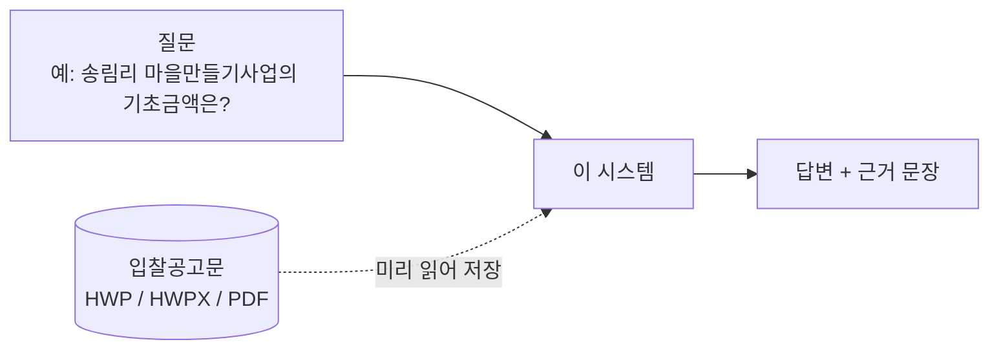

# 01. 개요

> 이 문서에서 알게 되는 것: ① 이 프로젝트가 푸는 문제 ② 한 장으로 본 동작 ③ 팀 프로젝트에서 무엇을 바꿨는지

## 푸는 문제

공공기관 입찰공고문(HWP, HWPX, PDF)에서 **금액, 기간, 수량 같은 값을 질문으로 찾는다.** 
공고문은 표가 많고 형식이 제각각이라, 문서를 글자로만 바꾸면 표의 라벨과 값이 어긋나 답이 틀린다.

## 한 장으로 보기

## 팀 프로젝트와 달라진 점

이 프로젝트는 팀 프로젝트(AI_7-team)의 RAG 파이프라인에서 출발했다.

아래 표만 보면 어디가 같고 어디가 다른지 알 수 있다.

| 단계 | 팀 프로젝트 | 이 프로젝트 |
|---|---|---|
| HWP 읽기 | HWP를 PDF로 바꾼 뒤 글자 추출 | 전용 파서(kordoc)로 Markdown을 직접 생성 |
| 표 처리 | 표의 라벨과 값이 섞임(짝 맞음 22%) | 표를 `라벨: 값`으로 풀어 씀(짝 맞음 100%) |
| 검색 | 후보를 넓게 가져와 점수순 | 질문에서 찾은 기관의 문서부터 좁혀 검색 |
| 답변 만들기 | 규칙과 키워드 템플릿 | 기본은 LLM이 근거를 읽고 직접 작성. 선택: 질문을 단계로 나누는 `multi_agent` |
| 채점 | 같은 계열의 로컬 모델 | Claude 서브에이전트, 명시된 규칙(v2) |

## 결과 한 줄

40개 질문 기준 정답 점수(5점 만점): 팀 프로세스 1.1~2.8, 이 프로젝트의 프로세스 4.8~5.0. 
표와 읽는 법은 [`../EXPERIMENTS.md`](../EXPERIMENTS.md)에 있다(정리 중).

## 범위 밖

- 스캔 PDF(글자가 없는 이미지 PDF)는 다루지 않는다.
- 문서 업로드 기능은 없다.
- DB는 운영자가 명령으로 만든다.
- 사람이 매긴 점수와의 일치는 확인하지 않았다.
