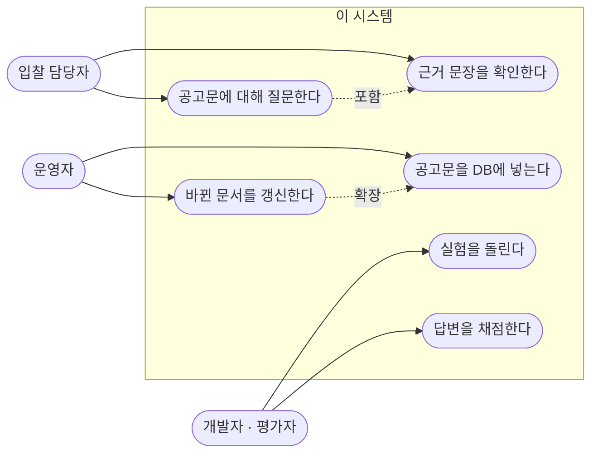
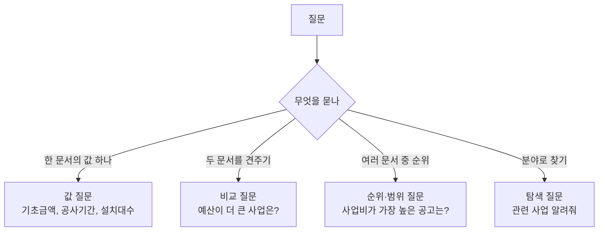

# 02. use case

> 이 문서에서 알게 되는 것 
    1. 누가 무엇을 하는가 
    2. 질문 유형별로 시스템이 어떻게 다르게 동작하는가

## 사용자와 할 일

| 사용자 | 하는 일 | 어떻게 |
|---|---|---|
| 입찰 담당자 | 질문하고 답과 근거를 받는다 | Gradio 화면 또는 `POST /v1/query` |
| 운영자 | 공고문을 읽어 DB에 넣는다 | 명령줄(`build_index_new_parser.py`, `index_pdf_originals.py`). 같은 문서는 덮어쓴다 |
| 운영자 | 내용이 바뀐 문서를 갱신한다 | 같은 명령. 이전 내용의 chunk가 남으므로 `data_index/chroma_B/`만 지우고 다시 넣는다(엑셀은 남긴다) |
| 개발자 · 평가자 | 여러 process를 같은 질문으로 비교하고 채점한다 | `run_experiment.py`, `claude_judge.py` |

## 질문 유형

| 유형 | 예 | 시스템 동작 |
|---|---|---|
| 값 질문 | "공사기간은 며칠인가요?" | 해당 기관의 문서에서 찾아 값 하나로 답한다 |
| 비교 질문 | "예산이 더 큰 사업은?" | 두 문서를 모두 검색해 값을 견준다 |
| 순위·범위 질문 | "사업비가 가장 높은 공고는?" | metadata CSV의 기관별 금액을 모아 순위를 바로 낸다(문서 본문 검색 없음) |
| 탐색 질문 | "도로 관련 사업 알려줘" | 기관 목록과 엑셀 정보로 목록을 바로 낸다 |

## 알려진 한계

- 순위 질문과 단축 경로는 엑셀의 `사업 금액` 열에 기대고, 그 열이 비어 있으면 답하지 못한다.
- 열 하나라서 금액 종류(기초금액, 추정금액)도 구분하지 못한다.
- 질문에 기관이나 사업명이 없으면 문서를 좁히지 못해 답이 흔들릴 수 있다.
