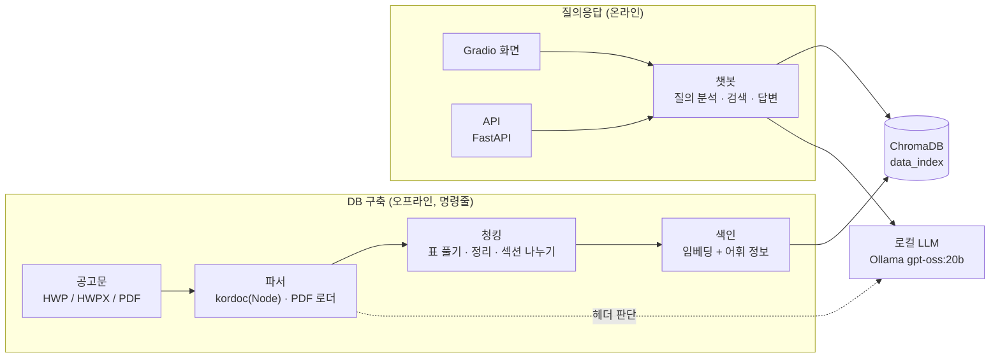
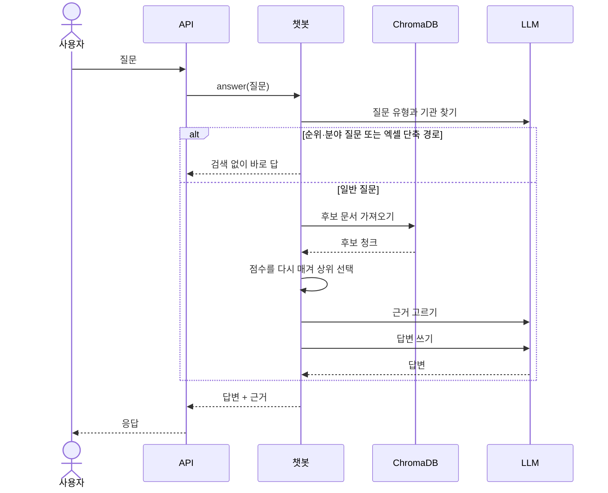

# 03. 아키텍처

> 이 문서에서 알게 되는 것</br>
    1. 구성요소와 역할</br>
    2. 질문 한 건이 지나가는 길</br>
    3. 어디서 무엇이 실행되는가

## 구성요소

DB를 **만드는 일(오프라인)**과 **질문에 답하는 일(온라인)**은 서로 다른 프로세스다.

둘은 같은 DB 파일만 공유한다.



| 구성요소 | 역할 | 위치 |
|---|---|---|
| 파서 | HWP/HWPX를 Markdown으로 변환 | [skill](https://github.com/adover134/korean_official_document_parser_skill) / [service](https://github.com/adover134/korean_official_document_parser_service) 저장소를 활용, Node 필요 |
| 청킹 | 표를 `라벨: 값`으로 풀고 섹션 단위로 자른다 | `src/parsers/` |
| ChromaDB | 청크와 문서 구조 저장 | `data_index/` (git 제외) |
| 챗봇 | 질문 분석, 검색, 근거 추출, 답변 생성 | `src/graph/workflow.py` |
| API / 화면 | 외부에서 질문을 보내는 입구 | `scripts/api.py`, `scripts/gradio_app.py` |
| LLM | 질문 분석과 답변 작성 | 로컬 Ollama(OpenAI 호환 주소) |

- 공고 목록(엑셀)은 지금 이 저장소가 읽어 기관명 사전과 순위·금액 질문에 쓴다.
  - 입찰 문서는 항상 [나라장터](https://www.g2b.go.kr/)에서 가져온다고 가정하며, 이 목록을 만드는 일은 앞으로 파서가 맡아야 한다.

## 질문 한 건의 흐름



## 실행하려면 (사용자 입장)

### 필요한 것

| 필요한 것 | 왜 | 비고 |
|---|---|---|
| Python 3.10 이상과 `requirements.txt`의 패키지 | 모든 프로세스 실행 | `pip install -r requirements.txt` |
| 답변용 LLM 연결 | 질문 분석과 답변 작성 | 로컬 Ollama의 `gpt-oss:20b`(`ollama pull gpt-oss:20b`로 받는다) 또는 Groq(OpenAI 호환 주소) |
| 만들어 둔 `data_index/` | 검색할 문서 | 없으면 먼저 DB를 만든다 |
| Node.js와 [파서 skill](https://github.com/adover134/korean_official_document_parser_skill) 저장소 | HWP/HWPX를 Markdown으로 바꿀 때만 | 질문만 할 때는 필요 없다. 이 저장소와 같은 상위 폴더에 두거나 `HWP_SKILL_DIR`로 위치를 알려 준다 |
| 파서용 LLM | 파서가 제목 계층을 판단할 때 | `build_index_new_parser.py`의 `--backend`(기본 ollama), `--model`(기본 `qwen3.5:9b`), `--base-url`로 지정 |

### LLM 연결 설정

프로젝트 루트의 `.env`(git 제외)에 적는다.

```bash
HWP_RAG_LLM_BASE_URL=http://localhost:11434/v1   # Groq이면 https://api.groq.com/openai/v1
OPENAI_API_KEY=ollama-local                      # 로컬이면 아무 문자열
REASONING_MODEL=gpt-oss:20b
QUERY_INTENT_MODEL=gpt-oss:20b
```

- 로컬 모델은 응답이 느려서(질문당 1~2분) `OPENAI_TIMEOUT_SEC=1200`처럼 시간 제한을 넉넉히 둔다.
- 응답이 중간에 잘리면 Ollama를 `OLLAMA_CONTEXT_LENGTH=32768`로 띄운다(기본 4096).
- 결과를 비교하려면 같은 모델(`gpt-oss:20b`)을 쓴다.

### 실행

| 하고 싶은 일 | 명령 | 결과 |
|---|---|---|
| 프로그램에서 질문 | `python scripts/api.py --port 8001` | `http://localhost:8001/v1/query`, 상태 확인 `/v1/health` |
| 화면에서 질문 | `python scripts/gradio_app.py --port 7860` | `http://localhost:7860` |
| DB 만들기 | `python scripts/build_index_new_parser.py --input <폴더>` | `data_index/` |

- 인증 값은 모두 `.env`에 적는다. 값 자체는 문서나 코드에 두지 않는다.
  - API: `RAG_API_KEYS`(쉼표로 여러 개, 비우면 열려 있음)
  - 화면: `GRADIO_APP_USERNAME`, `GRADIO_APP_PASSWORD`(둘 다 있어야 한다. 둘 다 비우면 인증 없이 열리고, 하나만 있으면 시작하지 않는다)
- 답변 방식: API는 `HWP_RAG_ANSWER_STRATEGY`로 고르고(`two_stage` 기본, `multi_agent`), 화면은 `multi_agent`로 고정이다.
