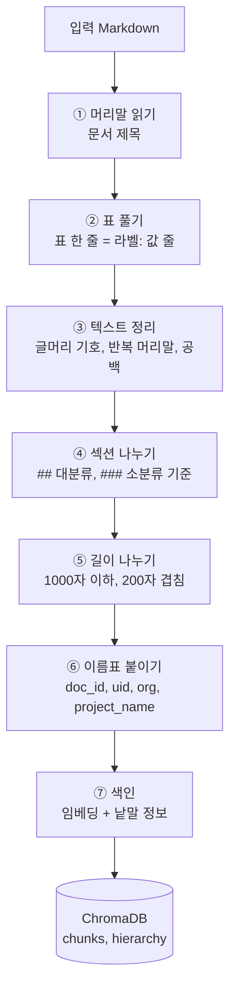
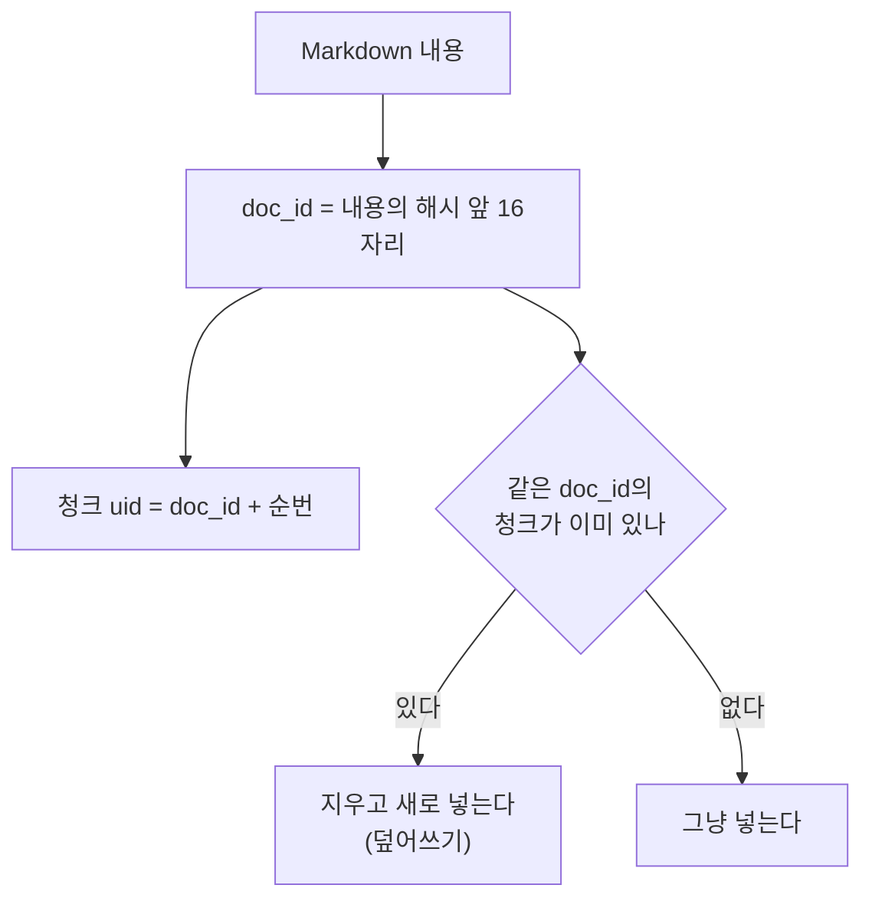
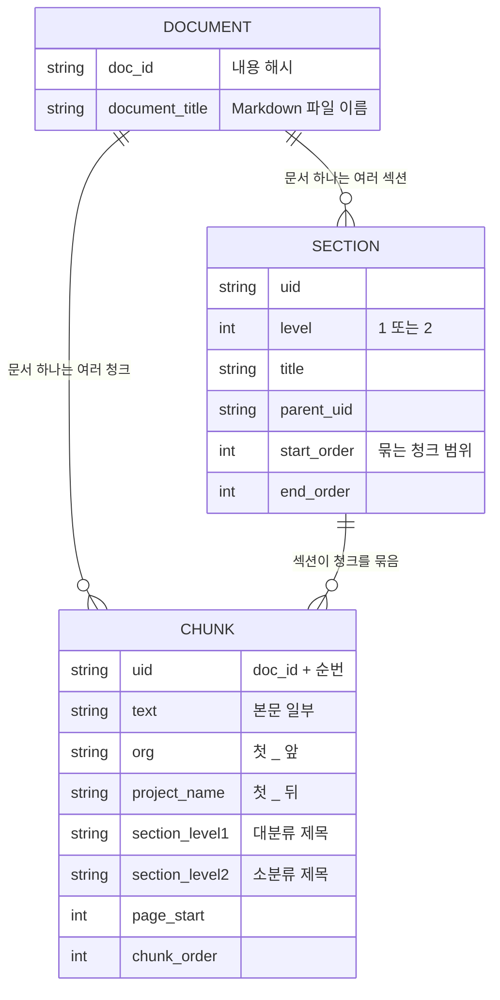

# 04. DB 구축

> 이 문서에서 알게 되는 것 
    1. Markdown이 청크가 되기까지의 순서 
    2. 표가 어떻게 풀리는가 
    3. DB에 무엇이 어떤 모양으로 저장되는가 
    4. 다시 넣을 때의 규칙

## 전체 순서

입력은 파서가 만든 Markdown이다(입력 모양은 [README](../README.md) 참고).

| 단계 | 하는 일 | 코드 |
|---|---|---|
| ② 표 풀기 | 표를 `라벨: 값` 줄로 바꿔 라벨과 값이 같은 줄에 있게 한다 | `src/parsers/table_flattener.py` |
| ③ 텍스트 정리 | 불필요한 기호와 반복되는 머리말을 지운다 | `src/parsers/text_cleaner.py` |
| ④ 섹션 나누기 | HWP/HWPX는 파서가 넣어 준 `##`/`###` 제목을 섹션 경계로 쓴다. PDF는 정규식으로 제목을 찾는다 | `scripts/parser_bridge.py` |
| ⑤ 길이 나누기 | 섹션이 길면 1000자 이하로 자른다(200자 겹침) | `src/parsers/chunker.py` |
| ⑦ 색인 | 임베딩(`jhgan/ko-sroberta-multitask`)과 낱말 정보(BM25, Kiwi)를 만든다 | `src/retrievers/build_db.py` |

## 표 풀기 예

표를 글자로만 바꾸면 라벨과 값이 멀어져서 검색된 조각만으로는 어느 값이 무엇인지 알 수 없다.

그래서 표의 한 행을 `라벨: 값` 한 줄로 바꾼다.

| 풀기 전 (표) | 풀린 뒤 (한 줄) |
|---|---|
| `\| 구분 \| 추정가격 \| 부가가치세 \| 기초금액 \|` `\| 송림리 \| 259,204,546 \| 25,920,454 \| 285,125,000 \|` | `구분: 송림리, 추정가격: 259,204,546, 부가가치세: 25,920,454, 기초금액: 285,125,000` |

헤더가 둘로 나뉜 표, 헤더가 없는 숫자 표 같은 경우도 같은 방식으로 라벨을 붙인다(규칙과 측정은 [기록](../EXPERIMENTS.md)의 표 지표 절).

## 이름표(ID) 규칙과 다시 넣기

- 같은 내용을 다시 넣으면 덮어쓴다(upsert).
- 내용이 바뀌면 `doc_id`가 달라져 **새 문서**가 되고, 이전 청크는 남는다.
  - 파서나 kordoc 버전을 바꿨다면 `data_index/chroma_B/`만 지우고 다시 만든다(같은 폴더의 공고 목록 엑셀과 `org_dictionary.txt`는 남긴다).
- 파일 이름 `공고명_기관명`의 첫 `_` 앞은 `org`, 뒤는 `project_name`으로 저장된다.

## DB에 저장되는 모양

ChromaDB에 컬렉션 둘이 있다. "문서"는 따로 저장되지 않고 `doc_id`로 묶인다.

| 컬렉션 | 담는 것 | 쓰임 |
|---|---|---|
| `chunks` | 청크 본문, 임베딩, 메타데이터 | 검색의 대상 |
| `hierarchy` | 문서의 섹션 구조(제목, 부모, 범위) | 섹션 단위로 묶어 보는 데 사용 |

## 알아 둘 점

- 낱말 정보(BM25)는 색인에 저장되지만 검색에서는 읽지 않는다.
  - 검색은 임베딩 후보에 낱말 겹침 점수를 섞는 방식이다([05 질의 처리](05_질의처리.md)).
- 기관명은 엑셀에서 읽어 형태소 분석기 사전에 넣는다.
  - 질문 속 기관명을 한 덩어리로 알아보게 하기 위해서다.
