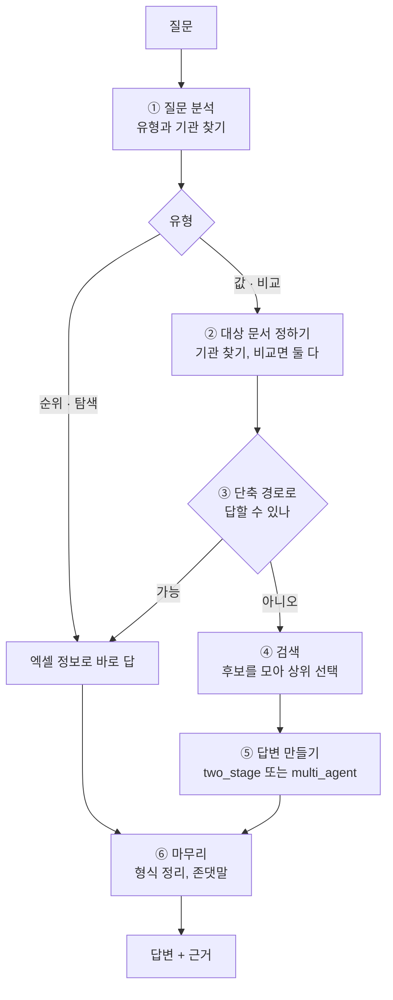
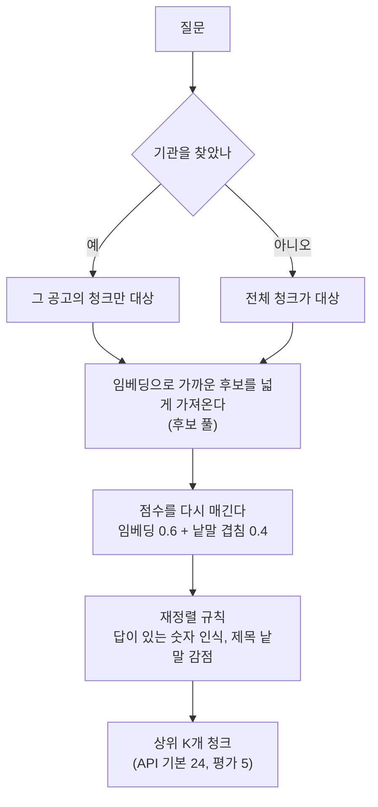
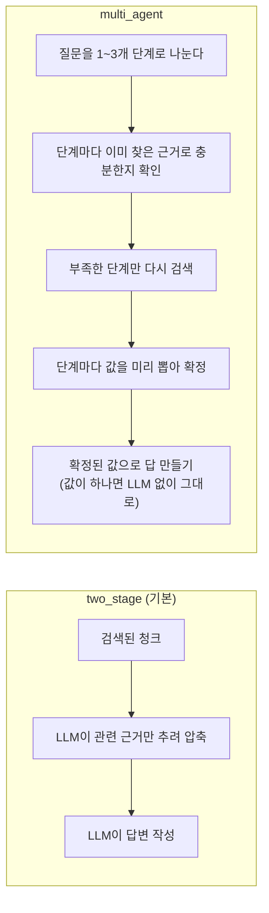
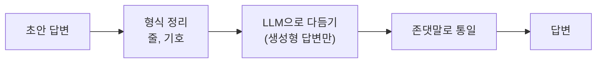

# 05. 질의 처리

> 이 문서에서 알게 되는 것 
    1. 질문이 답이 되기까지의 순서 
    2. 검색이 후보를 고르는 방법 
    3. 답변을 만드는 두 가지 방식 
    4. 답변을 다듬는 마지막 단계

## 전체 순서

| 단계 | 하는 일 |
|---|---|
| ① 질문 분석 | 질문이 순위, 탐색, 값, 비교 중 무엇인지와 기관 이름을 찾는다. 규칙으로 먼저 보고 필요할 때 LLM을 쓴다 |
| ② 대상 문서 정하기 | 질문에 든 기관을 문서 목록에서 찾는다. 비교 질문은 기관 둘을 모두 대상으로 한다 |
| ③ 단축 경로 | 엑셀에 금액이 있는 금액 질문 등은 검색 없이 바로 답한다. 금액 종류는 구분하지 못한다 |
| ④ 검색 | 아래 "검색" 참고 |
| ⑤ 답변 만들기 | 아래 "답변 방식" 참고 |
| ⑥ 마무리 | 형식을 정리하고 말투를 맞춘다(아래 "마무리" 참고) |

## 검색

- 후보 풀의 크기는 요청 개수 × 15(최소 150)이다. 요청이 24개면 360개다.
- 질문에서 공고(`org` 값)를 찾으면 그 공고의 청크 안에서만 후보를 모은다.
  - 비슷한 다른 문서의 청크가 끼어드는 것을 막는다.
- 한 질문에 검색은 여러 번 일어날 수 있고 하이브리드 검색은 최대 6번으로 제한한다.
- 청크 하나가 답변 모델에 전달될 때는 앞 700자만 들어간다(비교 질문은 900자).

## 답변 방식 두 가지

둘 다 위 검색 결과를 쓴다. 다른 점은 **근거를 어떻게 정리해서 답으로 만드는가**다.

| | `two_stage` | `multi_agent` |
|---|---|---|
| 핵심 | 근거를 LLM이 한 번 압축한 뒤 답한다 | 질문을 쪼개고 단계마다 값을 확정한다 |
| 강점 | 단순하고 호출이 적다 | 확정된 값은 LLM이 다시 판단하지 않아 흔들림이 적다 |
| 약점 | 압축 단계가 실행마다 정답 근거를 놓칠 때가 있다 | 복합 질문은 LLM 호출이 늘 수 있다 |
| 쓰이는 곳 | API 기본, 평가의 `main` | Gradio 화면, 평가의 `multi-agent` |

선택은 환경변수 `HWP_RAG_ANSWER_STRATEGY`(`two_stage` 또는 `multi_agent`)로 한다.

## 마무리

답변을 내보내기 전에 매번 거치는 단계다.

- 단축 경로로 만든 답은 LLM으로 다듬지 않는다.
- 정규식으로 값을 뽑아 템플릿에 끼우는 규칙 기반 단계(근거 확인, 값 하나로 줄이기)는 기본으로 꺼져 있다.
  - 비교 실험에서 LLM이 직접 쓴 답이 더 정확해서 껐고, `HWP_RAG_ENABLE_LEGACY_EXTRACTIVE=1`로 켤 수 있다.

## 알아 둘 점

- 단축 경로와 순위 질문은 엑셀의 `사업 금액` 열이 비어 있으면 답하지 못한다.
- 질문에 기관이나 사업명이 없으면 대상 문서를 좁히지 못해 답이 흔들릴 수 있다.
