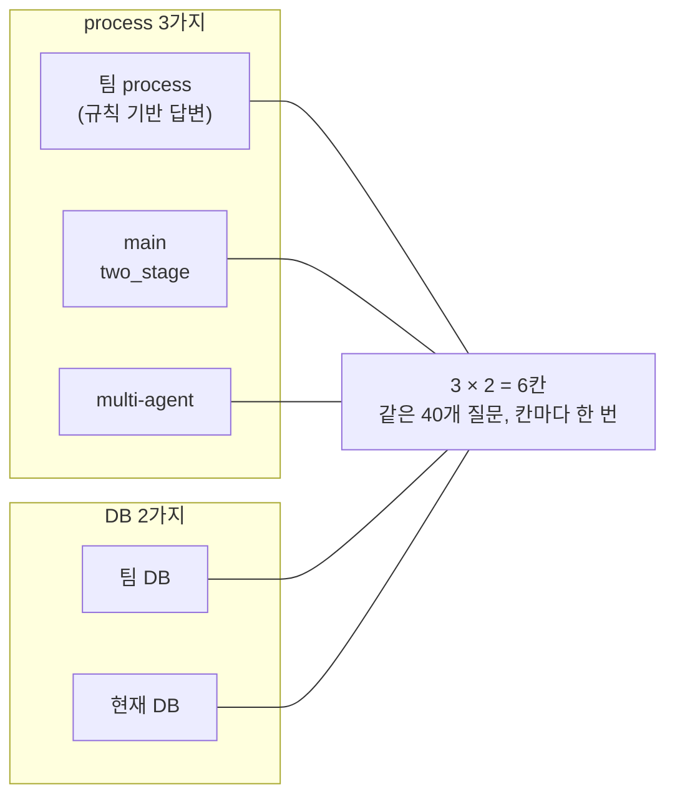
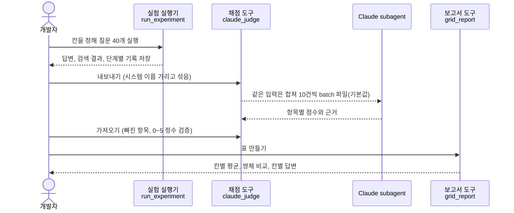

# 06. 평가

> 이 문서에서 알게 되는 것 
    1. 무엇을 무엇과 비교하는가 
    2. 평가가 돌아가는 순서 
    3. 점수가 무엇을 재는가 
    4. 결과를 읽을 때 조심할 점

## 무엇을 비교하나

현재 점수는 이 저장소의 두 방식(`two_stage`, `multi_agent`)을 현재 DB로 실행한 값이다([07 결과](07_결과.md)).
아래의 6칸 비교는 1.2 시점에 한 비교 실험의 설계다.

**process**(답을 만드는 방식)와 **DB**를 따로 바꿔 가며 같은 질문을 던진다.

그래야 점수 차이가 process 때문인지 DB 때문인지 가를 수 있다.

- 질문은 40개다. 문서 57건에서 만든 두 묶음(20개씩)이다.
- 칸마다 답변, 검색 결과, 단계별 기록을 저장해 두고 채점은 나중에 한다.

## 평가 순서

- 답변은 local 모델(`gpt-oss:20b`)이 만들고, 채점은 항상 Claude가 한다.
  - 같은 모델이 자기 답을 채점하면 안 되기 때문이다.
- 채점자는 어느 시스템의 답인지 모른다.
- 채점 입력이 글자까지 같은 답은 한 번만 채점해 같은 점수를 쓴다.

## 점수가 재는 것

### process 성능

| 지표 | 무엇을 보나 |
|---|---|
| Correctness | 주된 값이 맞는가 (0\~5) |
| Answer coverage | 주된 값이 빠짐없이 들어 있는가 (0\~5) |
| Faithfulness | 답이 검색된 근거에 기대는가 (0\~5, 거부 답변은 제외) |
| Context relevance | 검색된 근거가 질문과 관련 있는가 (0\~5, 보조로만 읽는다) |
| 최종 상위 5개 적중 | 답변 모델이 받은 chunk 5개 안에 정답이 있는가 |

- 결정은 Correctness와 최종 상위 5개 적중으로 한다.
- 보조로 MRR(정답이 몇 번째에 나왔는가)도 본다.
- 채점 규칙(주된 값, 표기 차이, 거부 답변 등)은 [채점기 규칙](judge_rules.md)에 있다.

### DB 성능

process를 거치기 전의 **후보 pool**에 정답 chunk가 들어 있는가로 잰다.

| 지표 | 설명 |
|---|---|
| 순수 밀집 pool Recall@90 · 180 · 360 | 필터 없이 embedding만으로 후보 N개를 가져올 때 |
| process가 만든 pool Recall@90 · 180 · 360 | process가 실제로 쓰는 방식(기관 필터 포함)으로 가져올 때 |

- 최종 상위 5개 같은 "마지막에 쓰는 개수"는 DB 성능에 쓰지 않는다.
- 정답 chunk는 정답 문서 안에서 모범 답안의 핵심 수치·날짜를 담은 chunk다. script가 DB마다 내용으로 찾아 라벨을 만든다(chunk가 DB마다 다르기 때문).

다시 돌리는 명령은 [이전 README](../README_이전.md)의 평가 절과 [`EXPERIMENTS.md`](../EXPERIMENTS.md)의 "직접 실행하기"에 있다.

## 결과를 읽을 때 조심할 점

- 질문은 40개고 칸마다 한 번만 돌렸다. 작은 차이는 우연일 수 있다.
- 비교는 같은 질문끼리 짝을 지어 보는 부호 검정을 쓰며, 40개로는 작은 차이를 구분하지 못한다.
- 점수가 만점 근처(4.8\~5.0)라 더 나아졌는지 알기 어렵다.
- 채점이 일관적인지는 확인했지만 사람이 매긴 점수와 맞는지는 확인하지 않았다.
- 같은 답도 채점 회차나 rubric 버전이 다르면 점수가 달라질 수 있다.
- [07 결과](07_결과.md)의 "현재 결과"는 단축 경로를 켠 조건이고, 비교 실험의 6칸 표는 끈 조건이다.

현재 점수와 읽는 법은 다음 문서([07 결과](07_결과.md))에, 지난 실험 과정은 [기록](../EXPERIMENTS.md)에 있다.
