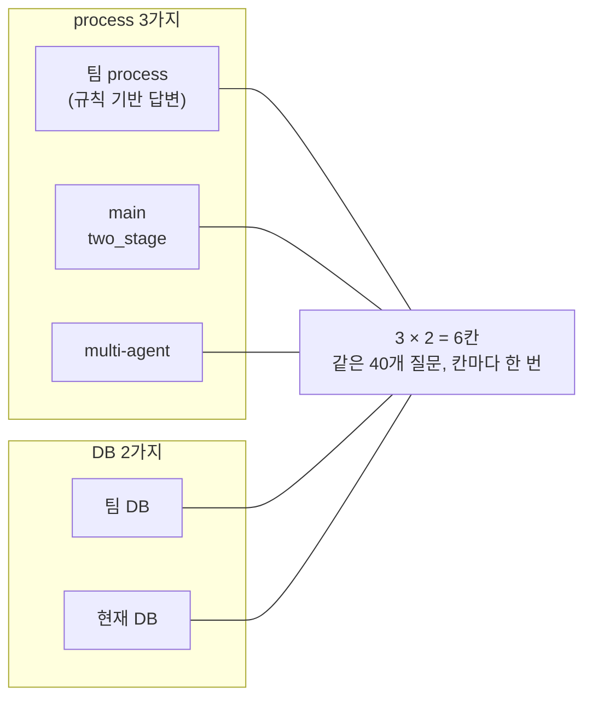
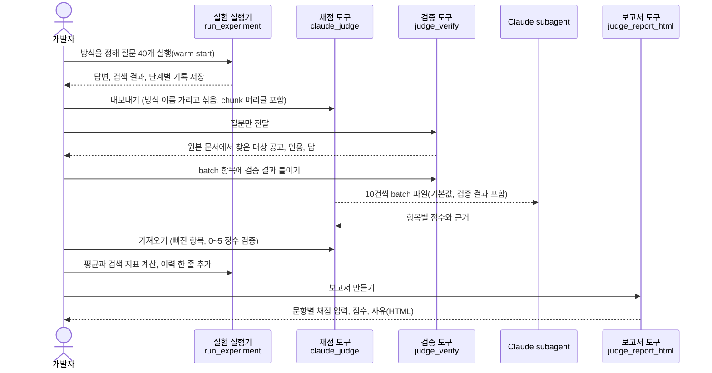

# 06. 평가

> 이 문서에서 알게 되는 것 
    1. 무엇을 무엇과 비교하는가 
    2. 평가가 돌아가는 순서 
    3. 점수가 무엇을 재는가 
    4. 결과를 읽을 때 조심할 점

## 무엇을 비교하나

현재 점수는 이 저장소의 두 방식(`two_stage`, `multi_agent`)을 현재 DB로 실행한 값이다([07 결과](07_결과.md)).
아래의 6칸 비교는 1.2 시점에 한 비교 실험의 설계다.

**process**(답을 만드는 방식)와 **DB**를 따로 바꿔 가며 같은 질문을 던진다.

그래야 점수 차이가 process 때문인지 DB 때문인지 가를 수 있다.

- 질문은 40개다. 문서 57건에서 만든 두 묶음(20개씩)이다.
- 칸마다 답변, 검색 결과, 단계별 기록을 저장해 두고 채점은 나중에 한다.

## 평가 순서

- 답변은 local 모델(`gpt-oss:20b`)이 만들고, 채점은 항상 Claude가 한다.
  - 같은 모델이 자기 답을 채점하면 안 되기 때문이다.
- 채점자는 어느 시스템의 답인지 모른다.
- **원본 검증**(2026-11-28부터): 검증자(Claude)는 질문만 받고 원본 PDF, HWP, HWPX와 공고 목록 엑셀을 검색한다. 프로젝트의 parser와 DB를 거치지 않으며 생성 답, 기대 답변, 검색 context는 보지 않는다.

## 점수가 재는 것

### process 성능

팀 프로젝트의 지표(팀 저장소의 `eval_resources/METRICS.md`, `scripts/eval_retrieval.py`)에 비용을 더한 것이다.
팀의 문서 MRR 자리는 2026-11-28부터 문서 nDCG@N이다.

| 지표 | 무엇을 보나 |
|---|---|
| Correctness | 기대 답변과 의미가 맞는가 (0\~5, 주된 값 기준) |
| Answer coverage | 기대 답변의 핵심 정보가 빠짐없이 들어 있는가 (0\~5) |
| Faithfulness | 답이 context에 근거하는가 (0\~5) |
| Context relevance | context가 질문과 관련 있는가 (0\~5) |
| Recall@5 (문서) | 정답 문서가 모두 검색 상위 5개에 든 문항의 비율 |
| nDCG@N (문서) | 정답 문서 N개가 검색 상위 N개 문서에 들었는가, 앞 순위에 들었는가 (0\~1) |
| Recall@5 (chunk) | 정답 chunk의 `chunk_id`(문서 ID와 chunk 번호) 중 상위 5개에 든 비율. chunk를 보지 않고 만든 답(단축 경로)은 null로 두고 뺀다 |
| 단계별 지연시간 | 질의 분석, 검색, 근거 추출, 답변 생성, 문항 전체 |
| 비용 | token 수와 환산 요금([11 비용 측정](11_비용측정.md)) |

- 채점자는 질문, 기대 답변, 생성 답변, context와 원본 검증 결과를 받는다. context는 답의 근거와 검색 상위 5개 chunk이고, chunk마다 답변 모델이 받는 것과 같은 머리글(공고명, 문서, 쪽, 기관명)을 붙인다.
- 채점 기준은 팀 rubric에 추가 기준 4개를 붙인 것이다. 전문은 [채점기 규칙](judge_rules.md)에 있다.

#### 문서 nDCG@N

N은 그 문항의 정답 문서 수다.

1. 검색 상위 5개 chunk를 문서 순위로 바꾼다. 같은 문서의 chunk는 처음 나온 자리의 문서 하나로 센다.
2. i위의 가중치는 `1/log2(i+1)`이다.
3. 1\~N위 중 정답 문서가 있는 순위의 가중치 합을, 1\~N위 가중치의 합으로 나눈다.

| 정답 문서 2개일 때 | 점수 |
|---|---|
| 1위와 2위 | 1.000 |
| 1위만(다른 하나는 3위 이하이거나 없음) | 0.613 |
| 2위만 | 0.387 |
| 상위 2위에 없음 | 0 |

- 정답 문서가 1개면 1위일 때 1, 아니면 0이다. 상위 5개 안에 있었는지는 Recall@5가 보여준다.

### DB 성능

process를 거치기 전의 **후보 pool**에 정답 chunk가 들어 있는가로 잰다.

| 지표 | 설명 |
|---|---|
| 순수 밀집 pool Recall@90 · 180 · 360 | 필터 없이 embedding만으로 후보 N개를 가져올 때 |
| process가 만든 pool Recall@90 · 180 · 360 | process가 실제로 쓰는 방식(기관 필터 포함)으로 가져올 때 |

- 최종 상위 5개 같은 "마지막에 쓰는 개수"는 DB 성능에 쓰지 않는다.
- 정답 chunk는 정답 문서 안에서 모범 답안의 핵심 수치·날짜를 담은 chunk다. script가 DB마다 내용으로 찾아 라벨을 만든다(chunk가 DB마다 다르기 때문).

다시 돌리는 명령은 [이전 README](../README_이전.md)의 평가 절과 [`EXPERIMENTS.md`](../EXPERIMENTS.md)의 "직접 실행하기"에 있다.

## 결과를 읽을 때 조심할 점

- 질문은 40개고 칸마다 한 번만 돌렸다. 작은 차이는 우연일 수 있다.
- 비교는 같은 질문끼리 짝을 지어 보는 부호 검정을 쓰며, 40개로는 작은 차이를 구분하지 못한다.
- 점수가 만점 근처(4.8\~5.0)라 더 나아졌는지 알기 어렵다.
- 채점 입력이 같은 답도 점수가 갈릴 수 있다. 사람이 매긴 점수와 맞는지는 확인하지 않았다.
- 같은 답도 채점 회차나 rubric 버전이 다르면 점수가 달라질 수 있다.
- [07 결과](07_결과.md)의 "현재 결과"는 단축 경로를 켠 조건이고, 비교 실험의 6칸 표는 끈 조건이다.

현재 점수와 읽는 법은 다음 문서([07 결과](07_결과.md))에, 지난 실험 과정은 [기록](../EXPERIMENTS.md)에 있다.
