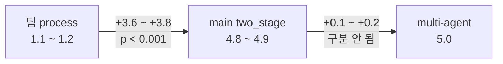

# 07. 결과

> 이 문서에서 알게 되는 것 
    1. **현재** 점수, 시간, token, 환산 요금 
    2. 이 숫자를 얼마나 믿어도 되는가 
    3. process와 DB를 바꿔 본 비교 실험(이전 기록) 
    4. 이전 실행의 점수

**현재 값은 아래 "현재 결과" 절 하나다.** 다른 절과 다른 문서의 점수는 모두 이전 기록이다.

## 현재 결과

| 항목 | 값 |
|---|---|
| 실행 이름(run id) | **`eval_20261127`** |
| 실행일 | 2026-11-27 |
| 코드 | `multi-agent` branch, commit `3d9c004` (버전 1.3.2에 목록 답 후처리 수정을 반영한 상태) |
| 조건 | 현재 DB(chunk 1,207개), 단축 경로 켬, `top_k` 5, 질문 40개, 방식마다 한 번 |
| 답변 모델 | local `gpt-oss:20b` (`num_batch` 256, warm start) |
| 심사 | **Claude(subagent, Opus)**, rubric v3, blind 채점 한 번. 채점 입력이 같은 답을 합쳐 80개를 56개 항목으로 채점했다(`multi-agent` branch의 `eval_resources/claude_judge/round17/`) |

### 점수 (5점 만점)

| 방식 | Correctness | Answer coverage | Faithfulness | Context relevance | Correctness 5점 |
|---|---|---|---|---|---|
| `two_stage` | **4.950** | 4.925 | 4.850 | 4.525 | 39 / 40 |
| `multi_agent` | **4.950** | 4.950 | 4.850 | 4.475 | 39 / 40 |

- 두 방식 모두 거부 답변과 실행 오류가 없다.
- 단축 경로를 거치지 않고 검색한 22문항은, 두 방식 모두 정답 chunk가 상위 5개에 22 / 22 들었다(MRR@5 0.924).
  - 나머지 18문항은 단축 경로로 답해 검색 지표에서 뺐다.
- **두 방식의 점수 차이는 구분되지 않는다.**
  - 24문항은 채점 입력이 같아 점수도 같다.
  - 나머지 16문항에서 갈린 것은 `m10`의 Answer coverage 1점과, 6문항의 Context relevance 1점씩이다.

### 시간과 token

측정 방법과 환경(GPU 메모리 8GB)은 [11 비용 측정](11_비용측정.md)에 있다.

| 항목 | `two_stage` | `multi_agent` |
|---|---|---|
| 40문항 총 시간 | 1,535.9초 | 1,235.4초 |
| 문항 평균 / 중앙값 / 최대 | 38.4 / 8.1 / 118.8초 | 30.9 / 8.3 / 143.8초 |
| LLM 호출 | 104 | 117 |
| LLM이 차지한 시간 | 98.6% | 96.9% |
| 호출이 1회 이하인 21문항 평균 | 7.2초 | 7.2초 |
| 호출 2회 이상인 19문항 평균 | 72.9초 | 57.1초 |
| 입력 token 합(문항 평균) | 144,459 (3,611) | 69,034 (1,726) |
| 출력 token 합(문항 평균) | 25,181 (630) | 22,767 (569) |
| 한 호출의 최대 입력 + 출력 | 5,046 (context 32768의 15%) | 3,884 (12%) |
| 실패한 호출, 답변 오류 | 0, 0 | 0, 0 |
| GPU 사용 최대 | 7,095MiB | 7,095MiB |

### 환산 요금

실제 청구액이 아니라, Groq 단가(입력 100만 token당 $0.075, 출력 $0.30)로 계산한 추정값이다. 계산 방법은 [11 비용 측정](11_비용측정.md)에 있다.

| 항목 | `two_stage` | `multi_agent` |
|---|---|---|
| LLM 응답 1회 평균 / 최대 | $0.00018 / $0.00053 | $0.00010 / $0.00041 |
| 문항 평균 / 중앙값 / 최대 | $0.00046 / $0.00007 / $0.00114 | $0.00030 / $0.00007 / $0.00095 |
| 40문항 합 | $0.0184 | $0.0120 |
| 1,000문항 환산 | $0.46 | $0.30 |
| 요금 중 출력 token의 몫 | 41% | 57% |

- Langfuse가 계산한 합과 위 값이 같다.
- `multi_agent`는 호출이 13번 많지만 입력 token이 절반 이하(48%)다. 총 시간은 20% 짧고, `two_stage`의 요금은 그 1.53배다.

### 감점 내역

Correctness나 Answer coverage가 깎인 문항 전부다.

| 문항 | 방식 | 점수 | 채점 근거 | 확인한 사실 |
|---|---|---|---|---|
| `m10` | `two_stage` | Coverage 4 | 기간의 "3일간"이 없다 | 시작일과 종료일은 맞다. `multi_agent`의 답은 5점이다 |
| `n15` | 두 방식 | Correctness 3, Coverage 3 | 묻는 사업(교통신호기)이 아니라 다른 사업(도로조명) 문서에서 가져온 값이다 | **값 100,000,000원은 맞다.** 원문 PDF의 파일 이름은 "도로조명"이고, 본문 표(파싱 결과)의 공고명은 "교통신호기"다. 채점 context에는 `metadata.csv`에서 온 한 줄만 있어 본문이 보이지 않았다 |

Faithfulness가 4점 이하인 문항:

- `n15`(두 방식, 2점): 위와 같은 이유다. Context relevance도 1점이다.
- `m11`(두 방식, 4점): 금액이 질문한 타일공사의 것이라는 점을 문서 이름에서 추론했다고 봤다.
- `n16`·`n17`(두 방식, 4점): 답의 "총 N기" 합계가 context에 없는 추론이라고 봤다.

## 믿어도 되는 범위

🔴 **`n15`의 감점은 주된 값 기준과 맞지 않는다**: 주된 값이 맞는데 Correctness가 3점이다. rubric 규칙 7의 "문자열이 있어도 엉뚱한 맥락이면 틀리다"가 context를 보고 값을 뒤집는 것까지 허용했다. 점수는 채점 그대로 둔다. 
🔴 **채점자 차이**: 채점 입력이 같은 답은 한 번 채점해 같은 점수를 쓴다. 입력이 다른 항목 사이의 채점자 차이는 남는다. 근거가 한 줄인 단축 경로 답의 Context relevance를 한 채점자는 5개 모두 4점으로, 다른 채점자들은 13개 중 11개를 5점으로 매겼다. 
🔴 **문항 40개, 방식마다 한 번**: 1\~2문항 차이는 우연일 수 있다. 점수가 만점 근처라 더 나아졌는지 구분하기 어렵다. 
🔴 **시간의 흔들림**: 같은 방법의 이전 실행(`cost_listfix`)보다 총 시간이 `two_stage` 9.9%, `multi_agent` 3.9% 길었다. `two_stage`는 출력 token도 12% 많았다. GPU 최대 사용량은 375MiB 컸고, 측정 중 같은 컴퓨터에서 파일을 읽는 작업을 했다. 원인은 가르지 않았다. 
🔴 **사람 채점과 대조하지 않음**

## 비교 실험 (1.2 시점의 기록)

**현재 값이 아니다.** process(답을 만드는 방식)와 DB 중 무엇이 점수를 바꿨는지 본 실험이다. 조건은 [평가](06_평가.md)를 본다.
팀 process와 팀 DB는 그 뒤에 다시 실행하지 않았다.

점수를 올린 것은 process였다. DB를 바꾼 효과는 **통계적으로 구분되지 않았다.**

### process × DB (정답 점수, `dbcmp6`, 단축 경로 끔)

| process | 팀 DB | 현재 DB(1.2) |
|---|---|---|
| 팀 process | 1.225 | 1.075 |
| main (`two_stage`) | 4.775 | 4.900 |
| multi-agent | 5.000 | 5.000 |

팀 process에서 단축 경로를 켜고 엑셀 금액 열을 채우면(`dbcmp7`) 정답 점수가 2.8까지 오른다.

- 팀 process → main: 40문항 중 31\~32개가 올랐고 내려간 문항은 0개다.
- main → multi-agent: 2\~4개가 올랐지만 p = 0.125(팀 DB), 0.5(현재 DB)라 우연과 구분되지 않는다.
- DB를 바꾼 효과(팀 DB → 현재 DB)는 어느 process에서도 p ≥ 0.25다.

### DB만 따로 본 결과

process를 거치기 전의 값이다.

| 지표 | 팀 DB | 현재 DB(1.2) | |
|---|---|---|---|
| 표 짝이 `라벨: 값`으로 남은 비율 (표 60쌍) | 23.3% | 100% | ✅ 나아졌다 |
| chunk 누락 coverage (평균) | 0.938 | 0.978 | ✅ 나아졌다 |
| 순수 밀집 pool Recall@360 | 0.957 | 0.938 | 🟡 나아지지 않았다 |
| process가 만든 pool @360에 정답 chunk가 든 문항 | 39 / 40 | 40 / 40 | 🟡 process 차이가 섞여 있다 |

- 표 처리와 누락 방지는 DB를 새로 만든 목적이었고 실제로 나아졌다.
- embedding만으로 후보를 찾는 능력은 같거나 약간 낮다.
  - 이를 높이려면 chunk 구성이나 embedding 입력을 바꿔야 한다.
- 정답 chunk 라벨은 DB마다 따로 만들고 chunk 수도 다르다(팀 1,844개, 현재 1,207개). chunk 단위 수치를 두 DB가 직접 견주기에는 한계가 있다.

## 이전 실행의 점수

**현재 값이 아니다.** 단축 경로를 켠 조건, 40문항, 심사: Claude(subagent), rubric v2.
현재 값(rubric v3)과는 채점 규칙과 context가 달라 직접 비교하지 않는다.

| run id | 코드 | 방식 | Correctness | Answer coverage | Faithfulness | Context relevance |
|---|---|---|---|---|---|---|
| `eval_20261127` (v2 채점) | 현재 값과 같은 답 | `two_stage` | 4.975 | 4.975 | 4.350 | 4.125 |
| `eval_20261127` (v2 채점) | 현재 값과 같은 답 | `multi_agent` | 4.950 | 4.950 | 4.475 | 4.225 |
| `dbcmp7` | 1.2 | `multi_agent` | 5.000 | 5.000 | 4.525 | 4.275 |
| `v13b` | 1.3.0 | `multi_agent` | 5.000 | 5.000 | 4.475 | 4.125 |
| `v13b` | 1.3.0 | `two_stage` | 4.850 | 4.850 | 4.400 | 4.050 |
| `v13c` | 1.3.0 | `two_stage` (`v13b`의 재실행) | 5.000 | 5.000 | 4.450 | 4.125 |

- `v13b`의 `two_stage` 감점 3건(`n4`, `n16`, `n19`)은 `v13c`에서 모두 5점이 됐다. 검색이 아니라 답변 생성의 편차였다.
- `eval_20261127`의 v2 채점(`round16`)에서는 채점 입력이 같은 24문항의 점수 96개 중 19개가 두 방식 사이에서 갈렸다. 그래서 채점 입력과 규칙을 고쳐 v3로 다시 채점했다([채점기 개선](judge_improvement.md)).
- 이전 실행과 `eval_20261127` v2 채점의 점수 차이는 답이 바뀐 것과 채점 회차가 바뀐 것이 섞여 있다.
  - 답, 근거, 검색 결과가 같은 `two_stage` 30문항(`v13c`와 비교)에서도 Correctness 1, Faithfulness 3, Context relevance 10개 점수가 달랐다.
  - `multi_agent` 33문항(`v13b`와 비교)에서는 Correctness 1, Answer coverage 1, Faithfulness 4, Context relevance 14개였다.

## 점수를 갱신할 때

1. 현재 코드로 40문항을 새로 실행하고 모두 채점한다.
2. "현재 결과" 절을 새 run id의 값으로 바꾼다.
3. 바뀌기 전의 값은 "이전 실행의 점수"로 옮긴다.
4. [발표.html](발표.html)의 "현재 결과" 슬라이드를 함께 바꾼다. 다른 문서에는 현재 점수를 적지 않는다.

## 자세한 기록

- 전체 표와 쌍체 검정: [`EXPERIMENTS.md`](../EXPERIMENTS.md)
- 비교 실험의 칸별 답변과 점수: [`dbcmp6_summary.md`](dbcmp6_summary.md), [`dbcmp6_answers.md`](dbcmp6_answers.md)
- 채점 규칙: [`judge_rules.md`](judge_rules.md)
- 실행의 답변과 채점 cache: `eval_resources/experiment_runs/<run id>/`(git 제외, 실행한 컴퓨터에만 있다)
