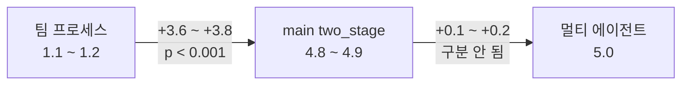

# 07. 결과

> 이 문서에서 알게 되는 것 
    1. 프로세스와 DB 중 무엇이 점수를 바꿨는가 
    2. DB가 나아진 곳과 나아지지 않은 곳 
    3. 이 숫자를 얼마나 믿어도 되는가

채점은 모두 Claude(서브에이전트)가 했다. 조건은 [평가](06_평가.md)를 본다.

## 한 줄 결론

점수를 올린 것은 프로세스(답을 만드는 방식)다. DB를 바꾼 효과는 **통계적으로 구분되지 않았다.**

## 1. 프로세스 × DB (정답 점수, 5점 만점)

| 프로세스 | 팀 DB | 현재 DB |
|---|---|---|
| 팀 프로세스 | 1.225 | 1.075 |
| main (`two_stage`) | 4.775 | 4.900 |
| 멀티 에이전트 | 5.000 | 5.000 |

위 표는 **단축 경로를 끈** 조건이다.
팀 프로세스에서 단축 경로를 켜고 엑셀 금액 열을 채우면 정답 점수가 2.8까지 오른다(자세한 값은 [`EXPERIMENTS.md`](../EXPERIMENTS.md)).

- 팀 프로세스 → main: 40문항 중 31\~32개가 올랐고 내려간 문항은 0개다.
- main → 멀티 에이전트: 2\~4개가 올랐지만 p = 0.125(팀 DB), 0.5(현재 DB)라 우연과 구분되지 않는다.
- DB를 바꾼 효과(팀 DB → 현재 DB)는 어느 프로세스에서도 p ≥ 0.25다.

## 2. DB만 따로 본 결과

프로세스를 거치기 전의 값이다.

| 지표 | 팀 DB | 현재 DB | |
|---|---|---|---|
| 표 짝이 `라벨: 값`으로 남은 비율 (표 60쌍) | 23.3% | 100% | ✅ 나아졌다 |
| 청크 누락 coverage (평균) | 0.938 | 0.978 | ✅ 나아졌다 |
| 순수 밀집 풀 Recall@360 | 0.957 | 0.938 | 🟡 나아지지 않았다 |
| 프로세스가 만든 풀 @360에 정답 청크가 든 문항 | 39 / 40 | 40 / 40 | 🟡 프로세스 차이가 섞여 있다 |

- 표 처리와 누락 방지는 DB를 새로 만든 목적이었고 실제로 나아졌다.
- 임베딩만으로 후보를 찾는 능력은 같거나 약간 낮다.
  - 이를 높이려면 청크 구성이나 임베딩 입력을 바꿔야 한다.

## 2-1. 1.3.0 확인 (메타데이터 단계 + DB 재구축)

조건: 단축 경로 켬(엑셀 금액 열이 채워짐), 40문항, 한 번 실행, 심사: Claude(서브에이전트).
위 1번 표(단축 끔)와는 조건이 달라서 직접 견주지 않는다.

| 시스템 | 정답 점수 | 만점 문항 | Faithfulness | Context relevance |
|---|---|---|---|---|
| 1.3 `multi_agent` | 5.000 | 40 / 40 | 4.475 | 4.125 |
| 1.2 `multi_agent` (단축 켬) | 5.000 | 40 / 40 | 4.525 | 4.275 |
| 1.3 `two_stage` | 4.850 | 37 / 40 | 4.400 | 4.050 |

- 청크 1,207개, 본문 집합이 1.2와 같다. 바뀐 것은 5건의 `org`, `project_name`이다.
- `two_stage` 감점 3건: n16(구성 누락, 같은 문서를 찾았고 생성 편차로 보임), n19(사업 주체 표기), n4(하복 납품기한 누락).
- 같은 `two_stage`를 한 번 더 돌리자 정답 점수가 5.000(40 / 40)이었다(Faithfulness 4.450, Context relevance 4.125). 위 3건이 모두 5점으로 바뀌었으므로 감점은 검색이 아니라 답변 생성의 편차다.
- Faithfulness와 Context relevance의 소폭 하락은 40문항 한 번 실행의 우연 범위로 본다.

## 3. 믿어도 되는 범위

🔴 **문항 40개, 칸마다 한 번**: 1\~2문항 차이는 우연일 수 있다. 
🔴 **만점 근처**: 4.8\~5.0에서는 더 나아졌는지 구분하기 어렵다. 
🔴 **사람 채점과 대조하지 않음**: Claude 채점이 일관적인지만 봤다. 
🔴 **정답 청크 라벨이 DB마다 따로**: 청크 수도 다르다(팀 1,844개, 현재 1,207개). 청크 단위 수치를 두 DB가 직접 견주기에는 한계가 있다.

## 자세한 기록

- 전체 표와 쌍체 검정: [`EXPERIMENTS.md`](../EXPERIMENTS.md)
- 칸별 답변과 점수: [`dbcmp6_summary.md`](dbcmp6_summary.md), [`dbcmp6_answers.md`](dbcmp6_answers.md)
- 채점 규칙: [`judge_rules.md`](judge_rules.md)
