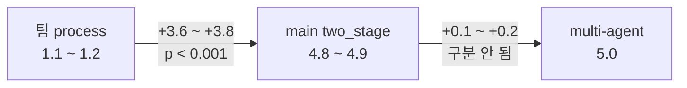

# 07. 결과

> 이 문서에서 알게 되는 것 
    1. **현재** 점수, 시간, token, 환산 요금 
    2. 이 숫자를 얼마나 믿어도 되는가 
    3. process와 DB를 바꿔 본 비교 실험(이전 기록) 
    4. 이전 실행의 점수

**현재 값은 아래 "현재 결과" 절 하나다.** 다른 절과 다른 문서의 점수는 모두 이전 기록이다.

## 현재 결과

| 항목 | 값 |
|---|---|
| 실행 이름(run id) | **`eval_20261127`** |
| 실행일 | 2026-11-27 |
| 코드 | `multi-agent` branch, commit `3d9c004` (버전 1.3.2에 목록 답 후처리 수정을 반영한 상태) |
| 조건 | 현재 DB(chunk 1,207개), 단축 경로 켬, `top_k` 5, 질문 40개, 방식마다 한 번 |
| 답변 모델 | local `gpt-oss:20b` (`num_batch` 256, warm start) |
| 심사 | **Claude(subagent, Opus)**, 팀 rubric + 추가 기준 3개(v5, [채점 규칙](judge_rules.md)), 80개를 섞은 blind 채점 한 번(`multi-agent` branch의 `eval_resources/claude_judge/round19/`) |
| 이력 | [`eval_resources/eval_history.jsonl`](../eval_resources/eval_history.jsonl)의 마지막 줄이 이 결과다 |

지표는 팀 프로젝트의 지표와 비용이다([평가](06_평가.md)).

### 채점 점수 (5점 만점)

| 방식 | Correctness | Answer coverage | Faithfulness | Context relevance | Correctness 5점 |
|---|---|---|---|---|---|
| `two_stage` | **4.900** | 4.825 | 4.600 | 4.125 | 36 / 40 |
| `multi_agent` | **4.900** | 4.950 | 4.575 | 4.200 | 36 / 40 |

- 평균은 40문항 전부다. 거부 답변과 실행 오류는 없다.
- **두 방식의 점수 차이는 방식의 차이로 보기 어렵다.** 채점 입력이 같은 24문항에서도 96개 점수 중 24개가 갈렸다.

### 검색 지표 (최종 상위 5개)

| 지표 | 두 방식 | 계산 |
|---|---|---|
| Recall@5 (문서), 40문항 | 1.000 | 정답 문서가 모두 상위 5개에 든 문항의 비율 |
| MRR (문서), 40문항 | 0.9625 | 정답 문서 순위의 역수 평균 |
| Recall@5 (chunk), 40문항 | 0.550 | 정답 chunk label 중 상위 5개에 든 비율의 평균 |
| Recall@5 (chunk), 검색한 22문항 | 1.000 | 단축 경로 18문항을 뺀 값 |

- 단축 경로 18문항은 `metadata.csv`의 행으로 답해 chunk가 없다. 팀 계산에서는 0이 된다.
- 단축 경로의 문서 이름에 붙는 `step2_audited_`는 떼고 비교한다.
- chunk label은 팀의 `sync_eval_chunk_labels.py`로 현재 DB에 맞춘 평가 set 사본(`multi-agent` branch의 `eval_resources/retrieval/chunk_synced_*.yaml`)의 43개다.

### 단계별 지연시간 (문항 평균, 초)

| 방식 | 질의 분석 | 검색 | 근거 추출 | 답변 생성 | 문항 전체 |
|---|---|---|---|---|---|
| `two_stage` | 9.16 | 0.19 | 0.02 | 28.06 | 39.02 |
| `multi_agent` | 9.20 | 0.50 | 0.01 | 20.17 | 31.33 |

- 실행 기록의 `latencies`와 문항별 실행 시간이다. 단계의 합은 전체와 조금 다르다.

### 시간과 token

측정 방법과 환경(GPU 메모리 8GB)은 [11 비용 측정](11_비용측정.md)에 있다.

| 항목 | `two_stage` | `multi_agent` |
|---|---|---|
| 40문항 총 시간 | 1,535.9초 | 1,235.4초 |
| 문항 평균 / 중앙값 / 최대 | 38.4 / 8.1 / 118.8초 | 30.9 / 8.3 / 143.8초 |
| LLM 호출 | 104 | 117 |
| LLM이 차지한 시간 | 98.6% | 96.9% |
| 호출이 1회 이하인 21문항 평균 | 7.2초 | 7.2초 |
| 호출 2회 이상인 19문항 평균 | 72.9초 | 57.1초 |
| 입력 token 합(문항 평균) | 144,459 (3,611) | 69,034 (1,726) |
| 출력 token 합(문항 평균) | 25,181 (630) | 22,767 (569) |
| 한 호출의 최대 입력 + 출력 | 5,046 (context 32768의 15%) | 3,884 (12%) |
| 실패한 호출, 답변 오류 | 0, 0 | 0, 0 |
| GPU 사용 최대 | 7,095MiB | 7,095MiB |

### 환산 요금

실제 청구액이 아니라, Groq 단가(입력 100만 token당 $0.075, 출력 $0.30)로 계산한 추정값이다. 계산 방법은 [11 비용 측정](11_비용측정.md)에 있다.

| 항목 | `two_stage` | `multi_agent` |
|---|---|---|
| LLM 응답 1회 평균 / 최대 | $0.00018 / $0.00053 | $0.00010 / $0.00041 |
| 문항 평균 / 중앙값 / 최대 | $0.00046 / $0.00007 / $0.00114 | $0.00030 / $0.00007 / $0.00095 |
| 40문항 합 | $0.0184 | $0.0120 |
| 1,000문항 환산 | $0.46 | $0.30 |
| 요금 중 출력 token의 몫 | 41% | 57% |

- Langfuse가 계산한 합과 위 값이 같다.
- `multi_agent`는 호출이 13번 많지만 입력 token이 절반 이하(48%)다. 총 시간은 20% 짧고, `two_stage`의 요금은 그 1.53배다.

### 감점 내역

Correctness가 깎인 답 전부다.

| 문항 | 방식 | 점수 | 채점 근거 | 확인한 사실 |
|---|---|---|---|---|
| `n8` | `two_stage` | 4 | "계약체결일로부터"가 빠졌다 | 괄호 밖의 사실이다. 같은 유형이 빠진 `m13`은 Correctness 5점이다 |
| `n16`·`n17` | 두 방식 | 4 | 덧붙인 "총 N기" 합산이 부정확하다 | 설치대수는 모두 맞다 |
| `n18` | `multi_agent` | 4 | "두산에너빌리티 (주)"가 질문과 무관하다 | **`metadata.csv`의 공고기관이 맞다.** `two_stage`의 같은 답은 5점이다 |
| `n19` | 두 방식 | 4 | 위와 같은 이유 | **`metadata.csv`의 공고기관이 맞다** |

Answer coverage가 4점인 답:

- 괄호 안의 내역이 빠졌다는 이유: `two_stage`의 `m3`·`m11`·`n7`·`n10`, `multi_agent`의 `m7`.
- 괄호 밖의 표현이 빠졌다는 이유: `two_stage`의 `m10`·`m13`·`n8`, `multi_agent`의 `m12`.

Faithfulness가 3점인 답:

- `m19`(두 방식): context에 어느 금액이 어느 공사의 것인지 표시가 없다고 봤다.
- `n18`(`multi_agent`), `n19`(`two_stage`): 답의 기관명이 context에 없다고 봤다.

비교 질문 `m19`·`m20`·`n20`은 두 방식 모두 Correctness와 Answer coverage가 5점이다.

## 믿어도 되는 범위

🔴 **같은 입력도 점수가 갈린다**: 채점 입력이 같은 24문항에서 갈린 점수는 Correctness 1, Answer coverage 5, Faithfulness 9, Context relevance 9개다. 
🔴 **맞는 기관명을 틀렸다고 본 답이 있다**: `n18`·`n19`의 Correctness 감점 3개는 채점 context에 문서 이름이 없어 채점자가 확인하지 못한 것이다. 
🔴 **채점기가 직접 RAG로 확인하는 방식은 구현하지 않았다**([채점 규칙](judge_rules.md)). 
🔴 **Answer coverage에는 주된 값 기준이 없다**: 괄호 안 내역이 빠진 답이 채점자에 따라 감점되기도 하고 안 되기도 한다. 
🔴 **이전 점수와 비교하지 않는다**: 2026-11-28에 채점 기준을 바꿨다. 
🔴 **문항 40개, 방식마다 한 번**: 1\~2문항 차이는 우연일 수 있다. 
🔴 **시간의 흔들림**: 같은 방법의 이전 실행(`cost_listfix`)보다 총 시간이 `two_stage` 9.9%, `multi_agent` 3.9% 길었다. `two_stage`는 출력 token도 12% 많았다. GPU 최대 사용량은 375MiB 컸고, 측정 중 같은 컴퓨터에서 파일을 읽는 작업을 했다. 원인은 가르지 않았다. 
🔴 **사람 채점과 대조하지 않음**

## 비교 실험 (1.2 시점의 기록)

**현재 값이 아니다.** 채점 기준(rubric v2)도 지금과 다르다. process(답을 만드는 방식)와 DB 중 무엇이 점수를 바꿨는지 본 실험이다. 조건은 [평가](06_평가.md)를 본다.
팀 process와 팀 DB는 그 뒤에 다시 실행하지 않았다.

점수를 올린 것은 process였다. DB를 바꾼 효과는 **통계적으로 구분되지 않았다.**

### process × DB (정답 점수, `dbcmp6`, 단축 경로 끔)

| process | 팀 DB | 현재 DB(1.2) |
|---|---|---|
| 팀 process | 1.225 | 1.075 |
| main (`two_stage`) | 4.775 | 4.900 |
| multi-agent | 5.000 | 5.000 |

팀 process에서 단축 경로를 켜고 엑셀 금액 열을 채우면(`dbcmp7`) 정답 점수가 2.8까지 오른다.

- 팀 process → main: 40문항 중 31\~32개가 올랐고 내려간 문항은 0개다.
- main → multi-agent: 2\~4개가 올랐지만 p = 0.125(팀 DB), 0.5(현재 DB)라 우연과 구분되지 않는다.
- DB를 바꾼 효과(팀 DB → 현재 DB)는 어느 process에서도 p ≥ 0.25다.

### DB만 따로 본 결과

process를 거치기 전의 값이다.

| 지표 | 팀 DB | 현재 DB(1.2) | |
|---|---|---|---|
| 표 짝이 `라벨: 값`으로 남은 비율 (표 60쌍) | 23.3% | 100% | ✅ 나아졌다 |
| chunk 누락 coverage (평균) | 0.938 | 0.978 | ✅ 나아졌다 |
| 순수 밀집 pool Recall@360 | 0.957 | 0.938 | 🟡 나아지지 않았다 |
| process가 만든 pool @360에 정답 chunk가 든 문항 | 39 / 40 | 40 / 40 | 🟡 process 차이가 섞여 있다 |

- 표 처리와 누락 방지는 DB를 새로 만든 목적이었고 실제로 나아졌다.
- embedding만으로 후보를 찾는 능력은 같거나 약간 낮다.
  - 이를 높이려면 chunk 구성이나 embedding 입력을 바꿔야 한다.
- 정답 chunk 라벨은 DB마다 따로 만들고 chunk 수도 다르다(팀 1,844개, 현재 1,207개). chunk 단위 수치를 두 DB가 직접 견주기에는 한계가 있다.

## 이전 실행의 점수

**현재 값이 아니다.** 단축 경로를 켠 조건, 40문항, 심사: Claude(subagent). "(v3 채점)", "(v4 채점)"처럼 적지 않은 행은 rubric v2다.

**현재 결과(v5)와 비교하지 않는다.** v1 \~ v4의 채점에는 사용자가 승인하지 않은 기준이 들어 있다([채점기 개선](judge_improvement.md)).

| run id | 코드 | 방식 | Correctness | Answer coverage | Faithfulness | Context relevance |
|---|---|---|---|---|---|---|
| `eval_20261127` (v4 채점) | 현재 값과 같은 답 | `two_stage` | 5.000 | 5.000 | 4.925 | 4.400 |
| `eval_20261127` (v4 채점) | 현재 값과 같은 답 | `multi_agent` | 4.975 | 5.000 | 4.925 | 4.525 |
| `eval_20261127` (v3 채점) | 현재 값과 같은 답 | `two_stage` | 4.950 | 4.925 | 4.850 | 4.525 |
| `eval_20261127` (v3 채점) | 현재 값과 같은 답 | `multi_agent` | 4.950 | 4.950 | 4.850 | 4.475 |
| `eval_20261127` (v2 채점) | 현재 값과 같은 답 | `two_stage` | 4.975 | 4.975 | 4.350 | 4.125 |
| `eval_20261127` (v2 채점) | 현재 값과 같은 답 | `multi_agent` | 4.950 | 4.950 | 4.475 | 4.225 |
| `dbcmp7` | 1.2 | `multi_agent` | 5.000 | 5.000 | 4.525 | 4.275 |
| `v13b` | 1.3.0 | `multi_agent` | 5.000 | 5.000 | 4.475 | 4.125 |
| `v13b` | 1.3.0 | `two_stage` | 4.850 | 4.850 | 4.400 | 4.050 |
| `v13c` | 1.3.0 | `two_stage` (`v13b`의 재실행) | 5.000 | 5.000 | 4.450 | 4.125 |

- `v13b`의 `two_stage` 감점 3건(`n4`, `n16`, `n19`)은 `v13c`에서 모두 5점이 됐다. 검색이 아니라 답변 생성의 편차였다.
- `eval_20261127`의 v2 채점(`round16`)에서는 채점 입력이 같은 24문항의 점수 96개 중 19개가 두 방식 사이에서 갈렸다. 그래서 채점 입력과 규칙을 고쳐 v3로 다시 채점했다([채점기 개선](judge_improvement.md)).
- v3 채점(`round17`)에서는 `n15`의 맞는 값이 Correctness 3점이었다. 그래서 규칙 문장을 고쳐 v4로 다시 채점했다.
- 이전 실행과 `eval_20261127` v2 채점의 점수 차이는 답이 바뀐 것과 채점 회차가 바뀐 것이 섞여 있다.
  - 답, 근거, 검색 결과가 같은 `two_stage` 30문항(`v13c`와 비교)에서도 Correctness 1, Faithfulness 3, Context relevance 10개 점수가 달랐다.
  - `multi_agent` 33문항(`v13b`와 비교)에서는 Correctness 1, Answer coverage 1, Faithfulness 4, Context relevance 14개였다.

## 점수를 갱신할 때

1. 현재 코드로 40문항을 새로 실행하고 모두 채점한다.
2. 팀 검색 지표를 계산하고(`--chunk-labels`) 이력 file에 한 줄을 더한다([채점 규칙](judge_rules.md)의 사용법).
3. "현재 결과" 절을 새 run id의 값으로 바꾸고, 바뀌기 전의 값은 "이전 실행의 점수"로 옮긴다.
4. [발표.html](발표.html)의 "현재 결과" 슬라이드를 함께 바꾼다. 다른 문서에는 현재 점수를 적지 않는다.
5. 채점 기준이나 지표 계산을 바꿔야 하면, 바꾸기 전과 후의 원문이나 code를 보이고 승인받는다.

## 자세한 기록

- 전체 표와 쌍체 검정: [`EXPERIMENTS.md`](../EXPERIMENTS.md)
- 비교 실험의 칸별 답변과 점수: [`dbcmp6_summary.md`](dbcmp6_summary.md), [`dbcmp6_answers.md`](dbcmp6_answers.md)
- 채점 규칙: [`judge_rules.md`](judge_rules.md)
- 실행의 답변과 채점 cache: `eval_resources/experiment_runs/<run id>/`(git 제외, 실행한 컴퓨터에만 있다)
