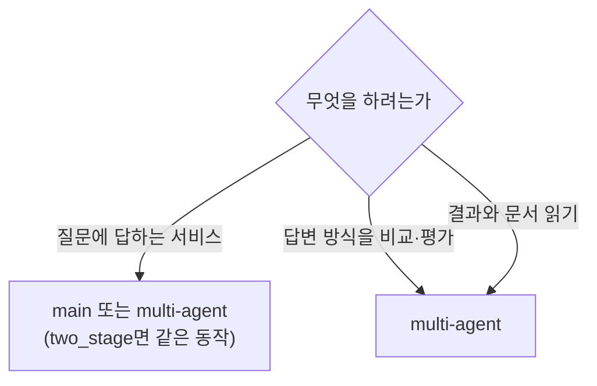

# 08. 버전과 branch

> 이 문서에서 알게 되는 것 
    1. 버전(1.0 / 1.1.0 / 1.2.0 / 1.3.0 / 1.3.1 / 1.3.2 / 1.4.0)마다 무엇이 달라졌는가 
    2. branch(`main` / `multi-agent`)가 어떻게 다른가 
    3. 어느 버전 / branch를 써야 하는가

## 버전

| 버전 | 한 줄 요약 | tag | 확정일(tag commit 날짜) |
|---|---|---|---|
| 1.0 | 팀 프로젝트에 전용 loader, 계층 chunking, 답변 전략 두 가지(`two_stage`, `multi_agent`)를 붙이고 비교 실험을 설계했다 | `v1.0` | 2026-10-31 |
| 1.1.0 | 검색과 답변 단계의 결함을 측정해서 고쳤다 | `v1.1.0` | 2026-11-02 |
| 1.2.0 | 채점 규칙을 명시한 v2로 바꿔 모든 칸을 다시 채점했다 | `v1.2.0` | 2026-11-03 |
| 1.3.0 | 엑셀에서 출발하는 metadata 단계를 넣고 DB를 다시 만들었다 | `v1.3.0` | 2026-11-24 |
| 1.3.1 | parser(계층 추출)의 기본 모델을 `gpt-oss:20b`로 바꾸고, 전처리 LLM 사용 그림을 문서에 넣었다 | `v1.3.1` | 2026-11-25 |
| 1.3.2 | 채운 metadata를 덮어쓰지 않도록 build 순서를 고쳤다 | `v1.3.2` | 2026-11-25 |
| 1.4.0 | 채점기를 바로잡아 맞는 답의 감점을 줄이고, 질의 비용을 재기 시작했다 | `v1.4.0` | 2026-11-28 |

### 1.1.0에서 고친 것

- 표 평탄화: header 없는 표와 병합된 2단 header가 뒤섞이던 문제
- 질문 키워드를 어간으로 정리하고, 기관명을 사전에 등록
- 후보 pool을 요청 수의 15배(최소 150)로 키우고 기관 필터를 기본으로 켬
- 기관 후보 추출 개선

### 1.2.0에서 한 것

- 첫 chunk에 문서 제목을 넣는 시도는 효과가 없어 되돌렸다.
- 스캔 PDF OCR(easyocr)은 코드를 남기되 **이 프로젝트의 범위 밖**으로 정했다.
- 채점 규칙 v2: 주된 값 기준, 거부 답변은 Faithfulness에서 제외([채점 규칙](judge_rules.md)).
- 순위 지표(MRR)를 보조로 추가했다.

### 1.3.0에서 한 것

- metadata 단계: 엑셀(나라장터 입찰공고목록)을 하나의 출처로 `data_index/metadata.csv`를 만든다([metadata](10_메타데이터.md)).
- 기관명 사전은 이 CSV에서만 만들고, `OO 중학교`와 `OO중학교`처럼 띄어쓰기가 달라도 인식한다.
- 엑셀에 없는 값(사업 금액, 입찰마감일시)은 Claude가 문서에서 찾아 채우고 근거를 남긴다.
- DB의 `org`와 `project_name`을 CSV에서 읽는다. 5건이 바뀌었고 chunk 본문은 1.2와 같다(1,207개).
- 질의 쪽 loader가 `metadata.csv`를 팀 열 이름으로 잘못 읽던 문제를 고쳤다.
- 당시 40문항 점수(실행 `v13b`, `v13c`)는 [07 결과](07_결과.md)의 "이전 실행의 점수"에 있다.
- OCR 문서는 포함하지 않았다.
- 1.2는 `release/1.2` branch로 따로 남겼다.

### 1.3.1에서 한 것

- parser(skill, service)와 이 저장소의 parser 호출 기본 모델을 `qwen3.5:9b`에서 `gpt-oss:20b`로 바꿨다.
- 계층 추출은 항상 gpt-oss(local 또는 사용자가 지정한 backend)를 쓴다.
- 코드는 1.3.0과 같게 동작한다. 점수는 당시 새로 측정하지 않았다.

### 1.3.2에서 한 것

- metadata는 한 번 만들고 채운 뒤에는 다시 만들지 않는다.
  - 채운 값이 있는 CSV는 덮어쓰지 않고 멈춘다(`--rebuild`로만 다시 만든다).
  - build는 CSV가 있으면 metadata 단계를 건너뛴다.
- build 순서(parsing, metadata, DB)를 끝까지 돌려 확인했다. chunk 1,207개와 `org`, `project_name`이 1.3.0 DB와 같다.
- 점수는 당시 새로 측정하지 않았다.

### 1.4.0에서 한 것

**채점기** ([채점 규칙](judge_rules.md), [채점기 개선](judge_improvement.md))

- 승인 없이 늘어난 채점 규칙을 빼고, 팀 rubric에 승인받은 추가 기준 4개를 붙인 `v6`로 정리했다.
- 채점 context의 chunk마다 답변 모델이 받는 것과 같은 머리글(공고명, 문서, 쪽, 기관명)을 붙였다.
- 추가 기준 4: 질문의 이름과 context의 공고명이 달라도 그것만으로 다른 문서로 보지 않는다.
- 검색 지표를 팀의 지표로 계산하고, chunk를 보지 않고 만든 답은 chunk Recall에서 뺀다.
- 실행마다 점수와 비용을 `eval_resources/eval_history.jsonl`에 남기고, 문항별 채점 입력과 결과를 HTML 보고서로 만든다.

**그 밖**

- 목록에 있는 답이 후처리에서 잘리던 문제를 고쳤다([수정 기록](BUGFIXES.md)).
- 질문의 시간과 token을 Langfuse에 남기고 비용을 잰다([측정 방법](11_비용측정.md)).
- DB는 바꾸지 않았다. 점수와 비용은 [07 결과](07_결과.md)의 "현재 결과"(`eval_20261128`)다.
- 채점 기준이 바뀌었으므로 1.3 이전의 점수와 비교하지 않는다.

다음 버전은 **답이 잘리거나 없는 경우**만 손볼 계획이다(요청이 있을 때).

## branch

| | `multi-agent` | `main` |
|---|---|---|
| 성격 | 최신, 모든 것이 들어 있다 | 기본 `two_stage` 경로만 |
| 답변 방식 | `two_stage` + `multi_agent` | `two_stage` |
| 평가 도구와 결과 문서 | 있다 | 없다 |
| Gradio 화면 | `multi_agent` 고정 | 있다(같은 인증 방식) |
| 이런 때 | 평가를 다시 돌리거나 결과를 볼 때 | 검색·답변 코드만 가져다 쓸 때 |

- 검색, chunking, 표 처리 같은 **process 변경은 두 branch에 모두** 반영한다.
- GitHub 기본 branch는 `multi-agent`다.
- `main`에도 같은 문서가 있지만, 상단 안내처럼 `multi_agent`와 평가 도구는 없다.

## 어느 쪽을 쓰나

- 40문항에서 `two_stage`와 `multi_agent`의 점수 차이는 구분되지 않았다([결과](07_결과.md)).
- `multi_agent`는 질문을 쪼개 LLM을 여러 번 부른다.
- 그래서 단순하게 쓰려면 `two_stage`, 평가나 화면 시연에는 `multi_agent`를 쓴다.
