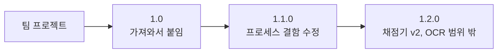
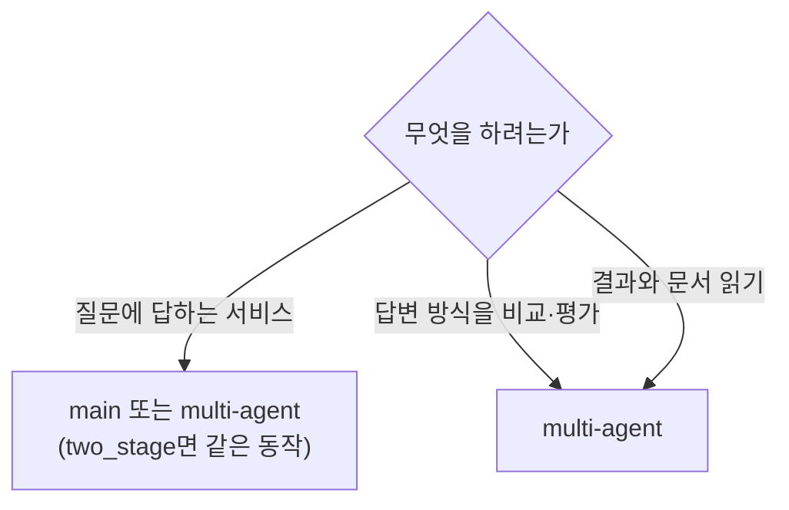

# 08. 버전과 브랜치

> 이 문서에서 알게 되는 것 
    1. 버전(1.0 / 1.1.0 / 1.2.0)마다 무엇이 달라졌는가 
    2. 브랜치(`main` / `multi-agent`)가 어떻게 다른가 
    3. 어느 버전 / 브랜치를 써야 하는가

## 버전

| 버전 | 한 줄 요약 | 태그 | 확정일 |
|---|---|---|---|
| 1.0 | 팀 프로젝트에 전용 로더, 계층 청킹, 답변 전략 두 가지(`two_stage`, `multi_agent`)를 붙이고 비교 실험을 설계했다 | `v1.0` | 2026-11-02 |
| 1.1.0 | 검색과 답변 단계의 결함을 측정해서 고쳤다 | `v1.1.0` | 2026-11-02 |
| 1.2.0 | 채점 규칙을 명시한 v2로 바꿔 모든 칸을 다시 채점했다 | `v1.2.0` | 2026-11-03 |

### 1.1.0에서 고친 것

- 표 평탄화: 헤더 없는 표와 병합된 2단 헤더가 뒤섞이던 문제
- 질문 키워드를 어간으로 정리하고, 기관명을 사전에 등록
- 후보 풀을 요청 수의 15배(최소 150)로 키우고 기관 필터를 기본으로 켬
- 기관 후보 추출 개선

### 1.2.0에서 한 것

- 첫 청크에 문서 제목을 넣는 시도는 효과가 없어 되돌렸다.
- 스캔 PDF OCR(easyocr)은 코드를 남기되 **이 프로젝트의 범위 밖**으로 정했다.
- 채점 규칙 v2: 주된 값 기준, 거부 답변은 Faithfulness에서 제외([채점 규칙](judge_rules.md)).
- 순위 지표(MRR)를 보조로 추가했다.

다음 버전은 **답이 잘리거나 없는 경우**만 손볼 계획이다(요청이 있을 때).

## 브랜치

| | `multi-agent` | `main` |
|---|---|---|
| 성격 | 최신, 모든 것이 들어 있다 | 기본 `two_stage` 경로만 |
| 답변 방식 | `two_stage` + `multi_agent` | `two_stage` |
| 평가 도구와 결과 문서 | 있다 | 없다 |
| Gradio 화면 | `multi_agent` 고정 | 있다(같은 인증 방식) |
| 이런 때 | 평가를 다시 돌리거나 결과를 볼 때 | 검색·답변 코드만 가져다 쓸 때 |

- 검색, 청킹, 표 처리 같은 **프로세스 변경은 두 브랜치에 모두** 반영한다.
- GitHub 기본 브랜치는 `multi-agent`다.
- `main`에도 같은 문서가 있지만, 상단 안내처럼 `multi_agent`와 평가 도구는 없다.

## 어느 쪽을 쓰나

- 40문항에서 `two_stage`와 `multi_agent`의 점수 차이는 구분되지 않았다([결과](07_결과.md)).
- `multi_agent`는 질문을 쪼개 LLM을 여러 번 부른다.
- 그래서 단순하게 쓰려면 `two_stage`, 평가나 화면 시연에는 `multi_agent`를 쓴다.
