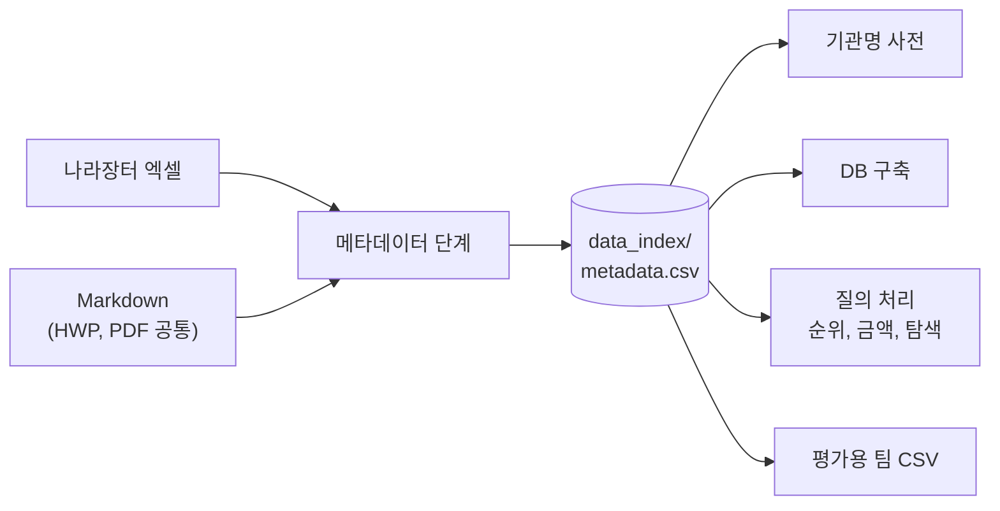

# 10. 메타데이터 단계 (설계 초안)

> 이 문서에서 알게 되는 것 
> &nbsp;&nbsp;&nbsp;&nbsp;1. 메타데이터가 어디서 시작해서 누가 읽는가 
> &nbsp;&nbsp;&nbsp;&nbsp;2. `data_index/metadata.csv`의 열 
> &nbsp;&nbsp;&nbsp;&nbsp;3. 아직 정하지 못한 것

**상태: 설계 중이다. 코드는 아직 바뀌지 않았다.**

## 원칙

1. 메타데이터는 **나라장터 엑셀**에서 출발한다.
2. 엑셀의 값은 버리지 않는다.
3. **엑셀에 없는 열만** 문서(Markdown)에서 채운다.
4. 기관명 사전은 이 CSV에서만 만든다.
5. 문서와 엑셀 행은 `파일명` 열로 연결한다.

## 흐름

- 입력이 Markdown이라서 HWP와 PDF를 같은 규칙으로 다룬다.
- 파서(skill, service)는 HWP/HWPX를 Markdown으로 바꾸는 일만 한다.

## `metadata.csv`의 열

| 열 | 출처 | 비고 |
|---|---|---|
| 업무구분 | 엑셀 | 그대로 |
| 업무여부 | 엑셀 | 그대로 |
| 구분 | 엑셀 | 그대로 |
| 입찰공고번호 | 엑셀 | `R26BK01672953-000`처럼 차수 포함 그대로 |
| 공고명 | 엑셀 | 그대로 |
| 공고기관 | 엑셀 | 그대로 |
| 수요기관 | 엑셀 | 그대로 |
| 게시일시 | 엑셀 | `게시일시(입찰마감일시)`의 앞부분 |
| 입찰마감일시 | 엑셀, 없으면 문서 | 괄호 안 값. `-`이면 문서에서 찾는다 |
| 사업 금액 | 엑셀, 없으면 문서 | 규칙으로 뽑는다 |
| 사업 요약 | 비워 둔다 | 열만 만든다 |
| 파일명 | 매칭 결과 | 문서와 이 행을 잇는 열 |
| 근거 | 문서에서 채운 열마다 | 예: 어떤 값을 어디서 가져왔는가 |

- 원본 문자열 `게시일시(입찰마감일시)`는 남기지 않는다.
- 게시일시는 중요하지 않아서 비어 있어도 문서에서 찾지 않는다.
- 입찰마감일시는 입찰 가능 여부를 가르는 값이라 비면 반드시 문서에서 찾는다.
- 문서에도 없으면 빈 값으로 두고, 만들어 넣지 않는다.

## 정한 것

| 항목 | 결정 |
|---|---|
| 위치 | `data_index/metadata.csv` |
| 날짜 열 | 게시일시와 입찰마감일시, 원본 문자열은 버린다 |
| 사업 요약 | 열만 만들고 비워 둔다 |

## 아직 정하지 못한 것

- `근거`를 열 하나에 담을지, 열마다 따로 둘지
- 파일명 매칭 방식(공고명 접두사 규칙을 그대로 쓸지, 공고번호를 파일 이름에 넣을지)
- 사업 금액과 마감일시를 문서에서 뽑는 규칙(정규식, LLM)
- DB의 `org`, `project_name`을 이 CSV에서 읽을지(DB 재구축이 필요하다)
