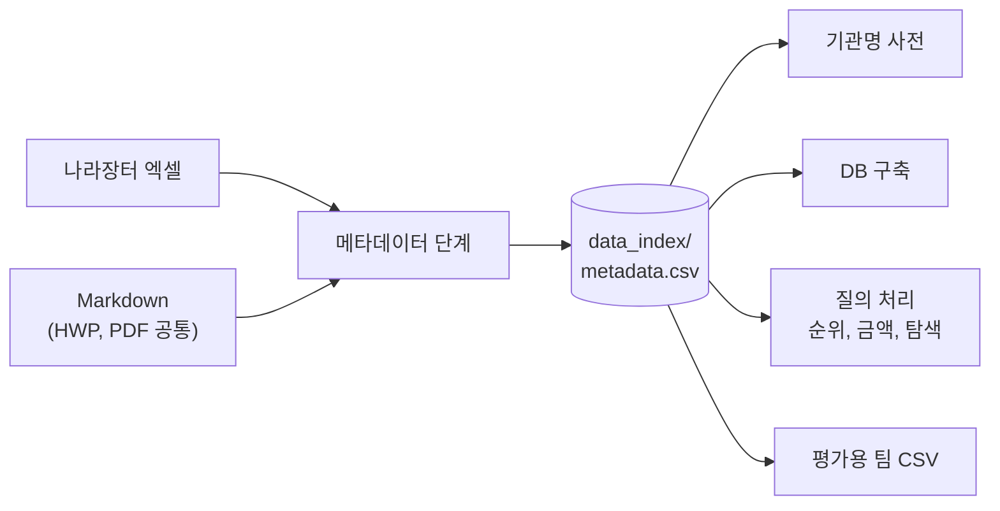
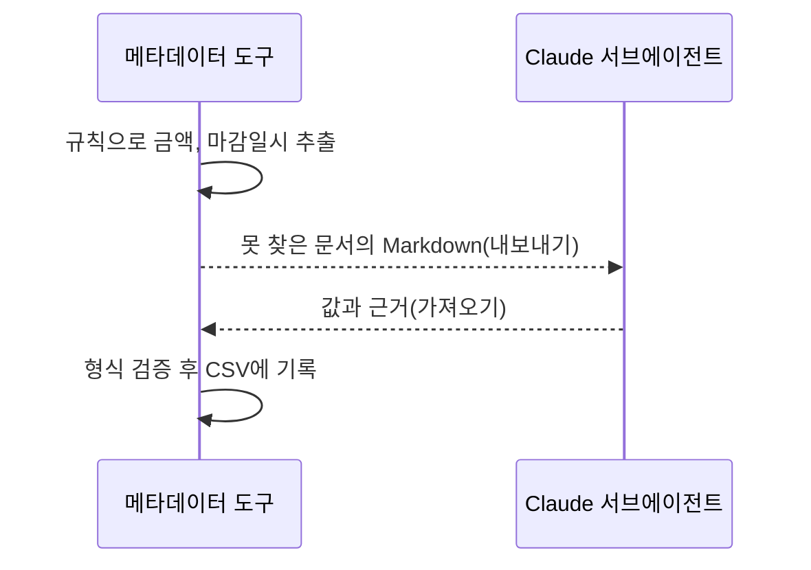

# 10. 메타데이터 단계 (설계 초안)

> 이 문서에서 알게 되는 것 
    1. 메타데이터가 어디서 시작해서 누가 읽는가 
    2. `data_index/metadata.csv`의 열 
    3. 아직 정하지 못한 것

**상태: 설계 중이다. 코드는 아직 바뀌지 않았다.**

## 원칙

1. 메타데이터는 **나라장터 엑셀**에서 출발한다.
2. 엑셀의 값은 버리지 않는다.
3. **엑셀에 없는 열만** 문서(Markdown)에서 채운다.
4. 기관명 사전은 이 CSV에서만 만든다.
5. 문서와 엑셀 행은 `파일명` 열로 연결한다.

## 흐름

- 입력이 Markdown이라서 HWP와 PDF를 같은 규칙으로 다룬다.
- 파서(skill, service)는 HWP/HWPX를 Markdown으로 바꾸는 일만 한다.

## `metadata.csv`의 열

| 열 | 출처 | 비고 |
|---|---|---|
| 업무구분 | 엑셀 | 그대로 |
| 업무여부 | 엑셀 | 그대로 |
| 구분 | 엑셀 | 그대로 |
| 입찰공고번호 | 엑셀 | `R26BK01672953-000`처럼 차수 포함 그대로 |
| 공고명 | 엑셀 | 그대로 |
| 공고기관 | 엑셀 | 그대로 |
| 수요기관 | 엑셀 | 그대로 |
| 게시일시 | 엑셀 | `게시일시(입찰마감일시)`의 앞부분 |
| 입찰마감일시 | 엑셀, 없으면 문서 | 괄호 안 값. `-`이면 문서에서 찾는다 |
| 사업 금액 | 엑셀, 없으면 문서 | 규칙으로 뽑는다 |
| 사업 요약 | 비워 둔다 | 열만 만든다 |
| 파일명 | 매칭 결과 | 문서와 이 행을 잇는 열 |
| 사업 금액 근거 | 문서에서 채운 경우 | 어떤 값을 문서 어디서 가져왔는가 |
| 입찰마감일시 근거 | 문서에서 채운 경우 | 같음 |

- 원본 문자열 `게시일시(입찰마감일시)`는 남기지 않는다.
- 게시일시는 중요하지 않아서 비어 있어도 문서에서 찾지 않는다.
- 입찰마감일시는 입찰 가능 여부를 가르는 값이라 비면 반드시 문서에서 찾는다.
- 문서에도 없으면 빈 값으로 두고, 만들어 넣지 않는다.

## 정한 것

| 항목 | 결정 |
|---|---|
| 위치 | `data_index/metadata.csv` |
| 날짜 열 | 게시일시와 입찰마감일시, 원본 문자열은 버린다 |
| 사업 요약 | 열만 만들고 비워 둔다 |
| 근거 | 문서에서 채운 열마다 `<열> 근거` 열을 둔다 |
| 파일명 매칭 | 지금 방식(공고명이 파일 이름 앞부분과 같은 파일)을 유지한다. 실제 질문이 공고명 기준이기 때문이다. 매칭 안 되는 행이나 주인 없는 파일이 있으면 목록을 보여 주고 멈춘다 |
| 문서에서 뽑는 방법 | 규칙(정규식, 표 라벨)이 먼저, 못 찾으면 **Claude나 GPT-5급 최신 LLM·에이전트**가 읽는다 |
| gpt-oss의 역할 | 서비스 시 답변 생성에 쓴다. 메타데이터 추출에는 쓰지 않는다(파서의 기존 작업은 그대로) |
| DB 범위 | `org`, `project_name`을 CSV에서 읽는 변경도 범위에 넣는다. 커밋은 CSV·사전 단계와 DB 단계로 나눈다 |

## 에이전트가 값을 채우는 방식

규칙으로 못 찾은 값은 Claude가 채운다.

- API 키를 쓰지 않으므로 코드가 LLM을 직접 부르지 않는다.
- 채점(`claude_judge.py`)처럼 내보내기와 가져오기 두 단계로 나눈다.

## 파서는 그대로 둔다

- 파서(skill, service)의 기존 작업은 **바꾸지 않는다.**
  - 헤더 계층 판단(Pass 1b)도 지금처럼 파서 안에서 한다.
- 메타데이터 단계는 파서가 만든 Markdown을 **읽기만** 한다.
- 규칙으로 못 찾은 메타데이터 값(사업 금액, 입찰마감일시 등 애매한 부분)만 Claude가 문서를 보고 판단한다.
- 그래서 파서 출력과 `doc_id`는 바뀌지 않고, 이 때문에 DB를 새로 만들 일은 `org`, `project_name` 변경에서만 생긴다.

## 아직 정하지 못한 것

- 금액과 마감일시를 뽑는 규칙의 세부(어떤 표 라벨과 문구를 먼저 볼지)
- CSV 열 순서
