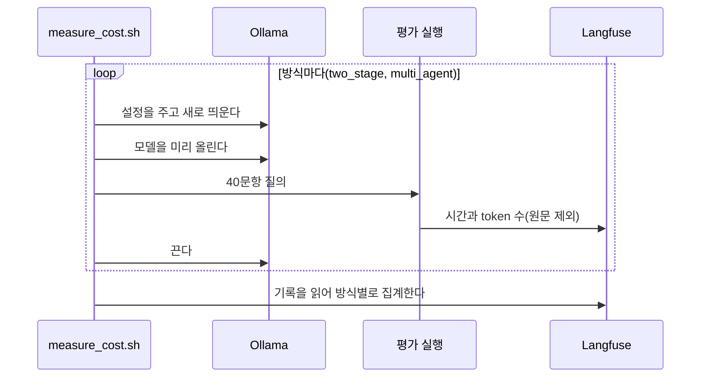

# 11. 질의 비용 측정 방법

> 이 문서에서 알게 되는 것</br>
    1. 여기서 말하는 비용이 무엇인가</br>
    2. 어떤 환경과 설정으로 재는가(개발 환경의 GPU 메모리)</br>
    3. 어떻게 재는가</br>
    4. 환산 요금을 어떻게 계산하는가

**측정값(시간, token, 환산 요금)은 [07 결과](07_결과.md)의 "현재 결과"에만 적는다.**
이 문서는 방법만 다룬다.

> 측정 script(`scripts/measure_cost.sh`, `scripts/cost_report.py`)와 `multi_agent` 방식은 `multi-agent` branch에 있다.
> `main`에는 Langfuse 기록 코드와 모델 설정만 있다.

## 비용이란

답변 모델이 local(`gpt-oss:20b`)이라 실제로 청구되는 호출 요금은 없다.
같은 모델을 유료 API로 쓸 때의 요금은 환산해서 본다.

그래서 비용은 세 가지로 본다.

| 비용 | 재는 값 |
|---|---|
| 시간 | 질문 한 건이 끝날 때까지 걸린 시간, LLM 호출마다 걸린 시간 |
| context | LLM에 넣은 token(입력)과 받은 token(출력), 한 호출이 context 크기를 얼마나 쓰는가 |
| 환산 요금 | 잰 token 수에 유료 제공처의 token 단가를 곱한 값 |

범위는 **질의 처리**다. DB를 만들 때의 parser 호출과 채점은 재지 않는다.

## 개발 환경과 설정

| 항목 | 값 |
|---|---|
| GPU | NVIDIA GeForce RTX 4060 Laptop, **VRAM 8GB**(8,188MiB) |
| CPU, 메모리 | AMD Ryzen 7 8845HS, 약 19.5GiB |
| 실행 환경 | WSL2 container, driver 591.44, Ollama 0.32.14 |

**시간 측정값은 VRAM 8GB라는 개발 환경에 묶여 있다.**

- 모델 가중치만 약 12GB라서 8GB에 다 올라가지 않는다.
- Ollama가 일부를 CPU 메모리에 두고 계산한다(25개 층 중 19개는 가중치 일부가 CPU에 남았다). 그래서 응답이 느리다.
- VRAM이 충분한 환경에서는 시간이 크게 달라진다.

### 측정에 쓴 설정

| 설정 | 값 | 이유 |
|---|---|---|
| `OLLAMA_CONTEXT_LENGTH` | 32768 | 저장소의 기존 실행 설정이다 |
| `OLLAMA_NUM_PARALLEL` | 1 | 기존 실행 설정이다 |
| GPU에 비워 두는 여유 | Ollama 기본값(1024MiB) | 바꾸지 않았다 |
| `num_batch` | 256 | 아래 "306token 충돌"을 피한다([Modelfile](../experiments/Modelfile.batch256)) |
| embedding | 저장소 코드 그대로 | 검색은 CPU에서 돌고, 기관명 순위 계산이 같은 모델을 GPU에 한 번 더 올린다 |

- GPU 사용량은 2초 간격으로 기록하고, 최댓값은 07에 적는다.
- 별도 실행에서 평가 process가 끝나자 595MiB가 줄었다.

### 306token 충돌

기본값 `num_batch` 512에서, **입력이 정확히 306token인 요청**이 `CUDA error: an illegal memory access`로 실패했다.

| 조건 | 결과 |
|---|---|
| 내용이 다른 306token 요청 | 실패 |
| 256, 257, 290, 305, 307, 320, 562, 818token | 성공 |
| `num_batch` 256 또는 128로 306token | 성공 |
| CPU만 사용 | 성공(103.3초) |
| CPU 계산 코드를 AMD용(`zen4`)에서 Intel용(`cooperlake`, `haswell`)으로 교체 | 실패 |

- 시험한 길이 밖에서도 충돌할 수 있다.
- 내부 원인은 확인하지 못했다. 이 환경 한 대에서만 시험했다.

### 시험했지만 쓰지 않은 설정

GPU에 더 많이 올리려고 context 8192, GPU 여유 256MiB, embedding GPU 한 벌을 함께 시험했다.

| 항목 | 측정에 쓴 설정 | 시험한 설정 |
|---|---|---|
| GPU에 올라간 가중치 | 5,026MiB | 6,374MiB |
| 출력 생성(token/초, 별도 시험 입력) | 23.5 | 26.9 |
| 40문항 총 시간 `two_stage` / `multi_agent` | 1,436 / 1,191초 | 1,332 / 1,015초 |

- 빨라졌지만 일부 답이 달라졌고, 그중 `two_stage` 2문항(`m1`, `n4`)은 맞던 답이 틀려졌다. 그래서 원래 설정으로 되돌렸다.
- 위 시간은 설정을 고를 때의 시험값이다. 모델을 미리 올리지 않고 재서 07의 측정값과 견주지 않는다.
- 어느 설정 때문에 답이 달라졌는지는 가르지 않았다.
  - 틀려진 답은 목록에 있는 답이 후처리에서 잘린 결과였고, 그 문제는 이후에 고쳤다([수정 기록](BUGFIXES.md)).

## 측정 방법

**warm start**로 잰다. 모델을 GPU에 미리 올려 둔 상태에서 질의를 시작한다.



1. `.env`에 Langfuse 키와 지역 주소를 넣는다(`.env.example` 참고).
2. 실행 중인 Ollama를 끈다. 떠 있으면 script가 멈춘다.
3. 저장소 폴더에서 실행한다.

```bash
PYTHON=python bash scripts/measure_cost.sh <실행 이름>          # 두 방식, 40문항씩
LIMIT=1 PYTHON=python bash scripts/measure_cost.sh <실행 이름>  # 2문항씩 시험
python scripts/cost_report.py --run-id <실행 이름> --systems current_default current_multi_agent --context 32768  # 집계만 다시
```

- 측정하는 동안에는 같은 컴퓨터에서 다른 작업을 하지 않는다. 모델 일부가 CPU에서 돌아, CPU를 쓰는 작업이 시간에 섞인다.
- 방식마다 Ollama를 새로 띄운다. 앞 방식의 prompt cache가 다음 방식의 시간을 줄이지 않게 하려는 것이다.
- 모델을 미리 올려, 첫 문항의 시간에 모델 load 시간이 섞이지 않게 한다.
- 검색용 embedding 모델은 평가 process가 시작할 때 올라간다. 기관명 순위용 GPU 사본은 처음 필요한 문항에서 올라가서, 그 문항의 시간에 포함된다.
- 결과는 `eval_resources/experiment_runs/<실행 이름>/`에 남는다(git 제외). 집계는 `cost_report.json`, GPU 사용량은 `<방식>_gpu.csv`다.

### Langfuse에 남기는 것

| 단위 | 남기는 값 |
|---|---|
| 질문 한 건 | 전체 시간, 단계별 시간, LLM 호출 수, token 합, 가장 큰 입력, 문항 식별자 |
| LLM 호출 한 번 | 시간, 모델 이름, 입력과 출력 token, prompt 글자 수, 종료 사유 |

- 질문, 근거, 답변, 오류 메시지 원문은 보내지 않는다.
- SDK가 붙이는 부가 정보(SDK 버전, public key 등)는 함께 저장된다.
- Langfuse의 단계별 시간은 합이 전체 시간과 맞지 않는 경우가 있어 쓰지 않는다. 07의 단계별 지연시간은 실행 기록의 `latencies`다.

## 환산 요금

단가는 Groq의 `openai/gpt-oss-20b` 기준이다. 입력 100만 token에 $0.075, 출력 100만 token에 $0.30이다([Groq 모델 문서](https://console.groq.com/docs/model/openai/gpt-oss-20b), 2026-11-27 확인).

- 계산식은 `(입력 token × 0.075 + 출력 token × 0.30) ÷ 1,000,000`이다.
- token 수는 Langfuse 기록에서 가져온다.
- 추정값이다. 실제 청구액이 아니다.
  - 입력 cache 할인은 넣지 않는다.
  - 제공처에서는 token 수와 답의 길이가 local 실행과 다를 수 있다.
  - embedding, DB 구축, 채점, local 전기 요금은 들어 있지 않다.

### Langfuse의 요금 표시

- 위 단가를 Langfuse project의 모델 가격 정의로 등록했다(2026-11-27).
  - 이름은 `gpt-oss-20b (Groq price estimate)`, 패턴은 `(?i)^gpt-oss:20b(-batch256)?$`다.
- 등록한 뒤의 기록에는 요금이 계산된다.
  - `eval_20261127`과 `eval_20261128`의 LLM 호출(실행마다 221번) 모두에 요금이 붙었고, 합이 위 계산식의 값과 같았다.
  - 등록 전의 기록에는 요금이 없다.
- 다른 Langfuse project에는 같은 정의를 따로 등록해야 한다. 기본 가격 정의에는 `gpt-oss`가 없고, 코드는 token 수만 보낸다.

## 조심할 점

- 한 번 잰 값은 흔들린다. 답과 token 합이 모두 같은 두 실행에서도 총 시간이 2.7% 달랐다(`multi_agent`, `cost_warm`과 `cost_listfix`).
- 답이 매번 같지 않아 출력 token과 시간이 실행마다 달라진다. 답이 일부 다른 두 실행(`eval_20261127`, `eval_20261128`)의 총 시간 차이는 `two_stage` 2.6%, `multi_agent` 0.9%였다.
- 답의 정확도는 이 측정이 재지 않는다. 같은 실행의 답을 따로 채점한다([평가](06_평가.md)).
