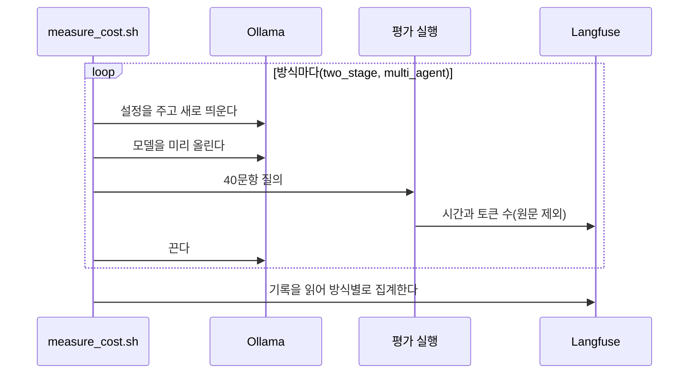

# 11. 질의 비용 측정

> 이 문서에서 알게 되는 것</br>
    1. 여기서 말하는 비용이 무엇인가</br>
    2. 어떤 환경과 설정으로 쟀는가(개발 환경의 GPU 메모리)</br>
    3. 어떻게 재는가</br>
    4. 방식별 비용과 결과를 읽을 때 조심할 점

> 측정 스크립트(`scripts/measure_cost.sh`, `scripts/cost_report.py`, `scripts/run_experiment.py`)와 `multi_agent` 방식은 `multi-agent` 브랜치에 있다.
> `main`에는 Langfuse 기록 코드와 모델 설정만 있다.

## 비용이란

답변 모델이 로컬(`gpt-oss:20b`)이라 호출 요금은 없다.

그래서 비용은 두 가지로 본다.

| 비용 | 재는 값 |
|---|---|
| 시간 | 질문 한 건이 끝날 때까지 걸린 시간, LLM 호출마다 걸린 시간 |
| 컨텍스트 | LLM에 넣은 토큰(입력)과 받은 토큰(출력), 한 호출이 컨텍스트 크기를 얼마나 쓰는가 |

범위는 **질의 처리**다. DB를 만들 때의 파서 호출과 채점은 재지 않는다.

## 개발 환경과 설정

| 항목 | 값 |
|---|---|
| GPU | NVIDIA GeForce RTX 4060 Laptop, **VRAM 8GB**(8,188MiB) |
| CPU, 메모리 | AMD Ryzen 7 8845HS, 약 19.5GiB |
| 실행 환경 | WSL2 컨테이너, 드라이버 591.44, Ollama 0.32.14 |

**시간 측정값은 VRAM 8GB라는 개발 환경에 묶여 있다.**

- 모델 가중치만 약 12GB라서 8GB에 다 올라가지 않는다.
- Ollama가 일부를 CPU 메모리에 두고 계산한다(25개 층 중 19개는 가중치 일부가 CPU에 남았다). 그래서 응답이 느리다.
- VRAM이 충분한 환경에서는 시간이 크게 달라진다.

### 측정에 쓴 설정

| 설정 | 값 | 이유 |
|---|---|---|
| `OLLAMA_CONTEXT_LENGTH` | 32768 | 저장소의 기존 실행 설정이다 |
| `OLLAMA_NUM_PARALLEL` | 1 | 기존 실행 설정이다 |
| GPU에 비워 두는 여유 | Ollama 기본값(1024MiB) | 바꾸지 않았다 |
| `num_batch` | 256 | 아래 "306토큰 충돌"을 피한다([Modelfile](../experiments/Modelfile.batch256)) |
| 임베딩 | 저장소 코드 그대로 | 검색은 CPU에서 돌고, 기관명 순위 계산이 같은 모델을 GPU에 한 번 더 올린다 |

- 측정 중 GPU 사용량은 6,121\~6,720MiB였다(2초 간격 기록).
- 별도 실행에서 평가 프로세스가 끝나자 595MiB가 줄었다.

### 306토큰 충돌

기본값 `num_batch` 512에서, **입력이 정확히 306토큰인 요청**이 `CUDA error: an illegal memory access`로 실패했다.

| 조건 | 결과 |
|---|---|
| 내용이 다른 306토큰 요청 | 실패 |
| 256, 257, 290, 305, 307, 320, 562, 818토큰 | 성공 |
| `num_batch` 256 또는 128로 306토큰 | 성공 |
| CPU만 사용 | 성공(103.3초) |
| CPU 계산 코드를 AMD용(`zen4`)에서 Intel용(`cooperlake`, `haswell`)으로 교체 | 실패 |

- 시험한 길이 밖에서도 충돌할 수 있다.
- 내부 원인은 확인하지 못했다. 이 환경 한 대에서만 시험했다.

### 시험했지만 쓰지 않은 설정

GPU에 더 많이 올리려고 컨텍스트 8192, GPU 여유 256MiB, 임베딩 GPU 한 벌을 함께 시험했다.

| 항목 | 측정에 쓴 설정 | 시험한 설정 |
|---|---|---|
| GPU에 올라간 가중치 | 5,026MiB | 6,374MiB |
| 출력 생성(토큰/초, 별도 시험 입력) | 23.5 | 26.9 |
| 40문항 총 시간 `two_stage` / `multi_agent` | 1,436 / 1,191초 | 1,332 / 1,015초 |

- 빨라졌지만 일부 답이 달라졌고, 그중 `two_stage` 2문항(`m1`, `n4`)은 맞던 답이 틀려졌다. 그래서 원래 설정으로 되돌렸다.
- 위 시간은 두 설정 모두 모델을 미리 올리지 않고 잰 값이다. 아래 "결과"와는 측정 방법이 다르다.
- 어느 설정 때문에 답이 달라졌는지는 가르지 않았다.
  - 틀려진 답은 목록에 있는 답이 후처리에서 잘린 결과였고, 그 문제는 이후에 고쳤다([수정 기록](BUGFIXES.md)).

## 측정 방법

**웜 스타트**로 잰다. 모델을 GPU에 미리 올려 둔 상태에서 질의를 시작한다.



1. `.env`에 Langfuse 키와 지역 주소를 넣는다(`.env.example` 참고).
2. 실행 중인 Ollama를 끈다. 떠 있으면 스크립트가 멈춘다.
3. 저장소 폴더에서 실행한다.

```bash
PYTHON=python bash scripts/measure_cost.sh <실행 이름>          # 두 방식, 40문항씩
LIMIT=1 PYTHON=python bash scripts/measure_cost.sh <실행 이름>  # 2문항씩 시험
python scripts/cost_report.py --run-id <실행 이름> --systems current_default current_multi_agent --context 32768  # 집계만 다시
```

- 방식마다 Ollama를 새로 띄운다. 앞 방식의 프롬프트 캐시가 다음 방식의 시간을 줄이지 않게 하려는 것이다.
- 모델을 미리 올려, 첫 문항의 시간에 모델 로드 시간이 섞이지 않게 한다.
- 검색용 임베딩 모델은 평가 프로세스가 시작할 때 올라간다. 기관명 순위용 GPU 사본은 처음 필요한 문항에서 올라가서, 그 문항의 시간에 포함된다.
- 결과는 `eval_resources/experiment_runs/<실행 이름>/`에 남는다(git 제외). 집계는 `cost_report.json`, GPU 사용량은 `<방식>_gpu.csv`다.

### Langfuse에 남기는 것

| 단위 | 남기는 값 |
|---|---|
| 질문 한 건 | 전체 시간, 단계별 시간, LLM 호출 수, 토큰 합, 가장 큰 입력, 문항 식별자 |
| LLM 호출 한 번 | 시간, 모델 이름, 입력과 출력 토큰, 프롬프트 글자 수, 종료 사유 |

- 질문, 근거, 답변, 오류 메시지 원문은 보내지 않는다.
- SDK가 붙이는 부가 정보(SDK 버전, public key 등)는 함께 저장된다.
- 단계별 시간은 합이 전체 시간과 맞지 않는 경우가 있어 아래 결과에 쓰지 않았다.

## 결과

측정일 2026-11-26, 실행 이름 `cost_listfix`, 같은 질문 40개(문서 57건), 방식마다 한 번.

[목록에 있는 답의 후처리](05_질의처리.md)를 고친 코드로 쟀다.
측정 뒤에 반영한 줄 제한 수정은 LLM에 보내는 내용을 바꾸지 않는다.

| 항목 | `two_stage` | `multi_agent` |
|---|---|---|
| 총 시간 | 1,397.5초 | 1,189.1초 |
| 문항 평균 / 중앙값 / 최대 | 34.9 / 8.5 / 112.1초 | 29.7 / 8.1 / 115.0초 |
| LLM 호출 | 104 | 118 |
| LLM이 차지한 시간 | 98.6% | 98.4% |
| 호출 1회인 21문항 평균 | 7.4초 | 7.2초 |
| 호출 2회 이상인 19문항 평균 | 65.4초 | 54.6초 |
| 입력 토큰 합(문항 평균) | 144,093 (3,602) | 69,677 (1,742) |
| 출력 토큰 합(문항 평균) | 22,458 (561) | 22,371 (559) |
| 한 호출의 최대 입력 + 출력 | 4,946 (32768의 15%) | 3,916 (12%) |
| 실패한 호출, 답변 오류 | 0, 0 | 0, 0 |
| GPU 사용 최대 | 6,720MiB | 6,720MiB |

읽는 법:

- `multi_agent`는 호출이 14번 많지만 입력 토큰이 절반 이하(48%)이고, 총 시간이 15% 짧다.
- 시간은 거의 전부 LLM 호출에서 나온다. 검색을 빠르게 해도 총 시간은 크게 줄지 않는다.
- 호출 한 번으로 끝나는 문항은 두 방식의 비용이 거의 같다.
- 한 호출이 쓰는 토큰은 기본 컨텍스트(4096)를 넘는 경우가 있어, 기본값으로 띄우면 안 된다.

## 조심할 점

- 방식마다 한 번만 쟀다.
- 후처리를 고치기 전에 같은 방법으로 잰 값(`cost_warm`)과 비교하면 이렇다.

| 방식 | 총 시간 | 답 |
|---|---|---|
| `two_stage` | 1,376.4 → 1,397.5초 (+1.5%) | `n16`, `n17` 2문항만 달라졌다 |
| `multi_agent` | 1,157.5 → 1,189.1초 (+2.7%) | 40문항이 모두 같다 |

- `multi_agent`는 답과 토큰 합이 모두 같은데 시간이 2.7% 달랐다. 이 정도 차이는 잴 때마다 생기는 흔들림으로 본다.
- `two_stage`의 `n16`, `n17`은 목록 지시가 붙어 입력 토큰 합이 150 늘었다. 두 문항의 시간은 늘지 않았다(78 → 71초, 74 → 71초).
- 답의 정확도는 이 측정의 범위가 아니다. 달라진 `n16`, `n17`만 따로 채점했다([버그 수정 기록](BUGFIXES.md)).
- 점수를 보고한 `v13c` 실행은 `num_batch` 512였고 후처리도 고치기 전이다. 이 측정과는 `two_stage` 40문항 중 11문항의 답변 문장이 다르다. `n16`, `n17`을 뺀 9문항의 답은 채점하지 않았다.
