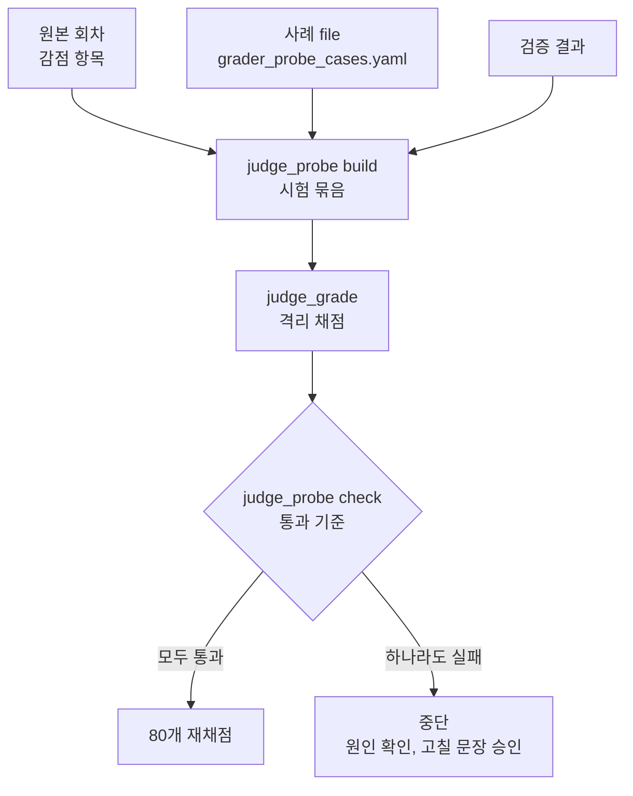

# 12. 채점기 시험

> 이 문서에서 알게 되는 것</br>
    1. 채점기를 왜, 언제 시험하는가</br>
    2. 시험 항목과 통과 기준</br>
    3. 시험을 돌리는 방법</br>
    4. 결과를 읽을 때 조심할 점

**시험에서 나온 점수는 답의 점수가 아니다.** 답과 context를 일부러 바꾼 항목이 섞여 있다.
07의 "현재 결과"에 넣지 않고, `claude_judge.py import`로 가져오지 않는다.

## 왜, 언제 시험하는가

채점 기준이나 지시문을 바꾸면 점수가 오를 수 있다.
그 이유가 "맞는 답을 깎던 것을 바로잡아서"인지, "틀린 답까지 봐줘서"인지는 점수만으로 알 수 없다.

그래서 80개를 다시 채점하기 전에, 틀리게 만든 항목을 섞어 채점기가 여전히 깎는지 확인한다.

| 언제 | 보기 |
|---|---|
| 채점 기준을 바꿀 때 | 추가 기준을 더하거나 고침 |
| 지시문을 바꿀 때 | 채점자나 검증자의 지시문([`.claude/agents/`](../.claude/agents/)) |
| 채점 입력이나 호출 방식을 바꿀 때 | context 구성, 검증 결과의 내용, 격리 방식 |

## 순서



1. 바꿀 기준이나 지시문의 **바꾸기 전과 후 원문**을 보이고 승인받는다.
2. 통과 기준과 기대하는 변화를 **채점하기 전에** 정한다.
3. 시험 묶음을 만들어 채점하고 판정한다.
4. 통과하면 80개를 다시 채점하고, [07 결과](07_결과.md)의 "점수를 갱신할 때" 순서를 따른다.

## 시험 항목과 통과 기준

| 항목 | 무엇을 바꾸나 | 통과 기준 | 판정 |
|---|---|---|---|
| context 바꿈 | 답은 그대로 두고 context만 다른 공고의 것으로 바꾼다 | Context relevance 3점 이하 | `check` |
| 값 바꿈 | 답의 금액, 날짜, 기간만 틀리게 바꾼다 | Correctness와 Faithfulness 3점 이하 | `check` |
| 감점 유지 | 바꾸지 않는다. 감점이 맞다고 판단한 항목이다 | 사례에 적은 축이 5점 미만 | `check` |
| 감점 항목 | 바꾸지 않는다. 원본 회차에서 감점된 나머지 항목이다 | 기준 없음. 변화를 읽는다 | 사람 |

### context 바꿈 8개

| 문항 | 방식 | 바꿔 넣은 context |
|---|---|---|
| `m8` | `two_stage` | 다른 기관의 다른 사업(`m7`의 것) |
| `m13` | `two_stage` | 값이 같은 다른 사업. 건축 공사 질문에 전기 공사(`n13`의 것) |
| `m19` | `two_stage` | 다른 기관의 무관한 사업(비교 문항 `n20`의 것) |
| `n4` | `two_stage` | 다른 학교의 같은 종류 공고(`n5`의 것) |
| `n15` | `two_stage` | 같은 기관, 같은 금액의 2지역 공고 |
| `n15` | `multi_agent` | 같은 기관, 같은 금액의 3지역 공고 |
| `n18` | `two_stage` | 같은 기관의 다른 금액 공고(`n19`의 것) |
| `n18` | `multi_agent` | 다른 기관의 다른 사업(`n15`의 것) |

### 값 바꿈 8개

모두 `two_stage`의 답이다.

| 문항 | 원래 값 | 바꾼 값 |
|---|---|---|
| `m3` | 770,250,000원 | 707,250,000원 |
| `n9` | 26,750,000원 | 29,750,000원 |
| `n11` | 228,081,000원 | 282,081,000원 |
| `n19` | 608,881,900원 | 680,881,900원 |
| `m4` | 2026년 12월 31일 | 2026년 11월 30일 |
| `m9` | 8월 12일 15:00 | 8월 17일 15:00 |
| `m10` | 10월 20일 \~ 22일 | 10월 27일 \~ 29일 |
| `m17` | 착공일로부터 60일 | 착공일로부터 90일 |

### 감점 유지 1개

| 문항 | 방식 | 남아야 하는 감점 | 이유 |
|---|---|---|---|
| `m1` | `two_stage` | Correctness, Faithfulness | 원문의 "예정가격"을 답이 "예산"으로 바꿔 썼다 |

## 돌리는 방법

저장소 최상위 폴더에서 실행한다. `claude` 명령(Claude Code)에 로그인돼 있어야 한다.

```bash
# 1. 시험 묶음 만들기: 원본 회차의 감점 항목 + 사례 file의 항목에 검증 결과를 붙인다
python scripts/judge_probe.py build \
    --source-round eval_resources/claude_judge/<원본 회차> \
    --verification eval_resources/claude_judge/<검증>/verification.json \
    --out-dir eval_resources/claude_judge/<시험 이름>

# 2. 격리 채점
python scripts/judge_grade.py --round-dir eval_resources/claude_judge/<시험 이름>

# 3. 판정: 하나라도 어긋나면 종료 code 1
python scripts/judge_probe.py check --round-dir eval_resources/claude_judge/<시험 이름>
```

`check`의 출력은 아래 모양이다.

```text
통과  context 바꿈: 8 / 8
통과  값 바꿈: 8 / 8
통과  감점 유지: 1 / 1
```

- `build`의 입력(원본 회차, 검증 결과, 사례 file)은 모두 git에 있어, 새로 clone한 저장소에서도 시험할 수 있다.
- 80개 재채점은 다르다. 저장한 답과 DB가 git에 없어, 그 둘이 있는 컴퓨터에서만 된다.

## 사례 file

[`eval_resources/grader_probe_cases.yaml`](../eval_resources/grader_probe_cases.yaml)에 적는다.

```yaml
context_swaps:
- id: m8
  system: current_default
  kind: 다른 기관·다른 사업 (m7의 context)
  context_from:          # 원본 회차의 다른 항목에서 context를 가져온다
    id: m7
    system: current_default
- id: n15
  system: current_default
  kind: 같은 기관·같은 금액 (1지역 질문에 2지역 공고)
  context: |-            # 평가 문항에 없는 공고는 context를 직접 적는다
    사업비: 약 1.0억 원 (100,000,000원)
altered_answers:
- id: m3
  system: current_default
  replace:               # [원래 글, 바꿀 글]
  - - 약 7.7억 원 (770,250,000원)
    - 약 7.1억 원 (707,250,000원)
keep_deducted:
- id: m1
  system: current_default
  axes:
  - correctness
  - faithfulness
```

`system`의 `current_default`는 `two_stage`, `current_multi_agent`는 `multi_agent`다.

## 결과를 읽을 때 조심할 점

🔴 **`check`는 세 가지만 판정한다**: "특정 감점이 사라져야 한다" 같은 기대 변화는 사람이 결과를 읽고 판정한다.</br>
🔴 **감점 항목의 변화는 흔들림이 섞인다**: 감점된 항목만 골라 다시 채점하면, 기준을 바꾸지 않아도 일부는 만점으로 돌아올 수 있다.</br>
🔴 **한 번의 시험이다**: 같은 입력도 채점마다 점수가 달라질 수 있다.</br>
🔴 **사례는 특정 실행의 답에 맞춰져 있다**: 값 바꿈의 원래 글은 `eval_20261128`의 답이다. 답을 새로 만들면 `build`가 "답에 그 글이 없다"며 멈출 수 있고, 사례를 고쳐야 한다.</br>
🔴 **시험을 통과해도 점수가 맞다는 뜻은 아니다**: 사람 채점과는 대조하지 않았다.

## 지난 시험

입력과 결과는 `eval_resources/claude_judge/<시험 이름>/`에 있다. 내용과 수치는 [채점 규칙](judge_rules.md)의 "채점기의 알려진 한계"를 본다.

| 시험 이름 | 날짜 | 시험한 것 | 채점 | `judge_probe.py`로 다시 만들기 |
|---|---|---|---|---|
| `probe_wrong_doc` | 2026-11-28 | context 바꿔 넣기(원본 검증 전) | subagent | 안 됨 |
| `probe_verify`, `probe_verify2` | 2026-11-28 | 원본 검증 | subagent | 안 됨 |
| `probe_v6_1` | 2026-11-28 | 추가 기준 3 | subagent | 안 됨 |
| `probe_v6_1b` | 2026-11-28 | 검증 지시 문장 | subagent | 안 됨 |
| `probe_v6_1c` | 2026-11-28 | 격리 채점, 값 바꿈 | 격리 | 안 됨 |
| `probe_v6_2` | 2026-11-29 | 추가 기준 5 | 격리 | ✅ 원본 `round25`, 검증 `verify02` |

"안 됨"인 시험은 묶음을 만드는 code를 저장하지 않았다.
`probe_v6_2`는 위 명령으로 입력 46개가 그대로 다시 만들어지는 것을 확인했다. 당시 호출 5회, CLI가 알려준 환산 비용은 $1.52였다.
